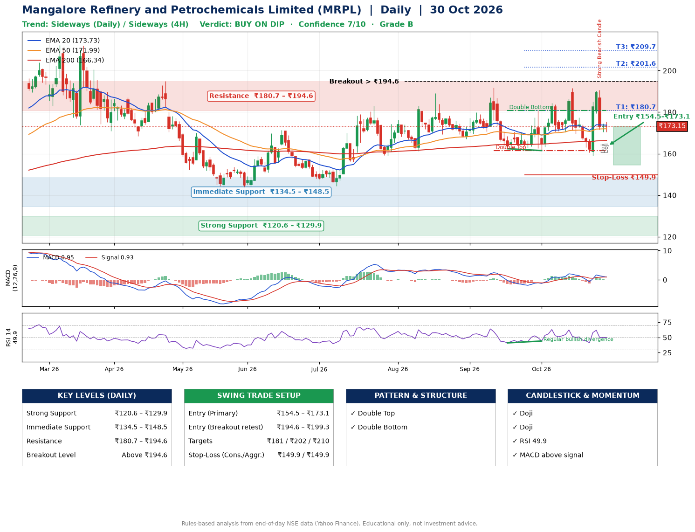

📌 **Mangalore Refinery and Petrochemicals Limited (MRPL) – Multi-Timeframe Technical Analysis (Daily + 4H Combined)**
_Data up to 30 Oct 2026 · Close ₹173.15_

**📍 Daily Timeframe Trend**
- Trend: **Sideways** (mixed swing structure)
- Recent swing highs: ₹189.0, ₹191.9, ₹191.5 · swing lows: ₹167.1, ₹162.4, ₹161.5
- EMAs: EMA20 ₹173.7, EMA50 ₹172.0, EMA200 ₹166.3; bullish stack (EMA20 > EMA50 > EMA200); price above EMA50, EMA200
- MACD 0.95 above signal 0.93 (above zero), fresh bullish crossover; histogram falling
- RSI(14) 49.9; Regular bullish divergence

**📍 4-Hour Timeframe Trend**
- Structure: **Sideways** (mixed swing structure)
- Pullback/support area: recent 4H swing lows ₹159.2, ₹170.4; EMA20 ₹174.2
- EMA20/50: bullish stack (EMA20 > EMA50); price below all EMAs
- MACD 0.48 below signal 0.70 (above zero), fresh bearish crossover; histogram falling
- RSI(14) 49.0; Hidden bullish divergence

**📍 Pattern Detection (Both Timeframes)**
- Daily: **Double Top** – tops near ₹191.9/₹191.5, neckline ₹161.5, forming
- Daily: **Double Bottom** – bottoms near ₹162.4/₹161.5, neckline ₹180.8, forming
- 4H: **Double Top** – tops near ₹191.2/₹190.4, neckline ₹159.2, forming
- 4H: **Inverse Head & Shoulders** – head ₹159.2, neckline ₹190.4

**📍 Candlestick Patterns (last 3 daily candles)**
- **Strong Bearish Candle** – 28 Oct: wide-range red candle, sellers in control
- **Doji** – 29 Oct: indecision; wait for the next candle to confirm direction
- **Doji** – 30 Oct: indecision; wait for the next candle to confirm direction

**📍 Price Action Key Levels (Daily Structure)**

| Zone | Price Level (₹) | Context |
|------|-----------------|---------|
| Strong Support | ₹120.6 – ₹129.9 | Cluster of earlier swing lows (demand) |
| Immediate Support | ₹134.5 – ₹148.5 | Nearest swing-low / wick area |
| Resistance | ₹180.7 – ₹194.6 | Nearest swing-high supply |
| Breakout Level | Above ₹194.6 | Swing continuation trigger (52-week high ₹212.3) |

**📍 Swing Trade Setup**

🟢 **Entry Zone**
- Primary: ₹154.5 – ₹173.1 (daily support / EMA20 area; enter on a bullish 4H candle)
- Alternate: ₹194.6 – ₹199.3 (breakout retest)

🎯 **Profit Targets**
- T1: ₹180.7
- T2: ₹201.6
- T3: ₹209.7

🛑 **Stop-Loss**
- Conservative: below daily swing low (₹149.9)
- Aggressive: below 4H structure (₹149.9)
- Risk per share ≈ ₹14.0; reward:risk to T1 ≈ 1.2

**📌 Strategy Notes**
- Higher timeframe: daily trend is sideways; only take longs while price holds above ₹120.6.
- Entry timing: wait for a bullish 4H candle (engulfing/hammer) inside ₹154.5 – ₹173.1 rather than buying mid-range.
- EMA stacking: bullish stack (EMA20 > EMA50 > EMA200); price above EMA50, EMA200.
- Breakout rule: a daily close above ₹194.6 with volume above its 20-day average (≈19,641,885) opens T2/T3.
- Momentum: RSI 50 – room to run; Regular bullish divergence.
- Exit discipline: move the stop to entry once T1 is hit; book partial profits at each target.

**STEP 2 — Marked Up Chart**

**✅ Trade Validation Checklist**
- Trend + momentum aligned: No · Price at entry zone: Yes
- Stop defined (₹149.9) · Reward:risk ≥ 1.5 to T1: No

## 📌 Final Verdict

Recommendation: **🟡 BUY ON DIP**

Confidence: **7/10**

Trade Quality: **B**

Reason:
• EMAs stacked bullishly
• Double Top: tops near ₹191.9/₹191.5, neckline ₹161.5, forming

Next Action:
• Wait for a pullback to ₹154.5–₹173.1, or a breakout above ₹194.6

_Rules-based analysis from end-of-day data. Educational only, not investment advice. Never place orders without your own confirmation._