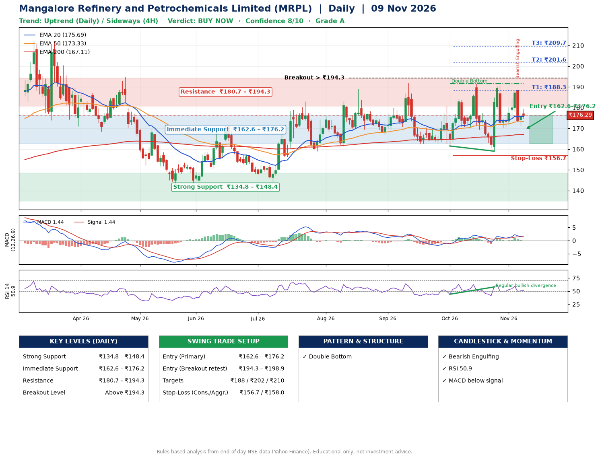

📌 **Mangalore Refinery and Petrochemicals Limited (MRPL) – Multi-Timeframe Technical Analysis (Daily + 4H Combined)**
_Data up to 09 Nov 2026 · Close ₹176.29_

**📍 Daily Timeframe Trend**
- Trend: **Uptrend** (price above rising EMAs)
- Recent swing highs: ₹191.9, ₹191.5, ₹190.7 · swing lows: ₹162.4, ₹161.5, ₹159.0
- EMAs: EMA20 ₹175.7, EMA50 ₹173.3, EMA200 ₹167.1; bullish stack (EMA20 > EMA50 > EMA200); price above EMA20, EMA50, EMA200
- MACD 1.44 below signal 1.44 (above zero), fresh bearish crossover; histogram falling
- RSI(14) 50.9; Regular bullish divergence

**📍 4-Hour Timeframe Trend**
- Structure: **Sideways** (mixed swing structure)
- Pullback/support area: recent 4H swing lows ₹170.4, ₹171.4; EMA20 ₹177.0
- EMA20/50: bullish stack (EMA20 > EMA50); price above EMA50
- MACD 0.65 below signal 1.23 (above zero), fresh bearish crossover; histogram falling
- RSI(14) 49.4; Hidden bearish divergence

**📍 Pattern Detection (Both Timeframes)**
- Daily: **Double Bottom** – bottoms near ₹161.5/₹159.0, neckline ₹191.5, forming
- 4H: **Double Top** – tops near ₹190.4/₹188.5, neckline ₹170.4, forming
- 4H: **Double Bottom** – bottoms near ₹170.4/₹171.4, neckline ₹188.5, forming
- 4H: **Ascending Triangle** – converging swing highs and lows over the last ~60 sessions

**📍 Candlestick Patterns (last 3 daily candles)**
- **Bearish Engulfing** – 05 Nov: sellers fully reversed the prior green candle

**📍 Price Action Key Levels (Daily Structure)**

| Zone | Price Level (₹) | Context |
|------|-----------------|---------|
| Strong Support | ₹134.8 – ₹148.4 | Cluster of earlier swing lows (demand) |
| Immediate Support | ₹162.6 – ₹176.2 | Nearest swing-low / wick area |
| Resistance | ₹180.7 – ₹194.3 | Nearest swing-high supply |
| Breakout Level | Above ₹194.3 | Swing continuation trigger (52-week high ₹212.3) |

**📍 Swing Trade Setup**

🟢 **Entry Zone**
- Primary: ₹162.6 – ₹176.2 (daily support / EMA20 area; enter on a bullish 4H candle)
- Alternate: ₹194.3 – ₹198.9 (breakout retest)

🎯 **Profit Targets**
- T1: ₹188.3
- T2: ₹201.6
- T3: ₹209.7

🛑 **Stop-Loss**
- Conservative: below daily swing low (₹156.7)
- Aggressive: below 4H structure (₹158.0)
- Risk per share ≈ ₹12.6; reward:risk to T1 ≈ 1.5

**📌 Strategy Notes**
- Higher timeframe: daily trend is uptrend; only take longs while price holds above ₹134.8.
- Entry timing: wait for a bullish 4H candle (engulfing/hammer) inside ₹162.6 – ₹176.2 rather than buying mid-range.
- EMA stacking: bullish stack (EMA20 > EMA50 > EMA200); price above EMA20, EMA50, EMA200.
- Breakout rule: a daily close above ₹194.3 with volume above its 20-day average (≈18,994,401) opens T2/T3.
- Momentum: RSI 51 – room to run; Regular bullish divergence.
- Exit discipline: move the stop to entry once T1 is hit; book partial profits at each target.

**STEP 2 — Marked Up Chart**

**✅ Trade Validation Checklist**
- Trend + momentum aligned: No · Price at entry zone: No
- Stop defined (₹156.7) · Reward:risk ≥ 1.5 to T1: No

## 📌 Final Verdict

Recommendation: **🟢 BUY NOW**

Confidence: **8/10**

Trade Quality: **A**

Reason:
• Daily uptrend (price above rising EMAs)
• EMAs stacked bullishly

Next Action:
• Buy now within the entry zone, with the stop-loss in place

_Rules-based analysis from end-of-day data. Educational only, not investment advice. Never place orders without your own confirmation._