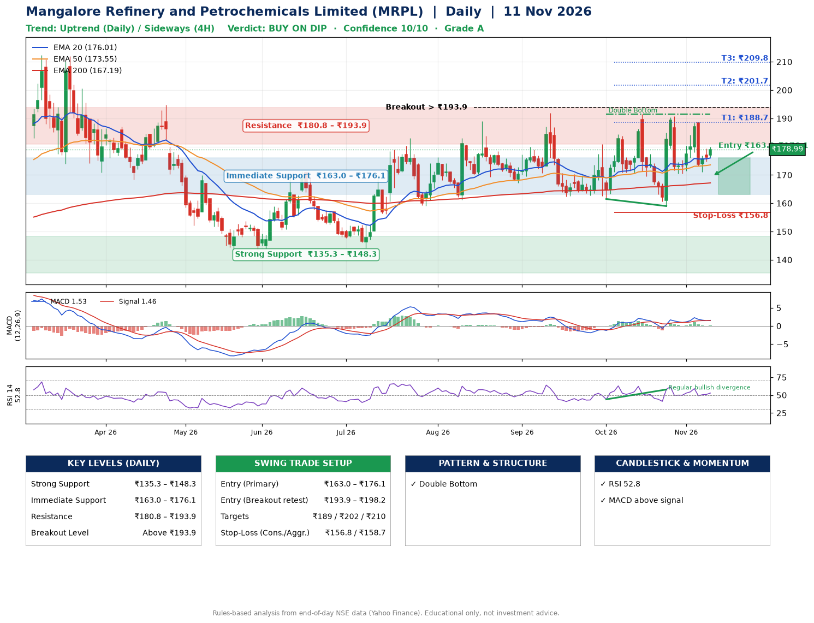

📌 **Mangalore Refinery and Petrochemicals Limited (MRPL) – Multi-Timeframe Technical Analysis (Daily + 4H Combined)**
_Data up to 11 Nov 2026 · Close ₹178.99_

**📍 Daily Timeframe Trend**
- Trend: **Uptrend** (price above rising EMAs)
- Recent swing highs: ₹191.9, ₹191.5, ₹190.7 · swing lows: ₹162.4, ₹161.5, ₹159.0
- EMAs: EMA20 ₹176.0, EMA50 ₹173.6, EMA200 ₹167.2; bullish stack (EMA20 > EMA50 > EMA200); price above EMA20, EMA50, EMA200
- MACD 1.53 above signal 1.46 (above zero), fresh bullish crossover; histogram rising
- RSI(14) 52.8; Regular bullish divergence

**📍 4-Hour Timeframe Trend**
- Structure: **Sideways** (mixed swing structure)
- Pullback/support area: recent 4H swing lows ₹170.4, ₹171.4; EMA20 ₹177.2
- EMA20/50: bullish stack (EMA20 > EMA50); price above EMA50
- MACD 0.51 below signal 0.89 (above zero); histogram falling
- RSI(14) 49.7; Hidden bearish divergence

**📍 Pattern Detection (Both Timeframes)**
- Daily: **Double Bottom** – bottoms near ₹161.5/₹159.0, neckline ₹191.5, forming
- 4H: **Double Bottom** – bottoms near ₹170.4/₹171.4, neckline ₹188.5, forming
- 4H: **Symmetrical Triangle** – converging swing highs and lows over the last ~60 sessions

**📍 Candlestick Patterns (last 3 daily candles)**
- No notable candlestick signal in the last 3 sessions.

**📍 Price Action Key Levels (Daily Structure)**

| Zone | Price Level (₹) | Context |
|------|-----------------|---------|
| Strong Support | ₹135.3 – ₹148.3 | Cluster of earlier swing lows (demand) |
| Immediate Support | ₹163.0 – ₹176.1 | Nearest swing-low / wick area |
| Resistance | ₹180.8 – ₹193.9 | Nearest swing-high supply |
| Breakout Level | Above ₹193.9 | Swing continuation trigger (52-week high ₹212.3) |

**📍 Swing Trade Setup**

🟢 **Entry Zone**
- Primary: ₹163.0 – ₹176.1 (daily support / EMA20 area; enter on a bullish 4H candle)
- Alternate: ₹193.9 – ₹198.2 (breakout retest)

🎯 **Profit Targets**
- T1: ₹188.7
- T2: ₹201.7
- T3: ₹209.8

🛑 **Stop-Loss**
- Conservative: below daily swing low (₹156.8)
- Aggressive: below 4H structure (₹158.7)
- Risk per share ≈ ₹12.7; reward:risk to T1 ≈ 1.5
- Time to T1: about 17 trading days (it rose this much within 60 trading days 65% of the time in the last 2 years)
- Time to T2: about 23 trading days (it rose this much within 60 trading days 43% of the time in the last 2 years)

**📌 Strategy Notes**
- Higher timeframe: daily trend is uptrend; only take longs while price holds above ₹135.3.
- Entry timing: wait for a bullish 4H candle (engulfing/hammer) inside ₹163.0 – ₹176.1 rather than buying mid-range.
- EMA stacking: bullish stack (EMA20 > EMA50 > EMA200); price above EMA20, EMA50, EMA200.
- Breakout rule: a daily close above ₹193.9 with volume above its 20-day average (≈19,007,290) opens T2/T3.
- Momentum: RSI 53 – room to run; Regular bullish divergence.
- Exit discipline: move the stop to entry once T1 is hit; book partial profits at each target.

**STEP 2 — Marked Up Chart**

**✅ Trade Validation Checklist**
- Trend + momentum aligned: Yes · Price at entry zone: No
- Stop defined (₹156.8) · Reward:risk ≥ 1.5 to T1: Yes

## 📌 Final Verdict

Recommendation: **🟡 BUY ON DIP**

Confidence: **10/10**

Trade Quality: **A**

Reason:
• Daily uptrend (price above rising EMAs)
• EMAs stacked bullishly

Next Action:
• Wait for a pullback to ₹163.0–₹176.1, or a breakout above ₹193.9

_Rules-based analysis from end-of-day data. Educational only, not investment advice. Never place orders without your own confirmation._