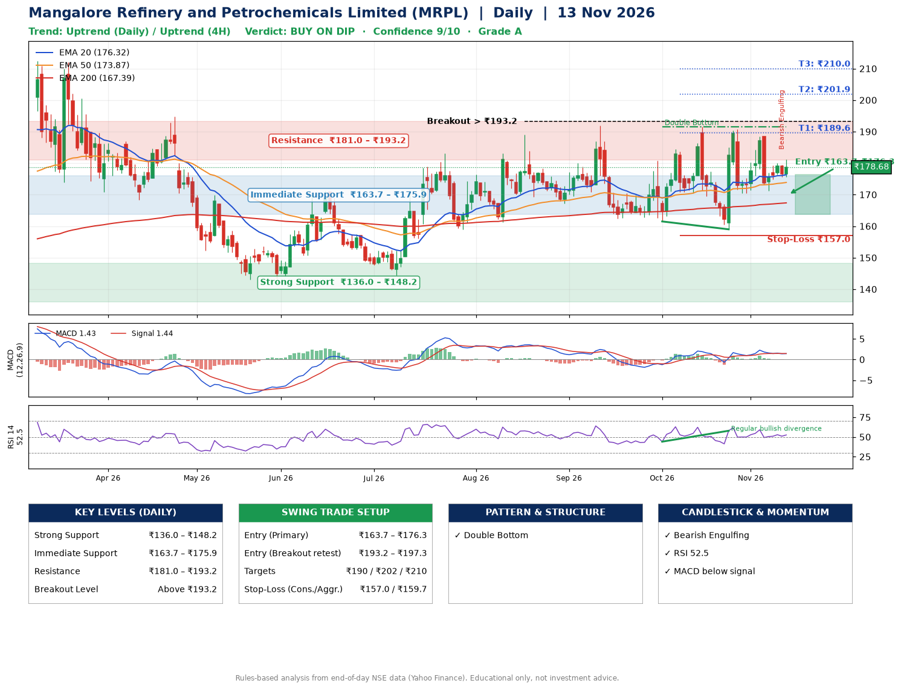

📌 **Mangalore Refinery and Petrochemicals Limited (MRPL) – Multi-Timeframe Technical Analysis (Daily + 4H Combined)**
_Data up to 13 Nov 2026 · Close ₹178.68_

**📍 Daily Timeframe Trend**
- Trend: **Uptrend** (price above rising EMAs)
- Recent swing highs: ₹191.5, ₹190.7, ₹188.5 · swing lows: ₹162.4, ₹161.5, ₹159.0
- EMAs: EMA20 ₹176.3, EMA50 ₹173.9, EMA200 ₹167.4; bullish stack (EMA20 > EMA50 > EMA200); price above EMA20, EMA50, EMA200
- MACD 1.43 below signal 1.44 (above zero), fresh bullish crossover; histogram rising
- RSI(14) 52.5; Regular bullish divergence

**📍 4-Hour Timeframe Trend**
- Structure: **Uptrend** (price above rising EMAs)
- Pullback/support area: recent 4H swing lows ₹170.4, ₹171.4; EMA20 ₹177.5
- EMA20/50: bullish stack (EMA20 > EMA50); price above EMA20, EMA50
- MACD 0.63 below signal 0.79 (above zero); histogram rising
- RSI(14) 52.8; Hidden bearish divergence

**📍 Pattern Detection (Both Timeframes)**
- Daily: **Double Bottom** – bottoms near ₹161.5/₹159.0, neckline ₹191.5, forming
- 4H: **Double Bottom** – bottoms near ₹170.4/₹171.4, neckline ₹188.5, forming
- 4H: **Symmetrical Triangle** – converging swing highs and lows over the last ~60 sessions

**📍 Candlestick Patterns (last 3 daily candles)**
- **Bearish Engulfing** – 12 Nov: sellers fully reversed the prior green candle

**📍 Price Action Key Levels (Daily Structure)**

| Zone | Price Level (₹) | Context |
|------|-----------------|---------|
| Strong Support | ₹136.0 – ₹148.2 | Cluster of earlier swing lows (demand) |
| Immediate Support | ₹163.7 – ₹175.9 | Nearest swing-low / wick area |
| Resistance | ₹181.0 – ₹193.2 | Nearest swing-high supply |
| Breakout Level | Above ₹193.2 | Swing continuation trigger (52-week high ₹212.3) |

**📍 Swing Trade Setup**

🟢 **Entry Zone**
- Primary: ₹163.7 – ₹176.3 (daily support / EMA20 area; enter on a bullish 4H candle)
- Alternate: ₹193.2 – ₹197.3 (breakout retest)

🎯 **Profit Targets**
- T1: ₹189.6
- T2: ₹201.9
- T3: ₹210.0

🛑 **Stop-Loss**
- Conservative: below daily swing low (₹157.0)
- Aggressive: below 4H structure (₹159.7)
- Risk per share ≈ ₹13.1; reward:risk to T1 ≈ 1.5
- Time to T1: about 17 trading days (it rose this much within 60 trading days 65% of the time in the last 2 years)
- Time to T2: about 22 trading days (it rose this much within 60 trading days 43% of the time in the last 2 years)

**📌 Strategy Notes**
- Higher timeframe: daily trend is uptrend; only take longs while price holds above ₹136.0.
- Entry timing: wait for a bullish 4H candle (engulfing/hammer) inside ₹163.7 – ₹176.3 rather than buying mid-range.
- EMA stacking: bullish stack (EMA20 > EMA50 > EMA200); price above EMA20, EMA50, EMA200.
- Breakout rule: a daily close above ₹193.2 with volume above its 20-day average (≈18,259,281) opens T2/T3.
- Momentum: RSI 53 – room to run; Regular bullish divergence.
- Exit discipline: move the stop to entry once T1 is hit; book partial profits at each target.

**STEP 2 — Marked Up Chart**

**✅ Trade Validation Checklist**
- Trend + momentum aligned: No · Price at entry zone: No
- Stop defined (₹157.0) · Reward:risk ≥ 1.5 to T1: No

## 📌 Final Verdict

Recommendation: **🟡 BUY ON DIP**

Confidence: **9/10**

Trade Quality: **A**

Reason:
• Daily uptrend (price above rising EMAs)
• EMAs stacked bullishly

Next Action:
• Wait for a pullback to ₹163.7–₹176.3, or a breakout above ₹193.2

_Rules-based analysis from end-of-day data. Educational only, not investment advice. Never place orders without your own confirmation._