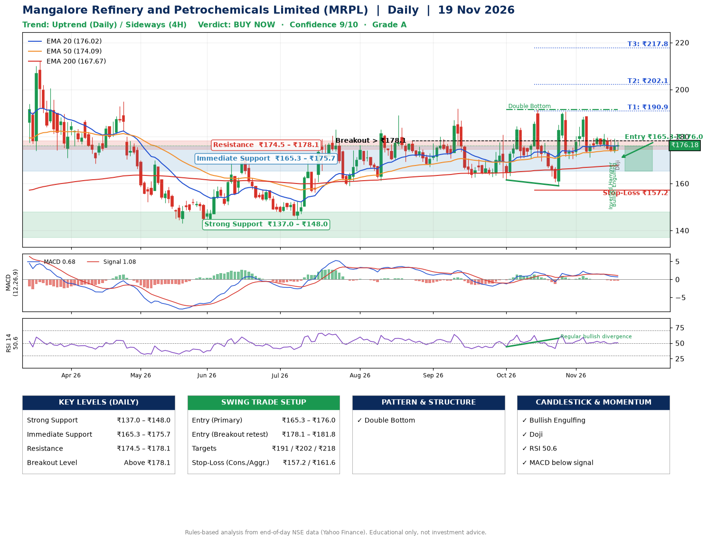

📌 **Mangalore Refinery and Petrochemicals Limited (MRPL) – Multi-Timeframe Technical Analysis (Daily + 4H Combined)**
_Data up to 19 Nov 2026 · Close ₹176.18_

**📍 Daily Timeframe Trend**
- Trend: **Uptrend** (price above rising EMAs)
- Recent swing highs: ₹191.5, ₹190.7, ₹188.5 · swing lows: ₹162.4, ₹161.5, ₹159.0
- EMAs: EMA20 ₹176.0, EMA50 ₹174.1, EMA200 ₹167.7; bullish stack (EMA20 > EMA50 > EMA200); price above EMA20, EMA50, EMA200
- MACD 0.68 below signal 1.08 (above zero); histogram rising
- RSI(14) 50.6; Regular bullish divergence

**📍 4-Hour Timeframe Trend**
- Structure: **Sideways** (mixed swing structure)
- Pullback/support area: recent 4H swing lows ₹171.4, ₹173.5; EMA20 ₹176.5
- EMA20/50: bullish stack (EMA20 > EMA50); price above EMA50
- MACD -0.19 below signal 0.01 (below zero); histogram rising
- RSI(14) 49.7; Hidden bullish divergence

**📍 Pattern Detection (Both Timeframes)**
- Daily: **Double Bottom** – bottoms near ₹161.5/₹159.0, neckline ₹191.5, forming
- 4H: **Double Bottom** – bottoms near ₹171.4/₹173.5, neckline ₹181.2, forming
- 4H: **Ascending Triangle** – converging swing highs and lows over the last ~60 sessions

**📍 Candlestick Patterns (last 3 daily candles)**
- **Inverted Hammer** – 17 Nov: long upper wick shows selling near ₹178.9
- **Bullish Engulfing** – 18 Nov: buyers fully reversed the prior red candle
- **Doji** – 19 Nov: indecision; wait for the next candle to confirm direction

**📍 Price Action Key Levels (Daily Structure)**

| Zone | Price Level (₹) | Context |
|------|-----------------|---------|
| Strong Support | ₹137.0 – ₹148.0 | Cluster of earlier swing lows (demand) |
| Immediate Support | ₹165.3 – ₹175.7 | Nearest swing-low / wick area |
| Resistance | ₹174.5 – ₹178.1 | Nearest swing-high supply |
| Breakout Level | Above ₹178.1 | Swing continuation trigger (52-week high ₹212.3) |

**📍 Swing Trade Setup**

🟢 **Entry Zone**
- Primary: ₹165.3 – ₹176.0 (daily support / EMA20 area; enter on a bullish 4H candle)
- Alternate: ₹178.1 – ₹181.8 (breakout retest)

🎯 **Profit Targets**
- T1: ₹190.9
- T2: ₹202.1
- T3: ₹217.8

🛑 **Stop-Loss**
- Conservative: below daily swing low (₹157.2)
- Aggressive: below 4H structure (₹161.6)
- Risk per share ≈ ₹13.5; reward:risk to T1 ≈ 1.5
- Time to T1: about 17 trading days (it rose this much within 60 trading days 63% of the time in the last 2 years)
- Time to T2: about 22 trading days (it rose this much within 60 trading days 43% of the time in the last 2 years)

**📌 Strategy Notes**
- Higher timeframe: daily trend is uptrend; only take longs while price holds above ₹137.0.
- Entry timing: wait for a bullish 4H candle (engulfing/hammer) inside ₹165.3 – ₹176.0 rather than buying mid-range.
- EMA stacking: bullish stack (EMA20 > EMA50 > EMA200); price above EMA20, EMA50, EMA200.
- Breakout rule: a daily close above ₹178.1 with volume above its 20-day average (≈14,718,133) opens T2/T3.
- Momentum: RSI 51 – room to run; Regular bullish divergence.
- Exit discipline: move the stop to entry once T1 is hit; book partial profits at each target.

**STEP 2 — Marked Up Chart**

**✅ Trade Validation Checklist**
- Trend + momentum aligned: No · Price at entry zone: No
- Stop defined (₹157.2) · Reward:risk ≥ 1.5 to T1: Yes

## 📌 Final Verdict

Recommendation: **🟢 BUY NOW**

Confidence: **9/10**

Trade Quality: **A**

Reason:
• Daily uptrend (price above rising EMAs)
• EMAs stacked bullishly

Next Action:
• Buy now within the entry zone, with the stop-loss in place

_Rules-based analysis from end-of-day data. Educational only, not investment advice. Never place orders without your own confirmation._