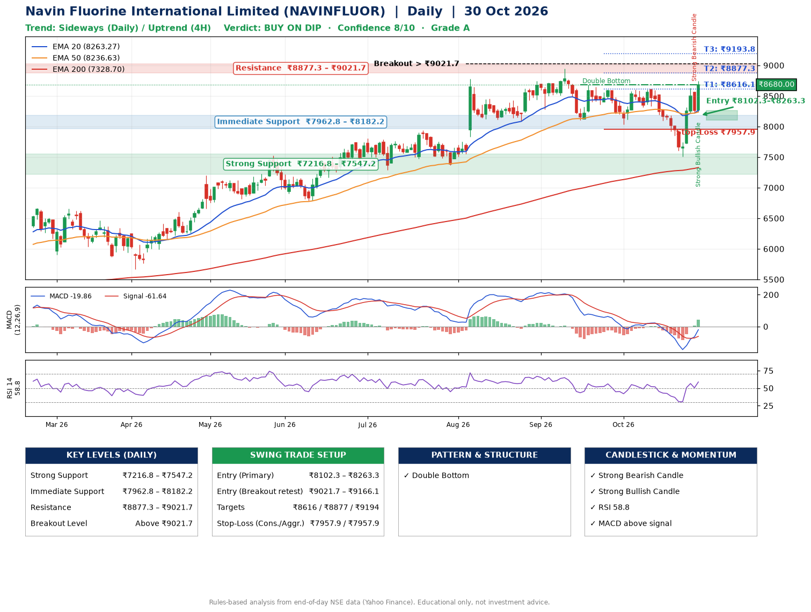

📌 **Navin Fluorine International Limited (NAVINFLUOR) – Multi-Timeframe Technical Analysis (Daily + 4H Combined)**
_Data up to 30 Oct 2026 · Close ₹8680.00_

**📍 Daily Timeframe Trend**
- Trend: **Sideways** (mixed swing structure)
- Recent swing highs: ₹8740.0, ₹8949.5, ₹8605.0 · swing lows: ₹8090.0, ₹8100.0, ₹8035.0
- EMAs: EMA20 ₹8263.3, EMA50 ₹8236.6, EMA200 ₹7328.7; bullish stack (EMA20 > EMA50 > EMA200); price above EMA20, EMA50, EMA200
- MACD -19.86 above signal -61.64 (below zero), fresh bullish crossover; histogram rising
- RSI(14) 58.8; no divergence on the last two swings

**📍 4-Hour Timeframe Trend**
- Structure: **Uptrend** (higher highs and higher lows)
- Pullback/support area: recent 4H swing lows ₹7510.5, ₹8237.0; EMA20 ₹8273.1
- EMA20/50: bearish stack (EMA20 < EMA50); price above EMA20, EMA50
- MACD 66.02 above signal 6.92 (above zero); histogram falling
- RSI(14) 54.4; no divergence

**📍 Pattern Detection (Both Timeframes)**
- Daily: **Double Bottom** – bottoms near ₹8100.0/₹8035.0, neckline ₹8682.5, forming
- 4H: **Double Top** – tops near ₹8605.0/₹8629.0, neckline ₹7510.5, forming
- 4H: **Inverse Head & Shoulders** – head ₹7510.5, neckline ₹8629.0

**📍 Candlestick Patterns (last 3 daily candles)**
- **Strong Bearish Candle** – 29 Oct: wide-range red candle, sellers in control
- **Strong Bullish Candle** – 30 Oct: wide-range green candle, buyers in control

**📍 Price Action Key Levels (Daily Structure)**

| Zone | Price Level (₹) | Context |
|------|-----------------|---------|
| Strong Support | ₹7216.8 – ₹7547.2 | Cluster of earlier swing lows (demand) |
| Immediate Support | ₹7962.8 – ₹8182.2 | Nearest swing-low / wick area |
| Resistance | ₹8877.3 – ₹9021.7 | Nearest swing-high supply |
| Breakout Level | Above ₹9021.7 | Swing continuation trigger (52-week high ₹8949.5) |

**📍 Swing Trade Setup**

🟢 **Entry Zone**
- Primary: ₹8102.3 – ₹8263.3 (daily support / EMA20 area; enter on a bullish 4H candle)
- Alternate: ₹9021.7 – ₹9166.1 (breakout retest)

🎯 **Profit Targets**
- T1: ₹8616.1
- T2: ₹8877.3
- T3: ₹9193.8

🛑 **Stop-Loss**
- Conservative: below daily swing low (₹7957.9)
- Aggressive: below 4H structure (₹7957.9)
- Risk per share ≈ ₹288.9; reward:risk to T1 ≈ 1.5

**📌 Strategy Notes**
- Higher timeframe: daily trend is sideways; only take longs while price holds above ₹7216.8.
- Entry timing: wait for a bullish 4H candle (engulfing/hammer) inside ₹8102.3 – ₹8263.3 rather than buying mid-range.
- EMA stacking: bullish stack (EMA20 > EMA50 > EMA200); price above EMA20, EMA50, EMA200.
- Breakout rule: a daily close above ₹9021.7 with volume above its 20-day average (≈137,679) opens T2/T3.
- Momentum: RSI 59 – room to run; no divergence on the last two swings.
- Exit discipline: move the stop to entry once T1 is hit; book partial profits at each target.

**STEP 2 — Marked Up Chart**

**✅ Trade Validation Checklist**
- Trend + momentum aligned: No · Price at entry zone: No
- Stop defined (₹7957.9) · Reward:risk ≥ 1.5 to T1: Yes

## 📌 Final Verdict

Recommendation: **🟡 BUY ON DIP**

Confidence: **8/10**

Trade Quality: **A**

Reason:
• EMAs stacked bullishly
• Double Bottom: bottoms near ₹8100.0/₹8035.0, neckline ₹8682.5, forming

Next Action:
• Wait for a pullback to ₹8102.3–₹8263.3

_Rules-based analysis from end-of-day data. Educational only, not investment advice. Never place orders without your own confirmation._