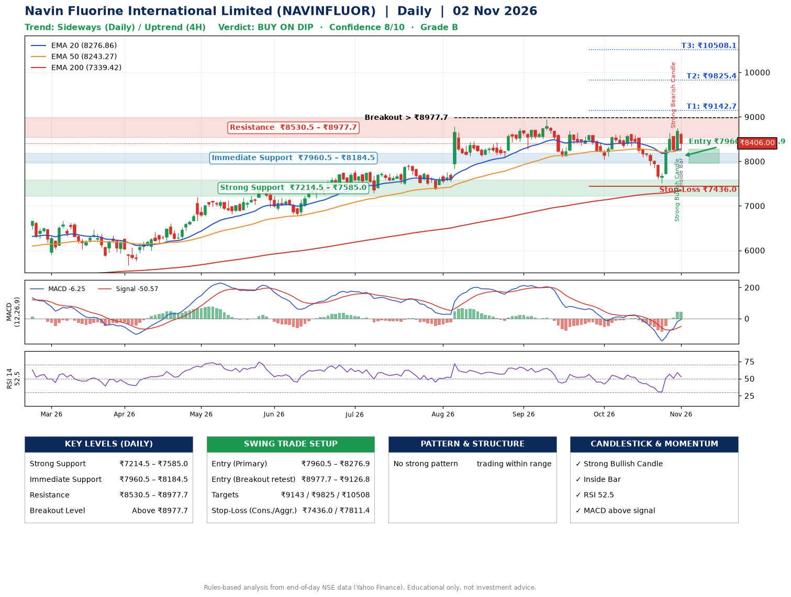

📌 **Navin Fluorine International Limited (NAVINFLUOR) – Multi-Timeframe Technical Analysis (Daily + 4H Combined)**
_Data up to 02 Nov 2026 · Close ₹8406.00_

**📍 Daily Timeframe Trend**
- Trend: **Sideways** (mixed swing structure)
- Recent swing highs: ₹8740.0, ₹8949.5, ₹8605.0 · swing lows: ₹8100.0, ₹8035.0, ₹7510.5
- EMAs: EMA20 ₹8276.9, EMA50 ₹8243.3, EMA200 ₹7339.4; bullish stack (EMA20 > EMA50 > EMA200); price above EMA20, EMA50, EMA200
- MACD -6.25 above signal -50.57 (below zero), fresh bullish crossover; histogram rising
- RSI(14) 52.5; no divergence on the last two swings

**📍 4-Hour Timeframe Trend**
- Structure: **Uptrend** (higher highs and higher lows)
- Pullback/support area: recent 4H swing lows ₹7510.5, ₹8237.0; EMA20 ₹8273.1
- EMA20/50: bearish stack (EMA20 < EMA50); price above EMA20, EMA50
- MACD 66.02 above signal 6.92 (above zero); histogram falling
- RSI(14) 54.4; no divergence

**📍 Pattern Detection (Both Timeframes)**
- 4H: **Double Top** – tops near ₹8605.0/₹8629.0, neckline ₹7510.5, forming
- 4H: **Inverse Head & Shoulders** – head ₹7510.5, neckline ₹8629.0

**📍 Candlestick Patterns (last 3 daily candles)**
- **Strong Bearish Candle** – 29 Oct: wide-range red candle, sellers in control
- **Strong Bullish Candle** – 30 Oct: wide-range green candle, buyers in control
- **Inside Bar** – 02 Nov: compression inside the prior range ₹8242.0–₹8745.0

**📍 Price Action Key Levels (Daily Structure)**

| Zone | Price Level (₹) | Context |
|------|-----------------|---------|
| Strong Support | ₹7214.5 – ₹7585.0 | Cluster of earlier swing lows (demand) |
| Immediate Support | ₹7960.5 – ₹8184.5 | Nearest swing-low / wick area |
| Resistance | ₹8530.5 – ₹8977.7 | Nearest swing-high supply |
| Breakout Level | Above ₹8977.7 | Swing continuation trigger (52-week high ₹8949.5) |

**📍 Swing Trade Setup**

🟢 **Entry Zone**
- Primary: ₹7960.5 – ₹8276.9 (daily support / EMA20 area; enter on a bullish 4H candle)
- Alternate: ₹8977.7 – ₹9126.8 (breakout retest)

🎯 **Profit Targets**
- T1: ₹9142.7
- T2: ₹9825.4
- T3: ₹10508.1

🛑 **Stop-Loss**
- Conservative: below daily swing low (₹7436.0)
- Aggressive: below 4H structure (₹7811.4)
- Risk per share ≈ ₹682.7; reward:risk to T1 ≈ 1.5

**📌 Strategy Notes**
- Higher timeframe: daily trend is sideways; only take longs while price holds above ₹7214.5.
- Entry timing: wait for a bullish 4H candle (engulfing/hammer) inside ₹7960.5 – ₹8276.9 rather than buying mid-range.
- EMA stacking: bullish stack (EMA20 > EMA50 > EMA200); price above EMA20, EMA50, EMA200.
- Breakout rule: a daily close above ₹8977.7 with volume above its 20-day average (≈150,841) opens T2/T3.
- Momentum: RSI 53 – room to run; no divergence on the last two swings.
- Exit discipline: move the stop to entry once T1 is hit; book partial profits at each target.

**STEP 2 — Marked Up Chart**

**✅ Trade Validation Checklist**
- Trend + momentum aligned: No · Price at entry zone: No
- Stop defined (₹7436.0) · Reward:risk ≥ 1.5 to T1: No

## 📌 Final Verdict

Recommendation: **🟡 BUY ON DIP**

Confidence: **8/10**

Trade Quality: **B**

Reason:
• EMAs stacked bullishly

Next Action:
• Wait for a pullback to ₹7960.5–₹8276.9, or a breakout above ₹8977.7

_Rules-based analysis from end-of-day data. Educational only, not investment advice. Never place orders without your own confirmation._