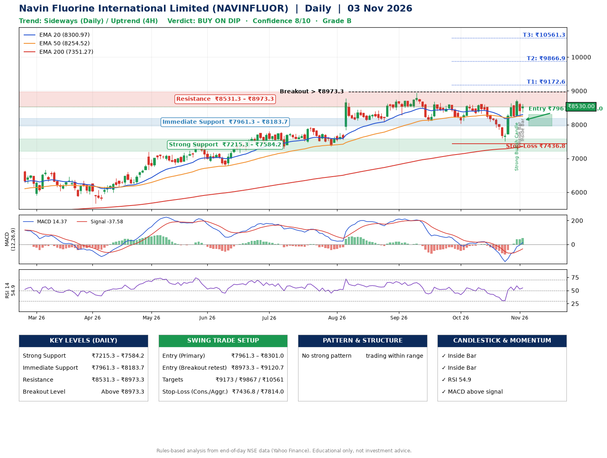

📌 **Navin Fluorine International Limited (NAVINFLUOR) – Multi-Timeframe Technical Analysis (Daily + 4H Combined)**
_Data up to 03 Nov 2026 · Close ₹8530.00_

**📍 Daily Timeframe Trend**
- Trend: **Sideways** (mixed swing structure)
- Recent swing highs: ₹8740.0, ₹8949.5, ₹8605.0 · swing lows: ₹8100.0, ₹8035.0, ₹7510.5
- EMAs: EMA20 ₹8301.0, EMA50 ₹8254.5, EMA200 ₹7351.3; bullish stack (EMA20 > EMA50 > EMA200); price above EMA20, EMA50, EMA200
- MACD 14.37 above signal -37.58 (above zero), fresh bullish crossover; histogram rising
- RSI(14) 54.9; no divergence on the last two swings

**📍 4-Hour Timeframe Trend**
- Structure: **Uptrend** (higher highs and higher lows)
- Pullback/support area: recent 4H swing lows ₹7510.5, ₹8237.0; EMA20 ₹8317.7
- EMA20/50: bullish stack (EMA20 > EMA50); price above EMA20, EMA50
- MACD 83.79 above signal 33.27 (above zero); histogram falling
- RSI(14) 57.6; Regular bearish divergence

**📍 Pattern Detection (Both Timeframes)**
- 4H: **Inverse Head & Shoulders** – head ₹7510.5, neckline ₹8629.0

**📍 Candlestick Patterns (last 3 daily candles)**
- **Strong Bullish Candle** – 30 Oct: wide-range green candle, buyers in control
- **Inside Bar** – 02 Nov: compression inside the prior range ₹8242.0–₹8745.0
- **Inside Bar** – 03 Nov: compression inside the prior range ₹8260.5–₹8650.0

**📍 Price Action Key Levels (Daily Structure)**

| Zone | Price Level (₹) | Context |
|------|-----------------|---------|
| Strong Support | ₹7215.3 – ₹7584.2 | Cluster of earlier swing lows (demand) |
| Immediate Support | ₹7961.3 – ₹8183.7 | Nearest swing-low / wick area |
| Resistance | ₹8531.3 – ₹8973.3 | Nearest swing-high supply |
| Breakout Level | Above ₹8973.3 | Swing continuation trigger (52-week high ₹8949.5) |

**📍 Swing Trade Setup**

🟢 **Entry Zone**
- Primary: ₹7961.3 – ₹8301.0 (daily support / EMA20 area; enter on a bullish 4H candle)
- Alternate: ₹8973.3 – ₹9120.7 (breakout retest)

🎯 **Profit Targets**
- T1: ₹9172.6
- T2: ₹9866.9
- T3: ₹10561.3

🛑 **Stop-Loss**
- Conservative: below daily swing low (₹7436.8)
- Aggressive: below 4H structure (₹7814.0)
- Risk per share ≈ ₹694.3; reward:risk to T1 ≈ 1.5

**📌 Strategy Notes**
- Higher timeframe: daily trend is sideways; only take longs while price holds above ₹7215.3.
- Entry timing: wait for a bullish 4H candle (engulfing/hammer) inside ₹7961.3 – ₹8301.0 rather than buying mid-range.
- EMA stacking: bullish stack (EMA20 > EMA50 > EMA200); price above EMA20, EMA50, EMA200.
- Breakout rule: a daily close above ₹8973.3 with volume above its 20-day average (≈152,846) opens T2/T3.
- Momentum: RSI 55 – room to run; no divergence on the last two swings.
- Exit discipline: move the stop to entry once T1 is hit; book partial profits at each target.

**STEP 2 — Marked Up Chart**

**✅ Trade Validation Checklist**
- Trend + momentum aligned: No · Price at entry zone: No
- Stop defined (₹7436.8) · Reward:risk ≥ 1.5 to T1: No

## 📌 Final Verdict

Recommendation: **🟡 BUY ON DIP**

Confidence: **8/10**

Trade Quality: **B**

Reason:
• EMAs stacked bullishly

Next Action:
• Wait for a pullback to ₹7961.3–₹8301.0, or a breakout above ₹8973.3

_Rules-based analysis from end-of-day data. Educational only, not investment advice. Never place orders without your own confirmation._