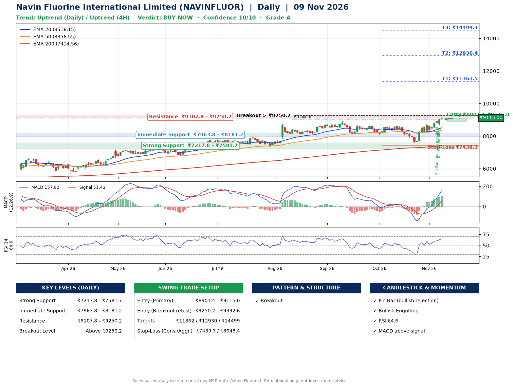

📌 **Navin Fluorine International Limited (NAVINFLUOR) – Multi-Timeframe Technical Analysis (Daily + 4H Combined)**
_Data up to 09 Nov 2026 · Close ₹9115.00_

**📍 Daily Timeframe Trend**
- Trend: **Uptrend** (price above rising EMAs)
- Recent swing highs: ₹8740.0, ₹8949.5, ₹8605.0 · swing lows: ₹8100.0, ₹8035.0, ₹7510.5
- EMAs: EMA20 ₹8516.1, EMA50 ₹8356.6, EMA200 ₹7414.6; bullish stack (EMA20 > EMA50 > EMA200); price above EMA20, EMA50, EMA200
- MACD 157.82 above signal 51.43 (above zero); histogram rising
- RSI(14) 64.6; no divergence on the last two swings

**📍 4-Hour Timeframe Trend**
- Structure: **Uptrend** (higher highs and higher lows)
- Pullback/support area: recent 4H swing lows ₹8237.0, ₹8665.5; EMA20 ₹8668.2
- EMA20/50: bullish stack (EMA20 > EMA50); price above EMA20, EMA50
- MACD 219.89 above signal 159.17 (above zero); histogram falling
- RSI(14) 70.3; Regular bearish divergence

**📍 Pattern Detection (Both Timeframes)**
- Daily: **Breakout** – closed above the 60-session high ₹9035.0 (volume not confirming yet)
- 4H: **Ascending Triangle** – converging swing highs and lows over the last ~60 sessions

**📍 Candlestick Patterns (last 3 daily candles)**
- **Pin Bar (bullish rejection)** – 05 Nov: long lower wick shows dip-buying near ₹8739.5
- **Bullish Engulfing** – 06 Nov: buyers fully reversed the prior red candle

**📍 Price Action Key Levels (Daily Structure)**

| Zone | Price Level (₹) | Context |
|------|-----------------|---------|
| Strong Support | ₹7217.8 – ₹7581.7 | Cluster of earlier swing lows (demand) |
| Immediate Support | ₹7963.8 – ₹8181.2 | Nearest swing-low / wick area |
| Resistance | ₹9107.8 – ₹9250.2 | Nearest swing-high supply |
| Breakout Level | Above ₹9250.2 | Swing continuation trigger (52-week high ₹9179.0) |

**📍 Swing Trade Setup**

🟢 **Entry Zone**
- Primary: ₹8901.4 – ₹9115.0 (daily support / EMA20 area; enter on a bullish 4H candle)
- Alternate: ₹9250.2 – ₹9392.6 (breakout retest)

🎯 **Profit Targets**
- T1: ₹11361.5
- T2: ₹12930.4
- T3: ₹14499.3

🛑 **Stop-Loss**
- Conservative: below daily swing low (₹7439.3)
- Aggressive: below 4H structure (₹8648.4)
- Risk per share ≈ ₹1568.9; reward:risk to T1 ≈ 1.5

**📌 Strategy Notes**
- Higher timeframe: daily trend is uptrend; only take longs while price holds above ₹7217.8.
- Entry timing: wait for a bullish 4H candle (engulfing/hammer) inside ₹8901.4 – ₹9115.0 rather than buying mid-range.
- EMA stacking: bullish stack (EMA20 > EMA50 > EMA200); price above EMA20, EMA50, EMA200.
- Breakout rule: a daily close above ₹9250.2 with volume above its 20-day average (≈174,951) opens T2/T3.
- Momentum: RSI 65 – room to run; no divergence on the last two swings.
- Exit discipline: move the stop to entry once T1 is hit; book partial profits at each target.

**STEP 2 — Marked Up Chart**

**✅ Trade Validation Checklist**
- Trend + momentum aligned: Yes · Price at entry zone: Yes
- Stop defined (₹7439.3) · Reward:risk ≥ 1.5 to T1: No

## 📌 Final Verdict

Recommendation: **🟢 BUY NOW**

Confidence: **10/10**

Trade Quality: **A**

Reason:
• Daily uptrend (price above rising EMAs)
• EMAs stacked bullishly

Next Action:
• Buy now within the entry zone, with the stop-loss in place

_Rules-based analysis from end-of-day data. Educational only, not investment advice. Never place orders without your own confirmation._