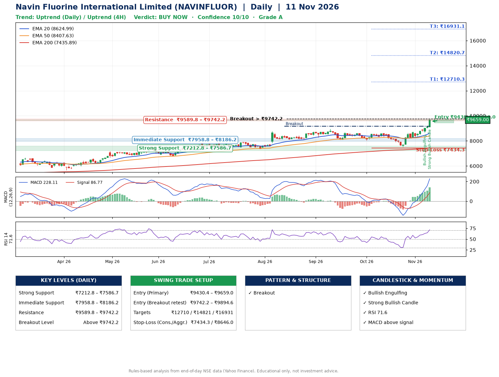

📌 **Navin Fluorine International Limited (NAVINFLUOR) – Multi-Timeframe Technical Analysis (Daily + 4H Combined)**
_Data up to 11 Nov 2026 · Close ₹9659.00_

**📍 Daily Timeframe Trend**
- Trend: **Uptrend** (price above rising EMAs)
- Recent swing highs: ₹8740.0, ₹8949.5, ₹8605.0 · swing lows: ₹8100.0, ₹8035.0, ₹7510.5
- EMAs: EMA20 ₹8625.0, EMA50 ₹8407.6, EMA200 ₹7435.9; bullish stack (EMA20 > EMA50 > EMA200); price above EMA20, EMA50, EMA200
- MACD 228.11 above signal 86.77 (above zero); histogram rising
- RSI(14) 71.6; no divergence on the last two swings

**📍 4-Hour Timeframe Trend**
- Structure: **Uptrend** (higher highs and higher lows)
- Pullback/support area: recent 4H swing lows ₹8237.0, ₹8665.5; EMA20 ₹9035.2
- EMA20/50: bullish stack (EMA20 > EMA50); price above EMA20, EMA50
- MACD 382.01 above signal 262.90 (above zero); histogram rising
- RSI(14) 82.6; Regular bearish divergence

**📍 Pattern Detection (Both Timeframes)**
- Daily: **Breakout** – closed above the 60-session high ₹9179.0 on strong volume
- 4H: **Ascending Triangle** – converging swing highs and lows over the last ~60 sessions

**📍 Candlestick Patterns (last 3 daily candles)**
- **Bullish Engulfing** – 06 Nov: buyers fully reversed the prior red candle
- **Strong Bullish Candle** – 11 Nov: wide-range green candle, buyers in control

**📍 Price Action Key Levels (Daily Structure)**

| Zone | Price Level (₹) | Context |
|------|-----------------|---------|
| Strong Support | ₹7212.8 – ₹7586.7 | Cluster of earlier swing lows (demand) |
| Immediate Support | ₹7958.8 – ₹8186.2 | Nearest swing-low / wick area |
| Resistance | ₹9589.8 – ₹9742.2 | Nearest swing-high supply |
| Breakout Level | Above ₹9742.2 | Swing continuation trigger (52-week high ₹9666.0) |

**📍 Swing Trade Setup**

🟢 **Entry Zone**
- Primary: ₹9430.4 – ₹9659.0 (daily support / EMA20 area; enter on a bullish 4H candle)
- Alternate: ₹9742.2 – ₹9894.6 (breakout retest)

🎯 **Profit Targets**
- T1: ₹12710.3
- T2: ₹14820.7
- T3: ₹16931.1

🛑 **Stop-Loss**
- Conservative: below daily swing low (₹7434.3)
- Aggressive: below 4H structure (₹8646.0)
- Risk per share ≈ ₹2110.4; reward:risk to T1 ≈ 1.5
- Time to T1: about 24 trading days (it rose this much within 60 trading days 3% of the time in the last 2 years)
- Time to T2: it never rose this much within 60 trading days in the price history

**📌 Strategy Notes**
- Higher timeframe: daily trend is uptrend; only take longs while price holds above ₹7212.8.
- Entry timing: wait for a bullish 4H candle (engulfing/hammer) inside ₹9430.4 – ₹9659.0 rather than buying mid-range.
- EMA stacking: bullish stack (EMA20 > EMA50 > EMA200); price above EMA20, EMA50, EMA200.
- Breakout rule: a daily close above ₹9742.2 with volume above its 20-day average (≈198,713) opens T2/T3.
- Momentum: RSI 72 – elevated, prefer dips; no divergence on the last two swings.
- Exit discipline: move the stop to entry once T1 is hit; book partial profits at each target.

**STEP 2 — Marked Up Chart**

**✅ Trade Validation Checklist**
- Trend + momentum aligned: Yes · Price at entry zone: Yes
- Stop defined (₹7434.3) · Reward:risk ≥ 1.5 to T1: No

## 📌 Final Verdict

Recommendation: **🟢 BUY NOW**

Confidence: **10/10**

Trade Quality: **A**

Reason:
• Daily uptrend (price above rising EMAs)
• EMAs stacked bullishly

Next Action:
• Buy now within the entry zone, with the stop-loss in place

_Rules-based analysis from end-of-day data. Educational only, not investment advice. Never place orders without your own confirmation._