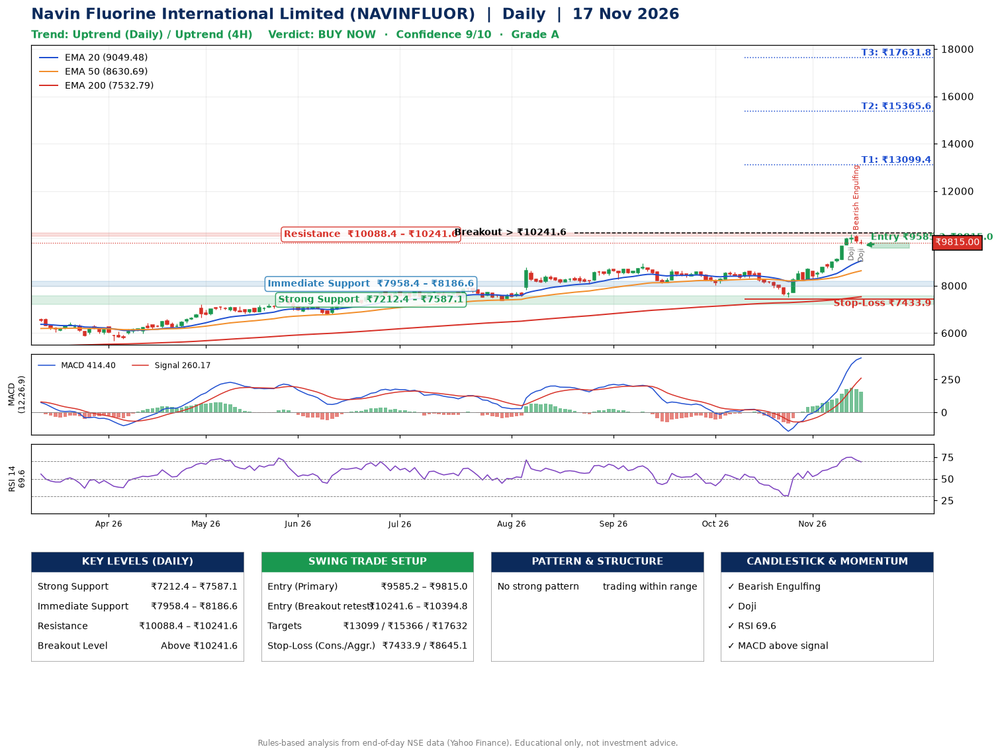

📌 **Navin Fluorine International Limited (NAVINFLUOR) – Multi-Timeframe Technical Analysis (Daily + 4H Combined)**
_Data up to 17 Nov 2026 · Close ₹9815.00_

**📍 Daily Timeframe Trend**
- Trend: **Uptrend** (price above rising EMAs)
- Recent swing highs: ₹8740.0, ₹8949.5, ₹8605.0 · swing lows: ₹8100.0, ₹8035.0, ₹7510.5
- EMAs: EMA20 ₹9049.5, EMA50 ₹8630.7, EMA200 ₹7532.8; bullish stack (EMA20 > EMA50 > EMA200); price above EMA20, EMA50, EMA200
- MACD 414.40 above signal 260.17 (above zero); histogram falling
- RSI(14) 69.6; no divergence on the last two swings

**📍 4-Hour Timeframe Trend**
- Structure: **Uptrend** (higher highs and higher lows)
- Pullback/support area: recent 4H swing lows ₹8237.0, ₹8665.5; EMA20 ₹9575.4
- EMA20/50: bullish stack (EMA20 > EMA50); price above EMA20, EMA50
- MACD 417.18 above signal 389.88 (above zero); histogram rising
- RSI(14) 77.5; no divergence

**📍 Pattern Detection (Both Timeframes)**
- 4H: **Bull Flag** – 17% pole then a tight 5% flag; trigger above ₹10289.0

**📍 Candlestick Patterns (last 3 daily candles)**
- **Doji** – 13 Nov: indecision; wait for the next candle to confirm direction
- **Bearish Engulfing** – 16 Nov: sellers fully reversed the prior green candle
- **Doji** – 17 Nov: indecision; wait for the next candle to confirm direction

**📍 Price Action Key Levels (Daily Structure)**

| Zone | Price Level (₹) | Context |
|------|-----------------|---------|
| Strong Support | ₹7212.4 – ₹7587.1 | Cluster of earlier swing lows (demand) |
| Immediate Support | ₹7958.4 – ₹8186.6 | Nearest swing-low / wick area |
| Resistance | ₹10088.4 – ₹10241.6 | Nearest swing-high supply |
| Breakout Level | Above ₹10241.6 | Swing continuation trigger (52-week high ₹10165.0) |

**📍 Swing Trade Setup**

🟢 **Entry Zone**
- Primary: ₹9585.2 – ₹9815.0 (daily support / EMA20 area; enter on a bullish 4H candle)
- Alternate: ₹10241.6 – ₹10394.8 (breakout retest)

🎯 **Profit Targets**
- T1: ₹13099.4
- T2: ₹15365.6
- T3: ₹17631.8

🛑 **Stop-Loss**
- Conservative: below daily swing low (₹7433.9)
- Aggressive: below 4H structure (₹8645.1)
- Risk per share ≈ ₹2266.2; reward:risk to T1 ≈ 1.5
- Time to T1: about 46 trading days (it rose this much within 60 trading days 1% of the time in the last 2 years)
- Time to T2: it never rose this much within 60 trading days in the price history

**📌 Strategy Notes**
- Higher timeframe: daily trend is uptrend; only take longs while price holds above ₹7212.4.
- Entry timing: wait for a bullish 4H candle (engulfing/hammer) inside ₹9585.2 – ₹9815.0 rather than buying mid-range.
- EMA stacking: bullish stack (EMA20 > EMA50 > EMA200); price above EMA20, EMA50, EMA200.
- Breakout rule: a daily close above ₹10241.6 with volume above its 20-day average (≈233,480) opens T2/T3.
- Momentum: RSI 70 – elevated, prefer dips; no divergence on the last two swings.
- Exit discipline: move the stop to entry once T1 is hit; book partial profits at each target.

**STEP 2 — Marked Up Chart**

**✅ Trade Validation Checklist**
- Trend + momentum aligned: Yes · Price at entry zone: Yes
- Stop defined (₹7433.9) · Reward:risk ≥ 1.5 to T1: No

## 📌 Final Verdict

Recommendation: **🟢 BUY NOW**

Confidence: **9/10**

Trade Quality: **A**

Reason:
• Daily uptrend (price above rising EMAs)
• EMAs stacked bullishly

Next Action:
• Buy now within the entry zone, with the stop-loss in place

_Rules-based analysis from end-of-day data. Educational only, not investment advice. Never place orders without your own confirmation._