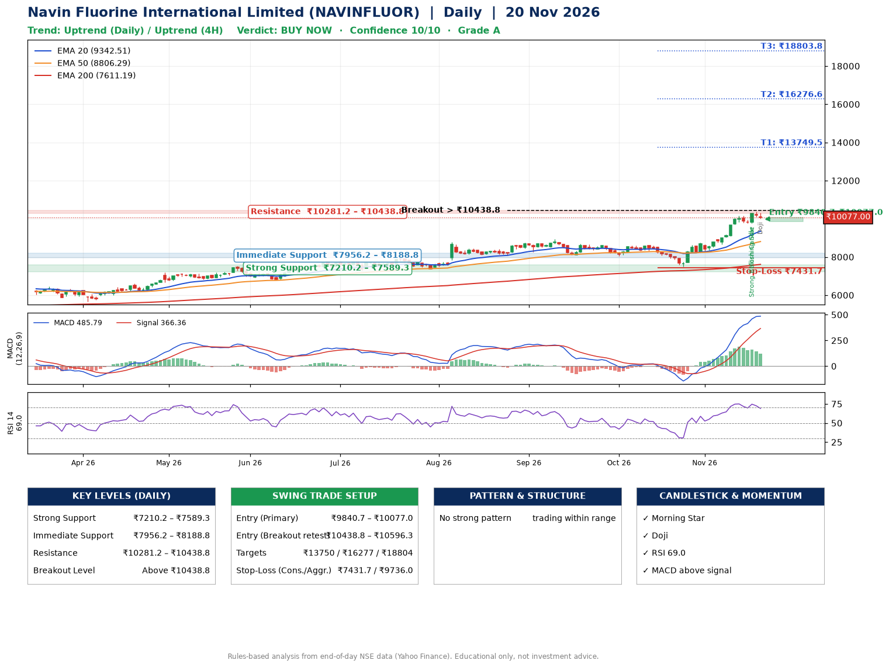

📌 **Navin Fluorine International Limited (NAVINFLUOR) – Multi-Timeframe Technical Analysis (Daily + 4H Combined)**
_Data up to 20 Nov 2026 · Close ₹10077.00_

**📍 Daily Timeframe Trend**
- Trend: **Uptrend** (price above rising EMAs)
- Recent swing highs: ₹8740.0, ₹8949.5, ₹8605.0 · swing lows: ₹8100.0, ₹8035.0, ₹7510.5
- EMAs: EMA20 ₹9342.5, EMA50 ₹8806.3, EMA200 ₹7611.2; bullish stack (EMA20 > EMA50 > EMA200); price above EMA20, EMA50, EMA200
- MACD 485.79 above signal 366.36 (above zero); histogram falling
- RSI(14) 69.0; no divergence on the last two swings

**📍 4-Hour Timeframe Trend**
- Structure: **Uptrend** (higher highs and higher lows)
- Pullback/support area: recent 4H swing lows ₹8665.5, ₹9756.0; EMA20 ₹9768.2
- EMA20/50: bullish stack (EMA20 > EMA50); price above EMA20, EMA50
- MACD 377.80 below signal 393.52 (above zero), fresh bearish crossover; histogram falling
- RSI(14) 66.8; Regular bearish divergence

**📍 Pattern Detection (Both Timeframes)**
- 4H: **Bull Flag** – 16% pole then a tight 6% flag; trigger above ₹10359.5

**📍 Candlestick Patterns (last 3 daily candles)**
- **Strong Bullish Candle** – 18 Nov: wide-range green candle, buyers in control
- **Morning Star** – 18 Nov: three-candle bullish reversal
- **Doji** – 20 Nov: indecision; wait for the next candle to confirm direction

**📍 Price Action Key Levels (Daily Structure)**

| Zone | Price Level (₹) | Context |
|------|-----------------|---------|
| Strong Support | ₹7210.2 – ₹7589.3 | Cluster of earlier swing lows (demand) |
| Immediate Support | ₹7956.2 – ₹8188.8 | Nearest swing-low / wick area |
| Resistance | ₹10281.2 – ₹10438.8 | Nearest swing-high supply |
| Breakout Level | Above ₹10438.8 | Swing continuation trigger (52-week high ₹10360.0) |

**📍 Swing Trade Setup**

🟢 **Entry Zone**
- Primary: ₹9840.7 – ₹10077.0 (daily support / EMA20 area; enter on a bullish 4H candle)
- Alternate: ₹10438.8 – ₹10596.3 (breakout retest)

🎯 **Profit Targets**
- T1: ₹13749.5
- T2: ₹16276.6
- T3: ₹18803.8

🛑 **Stop-Loss**
- Conservative: below daily swing low (₹7431.7)
- Aggressive: below 4H structure (₹9736.0)
- Risk per share ≈ ₹2527.1; reward:risk to T1 ≈ 1.5
- Time to T1: it never rose this much within 60 trading days in the price history
- Time to T2: it never rose this much within 60 trading days in the price history

**📌 Strategy Notes**
- Higher timeframe: daily trend is uptrend; only take longs while price holds above ₹7210.2.
- Entry timing: wait for a bullish 4H candle (engulfing/hammer) inside ₹9840.7 – ₹10077.0 rather than buying mid-range.
- EMA stacking: bullish stack (EMA20 > EMA50 > EMA200); price above EMA20, EMA50, EMA200.
- Breakout rule: a daily close above ₹10438.8 with volume above its 20-day average (≈263,829) opens T2/T3.
- Momentum: RSI 69 – elevated, prefer dips; no divergence on the last two swings.
- Exit discipline: move the stop to entry once T1 is hit; book partial profits at each target.

**STEP 2 — Marked Up Chart**

**✅ Trade Validation Checklist**
- Trend + momentum aligned: Yes · Price at entry zone: Yes
- Stop defined (₹7431.7) · Reward:risk ≥ 1.5 to T1: No

## 📌 Final Verdict

Recommendation: **🟢 BUY NOW**

Confidence: **10/10**

Trade Quality: **A**

Reason:
• Daily uptrend (price above rising EMAs)
• EMAs stacked bullishly

Next Action:
• Buy now within the entry zone, with the stop-loss in place

_Rules-based analysis from end-of-day data. Educational only, not investment advice. Never place orders without your own confirmation._