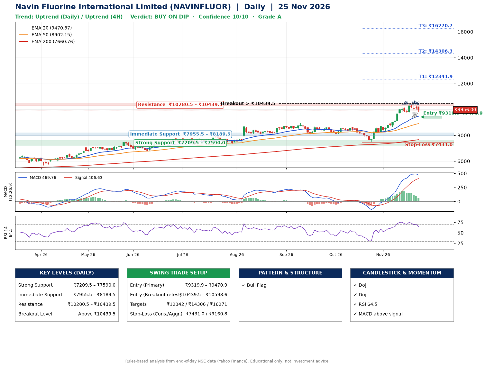

📌 **Navin Fluorine International Limited (NAVINFLUOR) – Multi-Timeframe Technical Analysis (Daily + 4H Combined)**
_Data up to 25 Nov 2026 · Close ₹9956.00_

**📍 Daily Timeframe Trend**
- Trend: **Uptrend** (price above rising EMAs)
- Recent swing highs: ₹8740.0, ₹8949.5, ₹8605.0 · swing lows: ₹8100.0, ₹8035.0, ₹7510.5
- EMAs: EMA20 ₹9470.9, EMA50 ₹8902.2, EMA200 ₹7660.8; bullish stack (EMA20 > EMA50 > EMA200); price above EMA20, EMA50, EMA200
- MACD 469.76 above signal 406.63 (above zero); histogram falling
- RSI(14) 64.5; no divergence on the last two swings

**📍 4-Hour Timeframe Trend**
- Structure: **Uptrend** (higher highs and higher lows)
- Pullback/support area: recent 4H swing lows ₹8665.5, ₹9756.0; EMA20 ₹9858.8
- EMA20/50: bullish stack (EMA20 > EMA50); price above EMA20, EMA50
- MACD 284.89 below signal 350.14 (above zero), fresh bearish crossover; histogram falling
- RSI(14) 59.0; Regular bearish divergence

**📍 Pattern Detection (Both Timeframes)**
- Daily: **Bull Flag** – 21% pole then a tight 6% flag; trigger above ₹10360.0
- 4H: **Bull Flag** – 15% pole then a tight 5% flag; trigger above ₹10359.5

**📍 Candlestick Patterns (last 3 daily candles)**
- **Doji** – 20 Nov: indecision; wait for the next candle to confirm direction
- **Doji** – 23 Nov: indecision; wait for the next candle to confirm direction

**📍 Price Action Key Levels (Daily Structure)**

| Zone | Price Level (₹) | Context |
|------|-----------------|---------|
| Strong Support | ₹7209.5 – ₹7590.0 | Cluster of earlier swing lows (demand) |
| Immediate Support | ₹7955.5 – ₹8189.5 | Nearest swing-low / wick area |
| Resistance | ₹10280.5 – ₹10439.5 | Nearest swing-high supply |
| Breakout Level | Above ₹10439.5 | Swing continuation trigger (52-week high ₹10360.0) |

**📍 Swing Trade Setup**

🟢 **Entry Zone**
- Primary: ₹9319.9 – ₹9470.9 (daily support / EMA20 area; enter on a bullish 4H candle)
- Alternate: ₹10439.5 – ₹10598.6 (breakout retest)

🎯 **Profit Targets**
- T1: ₹12341.9
- T2: ₹14306.3
- T3: ₹16270.7

🛑 **Stop-Loss**
- Conservative: below daily swing low (₹7431.0)
- Aggressive: below 4H structure (₹9160.8)
- Risk per share ≈ ₹1964.4; reward:risk to T1 ≈ 1.5
- Time to T1: about 26 trading days (it rose this much within 60 trading days 5% of the time in the last 2 years)
- Time to T2: it never rose this much within 60 trading days in the price history

**📌 Strategy Notes**
- Higher timeframe: daily trend is uptrend; only take longs while price holds above ₹7209.5.
- Entry timing: wait for a bullish 4H candle (engulfing/hammer) inside ₹9319.9 – ₹9470.9 rather than buying mid-range.
- EMA stacking: bullish stack (EMA20 > EMA50 > EMA200); price above EMA20, EMA50, EMA200.
- Breakout rule: a daily close above ₹10439.5 with volume above its 20-day average (≈264,820) opens T2/T3.
- Momentum: RSI 64 – room to run; no divergence on the last two swings.
- Exit discipline: move the stop to entry once T1 is hit; book partial profits at each target.

**STEP 2 — Marked Up Chart**

**✅ Trade Validation Checklist**
- Trend + momentum aligned: Yes · Price at entry zone: No
- Stop defined (₹7431.0) · Reward:risk ≥ 1.5 to T1: No

## 📌 Final Verdict

Recommendation: **🟡 BUY ON DIP**

Confidence: **10/10**

Trade Quality: **A**

Reason:
• Daily uptrend (price above rising EMAs)
• EMAs stacked bullishly

Next Action:
• Wait for a pullback to ₹9319.9–₹9470.9

_Rules-based analysis from end-of-day data. Educational only, not investment advice. Never place orders without your own confirmation._