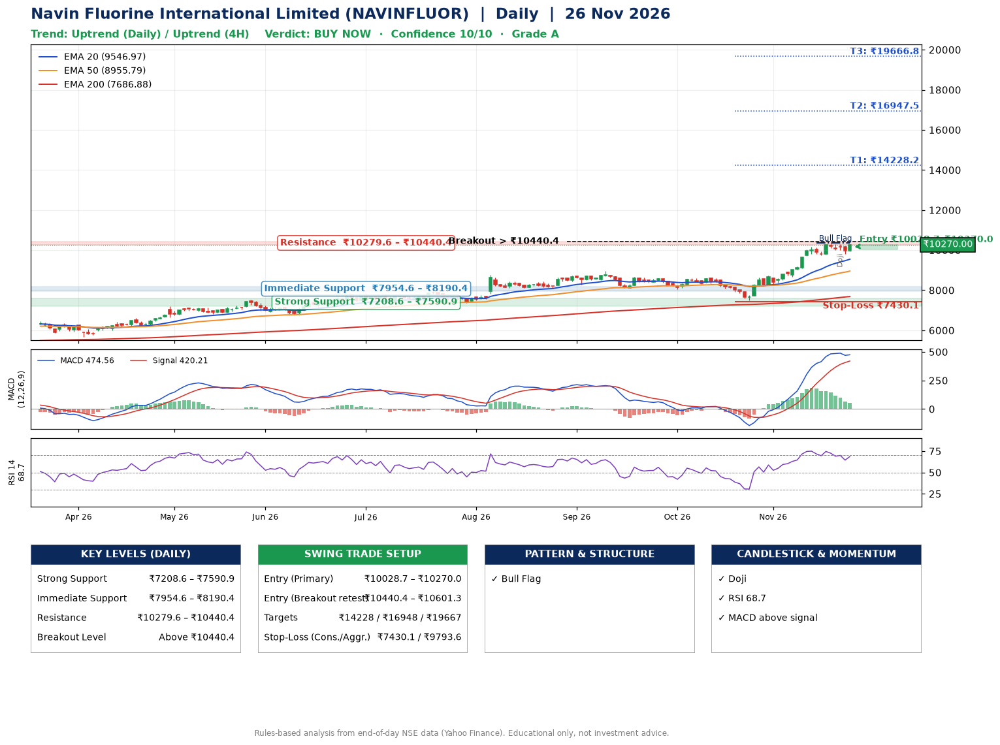

📌 **Navin Fluorine International Limited (NAVINFLUOR) – Multi-Timeframe Technical Analysis (Daily + 4H Combined)**
_Data up to 26 Nov 2026 · Close ₹10270.00_

**📍 Daily Timeframe Trend**
- Trend: **Uptrend** (price above rising EMAs)
- Recent swing highs: ₹8740.0, ₹8949.5, ₹8605.0 · swing lows: ₹8100.0, ₹8035.0, ₹7510.5
- EMAs: EMA20 ₹9547.0, EMA50 ₹8955.8, EMA200 ₹7686.9; bullish stack (EMA20 > EMA50 > EMA200); price above EMA20, EMA50, EMA200
- MACD 474.56 above signal 420.21 (above zero); histogram falling
- RSI(14) 68.7; no divergence on the last two swings

**📍 4-Hour Timeframe Trend**
- Structure: **Uptrend** (higher highs and higher lows)
- Pullback/support area: recent 4H swing lows ₹9756.0, ₹9814.0; EMA20 ₹9925.3
- EMA20/50: bullish stack (EMA20 > EMA50); price above EMA20, EMA50
- MACD 274.80 below signal 323.35 (above zero); histogram rising
- RSI(14) 66.8; Hidden bullish divergence; Regular bearish divergence

**📍 Pattern Detection (Both Timeframes)**
- Daily: **Bull Flag** – 15% pole then a tight 6% flag; trigger above ₹10360.0
- 4H: **Bull Flag** – 15% pole then a tight 5% flag; trigger above ₹10315.0

**📍 Candlestick Patterns (last 3 daily candles)**
- **Doji** – 23 Nov: indecision; wait for the next candle to confirm direction

**📍 Price Action Key Levels (Daily Structure)**

| Zone | Price Level (₹) | Context |
|------|-----------------|---------|
| Strong Support | ₹7208.6 – ₹7590.9 | Cluster of earlier swing lows (demand) |
| Immediate Support | ₹7954.6 – ₹8190.4 | Nearest swing-low / wick area |
| Resistance | ₹10279.6 – ₹10440.4 | Nearest swing-high supply |
| Breakout Level | Above ₹10440.4 | Swing continuation trigger (52-week high ₹10360.0) |

**📍 Swing Trade Setup**

🟢 **Entry Zone**
- Primary: ₹10028.7 – ₹10270.0 (daily support / EMA20 area; enter on a bullish 4H candle)
- Alternate: ₹10440.4 – ₹10601.3 (breakout retest)

🎯 **Profit Targets**
- T1: ₹14228.2
- T2: ₹16947.5
- T3: ₹19666.8

🛑 **Stop-Loss**
- Conservative: below daily swing low (₹7430.1)
- Aggressive: below 4H structure (₹9793.6)
- Risk per share ≈ ₹2719.3; reward:risk to T1 ≈ 1.5
- Time to T1: it never rose this much within 60 trading days in the price history
- Time to T2: it never rose this much within 60 trading days in the price history

**📌 Strategy Notes**
- Higher timeframe: daily trend is uptrend; only take longs while price holds above ₹7208.6.
- Entry timing: wait for a bullish 4H candle (engulfing/hammer) inside ₹10028.7 – ₹10270.0 rather than buying mid-range.
- EMA stacking: bullish stack (EMA20 > EMA50 > EMA200); price above EMA20, EMA50, EMA200.
- Breakout rule: a daily close above ₹10440.4 with volume above its 20-day average (≈264,699) opens T2/T3.
- Momentum: RSI 69 – elevated, prefer dips; no divergence on the last two swings.
- Exit discipline: move the stop to entry once T1 is hit; book partial profits at each target.

**STEP 2 — Marked Up Chart**

**✅ Trade Validation Checklist**
- Trend + momentum aligned: Yes · Price at entry zone: Yes
- Stop defined (₹7430.1) · Reward:risk ≥ 1.5 to T1: No

## 📌 Final Verdict

Recommendation: **🟢 BUY NOW**

Confidence: **10/10**

Trade Quality: **A**

Reason:
• Daily uptrend (price above rising EMAs)
• EMAs stacked bullishly

Next Action:
• Buy now within the entry zone, with the stop-loss in place

_Rules-based analysis from end-of-day data. Educational only, not investment advice. Never place orders without your own confirmation._