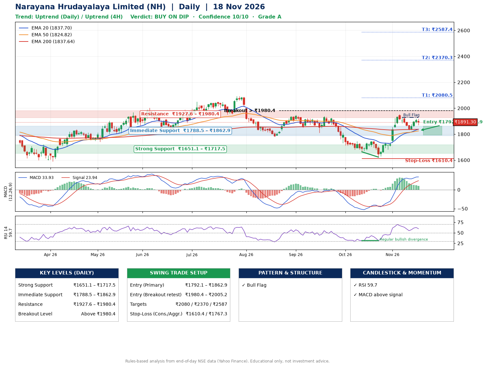

📌 **Narayana Hrudayalaya Limited (NH) – Multi-Timeframe Technical Analysis (Daily + 4H Combined)**
_Data up to 18 Nov 2026 · Close ₹1891.30_

**📍 Daily Timeframe Trend**
- Trend: **Uptrend** (price above rising EMAs)
- Recent swing highs: ₹1940.0, ₹1748.8, ₹1952.9 · swing lows: ₹1811.0, ₹1663.5, ₹1622.8
- EMAs: EMA20 ₹1837.7, EMA50 ₹1824.8, EMA200 ₹1837.6; mixed / crossing; price above EMA20, EMA50, EMA200
- MACD 33.93 above signal 23.94 (above zero); histogram falling
- RSI(14) 59.7; Regular bullish divergence

**📍 4-Hour Timeframe Trend**
- Structure: **Uptrend** (price above rising EMAs)
- Pullback/support area: recent 4H swing lows ₹1625.1, ₹1834.2; EMA20 ₹1868.8
- EMA20/50: bullish stack (EMA20 > EMA50); price above EMA20, EMA50
- MACD 25.06 below signal 29.01 (above zero); histogram falling
- RSI(14) 59.7; no divergence

**📍 Pattern Detection (Both Timeframes)**
- Daily: **Bull Flag** – 16% pole then a tight 5% flag; trigger above ₹1929.9
- 4H: **Double Top** – tops near ₹1950.6/₹1919.4, neckline ₹1834.2, forming

**📍 Candlestick Patterns (last 3 daily candles)**
- No notable candlestick signal in the last 3 sessions.

**📍 Price Action Key Levels (Daily Structure)**

| Zone | Price Level (₹) | Context |
|------|-----------------|---------|
| Strong Support | ₹1651.1 – ₹1717.5 | Cluster of earlier swing lows (demand) |
| Immediate Support | ₹1788.5 – ₹1862.9 | Nearest swing-low / wick area |
| Resistance | ₹1927.6 – ₹1980.4 | Nearest swing-high supply |
| Breakout Level | Above ₹1980.4 | Swing continuation trigger (52-week high ₹2093.3) |

**📍 Swing Trade Setup**

🟢 **Entry Zone**
- Primary: ₹1792.1 – ₹1862.9 (daily support / EMA20 area; enter on a bullish 4H candle)
- Alternate: ₹1980.4 – ₹2005.2 (breakout retest)

🎯 **Profit Targets**
- T1: ₹2080.5
- T2: ₹2370.3
- T3: ₹2587.4

🛑 **Stop-Loss**
- Conservative: below daily swing low (₹1610.4)
- Aggressive: below 4H structure (₹1767.3)
- Risk per share ≈ ₹217.1; reward:risk to T1 ≈ 1.2
- Time to T1: about 31 trading days (it rose this much within 60 trading days 54% of the time in the last 2 years)
- Time to T2: about 41 trading days (it rose this much within 60 trading days 22% of the time in the last 2 years)

**📌 Strategy Notes**
- Higher timeframe: daily trend is uptrend; only take longs while price holds above ₹1651.1.
- Entry timing: wait for a bullish 4H candle (engulfing/hammer) inside ₹1792.1 – ₹1862.9 rather than buying mid-range.
- EMA stacking: mixed / crossing; price above EMA20, EMA50, EMA200.
- Breakout rule: a daily close above ₹1980.4 with volume above its 20-day average (≈171,180) opens T2/T3.
- Momentum: RSI 60 – room to run; Regular bullish divergence.
- Exit discipline: move the stop to entry once T1 is hit; book partial profits at each target.

**STEP 2 — Marked Up Chart**

**✅ Trade Validation Checklist**
- Trend + momentum aligned: Yes · Price at entry zone: No
- Stop defined (₹1610.4) · Reward:risk ≥ 1.5 to T1: No

## 📌 Final Verdict

Recommendation: **🟡 BUY ON DIP**

Confidence: **10/10**

Trade Quality: **A**

Reason:
• Daily uptrend (price above rising EMAs)
• Bull Flag: 16% pole then a tight 5% flag; trigger above ₹1929.9

Next Action:
• Wait for a pullback to ₹1792.1–₹1862.9, or a breakout above ₹1980.4

_Rules-based analysis from end-of-day data. Educational only, not investment advice. Never place orders without your own confirmation._