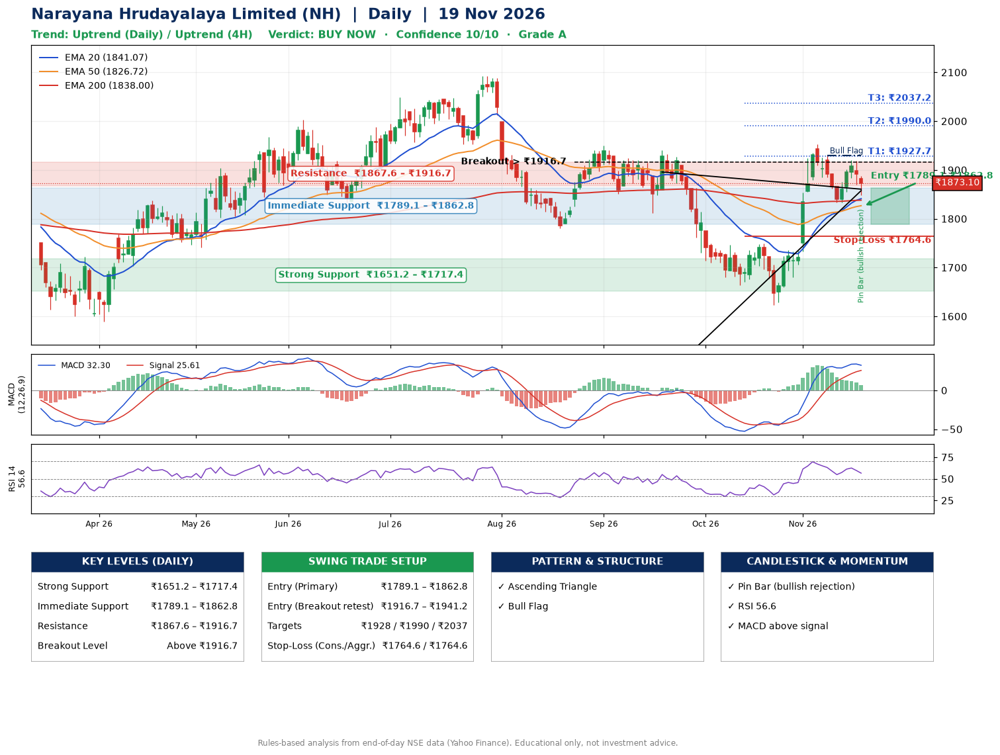

📌 **Narayana Hrudayalaya Limited (NH) – Multi-Timeframe Technical Analysis (Daily + 4H Combined)**
_Data up to 19 Nov 2026 · Close ₹1873.10_

**📍 Daily Timeframe Trend**
- Trend: **Uptrend** (higher highs and higher lows)
- Recent swing highs: ₹1940.0, ₹1748.8, ₹1952.9 · swing lows: ₹1663.5, ₹1622.8, ₹1833.0
- EMAs: EMA20 ₹1841.1, EMA50 ₹1826.7, EMA200 ₹1838.0; mixed / crossing; price above EMA20, EMA50, EMA200
- MACD 32.30 above signal 25.61 (above zero); histogram falling
- RSI(14) 56.6; no divergence on the last two swings

**📍 4-Hour Timeframe Trend**
- Structure: **Uptrend** (price above rising EMAs)
- Pullback/support area: recent 4H swing lows ₹1625.1, ₹1834.2; EMA20 ₹1869.2
- EMA20/50: bullish stack (EMA20 > EMA50); price above EMA20, EMA50
- MACD 19.84 below signal 26.06 (above zero); histogram falling
- RSI(14) 54.2; no divergence

**📍 Pattern Detection (Both Timeframes)**
- Daily: **Ascending Triangle** – converging swing highs and lows over the last ~60 sessions
- Daily: **Bull Flag** – 16% pole then a tight 5% flag; trigger above ₹1929.9
- 4H: **Double Top** – tops near ₹1950.6/₹1919.4, neckline ₹1834.2, forming

**📍 Candlestick Patterns (last 3 daily candles)**
- **Pin Bar (bullish rejection)** – 19 Nov: long lower wick shows dip-buying near ₹1848.5

**📍 Price Action Key Levels (Daily Structure)**

| Zone | Price Level (₹) | Context |
|------|-----------------|---------|
| Strong Support | ₹1651.2 – ₹1717.4 | Cluster of earlier swing lows (demand) |
| Immediate Support | ₹1789.1 – ₹1862.8 | Nearest swing-low / wick area |
| Resistance | ₹1867.6 – ₹1916.7 | Nearest swing-high supply |
| Breakout Level | Above ₹1916.7 | Swing continuation trigger (52-week high ₹2093.3) |

**📍 Swing Trade Setup**

🟢 **Entry Zone**
- Primary: ₹1789.1 – ₹1862.8 (daily support / EMA20 area; enter on a bullish 4H candle)
- Alternate: ₹1916.7 – ₹1941.2 (breakout retest)

🎯 **Profit Targets**
- T1: ₹1927.7
- T2: ₹1990.0
- T3: ₹2037.2

🛑 **Stop-Loss**
- Conservative: below daily swing low (₹1764.6)
- Aggressive: below 4H structure (₹1764.6)
- Risk per share ≈ ₹61.4; reward:risk to T1 ≈ 1.7
- Time to T1: about 10 trading days (it rose this much within 60 trading days 74% of the time in the last 2 years)
- Time to T2: about 20 trading days (it rose this much within 60 trading days 65% of the time in the last 2 years)

**📌 Strategy Notes**
- Higher timeframe: daily trend is uptrend; only take longs while price holds above ₹1651.2.
- Entry timing: wait for a bullish 4H candle (engulfing/hammer) inside ₹1789.1 – ₹1862.8 rather than buying mid-range.
- EMA stacking: mixed / crossing; price above EMA20, EMA50, EMA200.
- Breakout rule: a daily close above ₹1916.7 with volume above its 20-day average (≈169,232) opens T2/T3.
- Momentum: RSI 57 – room to run; no divergence on the last two swings.
- Exit discipline: move the stop to entry once T1 is hit; book partial profits at each target.

**STEP 2 — Marked Up Chart**

**✅ Trade Validation Checklist**
- Trend + momentum aligned: Yes · Price at entry zone: No
- Stop defined (₹1764.6) · Reward:risk ≥ 1.5 to T1: Yes

## 📌 Final Verdict

Recommendation: **🟢 BUY NOW**

Confidence: **10/10**

Trade Quality: **A**

Reason:
• Daily uptrend (higher highs and higher lows)
• Ascending Triangle: converging swing highs and lows over the last ~60 sessions

Next Action:
• Buy now within the entry zone, with the stop-loss in place

_Rules-based analysis from end-of-day data. Educational only, not investment advice. Never place orders without your own confirmation._