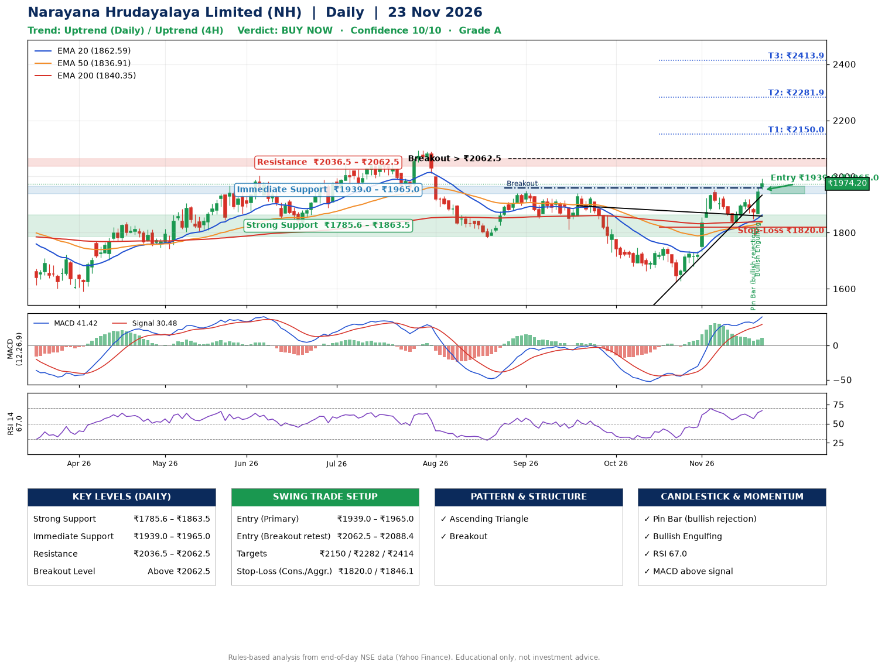

📌 **Narayana Hrudayalaya Limited (NH) – Multi-Timeframe Technical Analysis (Daily + 4H Combined)**
_Data up to 23 Nov 2026 · Close ₹1974.20_

**📍 Daily Timeframe Trend**
- Trend: **Uptrend** (price above rising EMAs)
- Recent swing highs: ₹1940.0, ₹1748.8, ₹1952.9 · swing lows: ₹1622.8, ₹1833.0, ₹1833.0
- EMAs: EMA20 ₹1862.6, EMA50 ₹1836.9, EMA200 ₹1840.4; mixed / crossing; price above EMA20, EMA50, EMA200
- MACD 41.42 above signal 30.48 (above zero); histogram rising
- RSI(14) 67.0; no divergence on the last two swings

**📍 4-Hour Timeframe Trend**
- Structure: **Uptrend** (price above rising EMAs)
- Pullback/support area: recent 4H swing lows ₹1834.2, ₹1849.3; EMA20 ₹1900.7
- EMA20/50: bullish stack (EMA20 > EMA50); price above EMA20, EMA50
- MACD 34.09 above signal 28.41 (above zero), fresh bullish crossover; histogram rising
- RSI(14) 68.6; no divergence

**📍 Pattern Detection (Both Timeframes)**
- Daily: **Ascending Triangle** – converging swing highs and lows over the last ~60 sessions
- Daily: **Breakout** – closed above the 60-session high ₹1960.0 on strong volume

**📍 Candlestick Patterns (last 3 daily candles)**
- **Pin Bar (bullish rejection)** – 19 Nov: long lower wick shows dip-buying near ₹1848.5
- **Bullish Engulfing** – 20 Nov: buyers fully reversed the prior red candle

**📍 Price Action Key Levels (Daily Structure)**

| Zone | Price Level (₹) | Context |
|------|-----------------|---------|
| Strong Support | ₹1785.6 – ₹1863.5 | Cluster of earlier swing lows (demand) |
| Immediate Support | ₹1939.0 – ₹1965.0 | Nearest swing-low / wick area |
| Resistance | ₹2036.5 – ₹2062.5 | Nearest swing-high supply |
| Breakout Level | Above ₹2062.5 | Swing continuation trigger (52-week high ₹2092.9) |

**📍 Swing Trade Setup**

🟢 **Entry Zone**
- Primary: ₹1939.0 – ₹1965.0 (daily support / EMA20 area; enter on a bullish 4H candle)
- Alternate: ₹2062.5 – ₹2088.4 (breakout retest)

🎯 **Profit Targets**
- T1: ₹2150.0
- T2: ₹2281.9
- T3: ₹2413.9

🛑 **Stop-Loss**
- Conservative: below daily swing low (₹1820.0)
- Aggressive: below 4H structure (₹1846.1)
- Risk per share ≈ ₹132.0; reward:risk to T1 ≈ 1.5
- Time to T1: about 26 trading days (it rose this much within 60 trading days 62% of the time in the last 2 years)
- Time to T2: about 31 trading days (it rose this much within 60 trading days 46% of the time in the last 2 years)

**📌 Strategy Notes**
- Higher timeframe: daily trend is uptrend; only take longs while price holds above ₹1785.6.
- Entry timing: wait for a bullish 4H candle (engulfing/hammer) inside ₹1939.0 – ₹1965.0 rather than buying mid-range.
- EMA stacking: mixed / crossing; price above EMA20, EMA50, EMA200.
- Breakout rule: a daily close above ₹2062.5 with volume above its 20-day average (≈206,935) opens T2/T3.
- Momentum: RSI 67 – elevated, prefer dips; no divergence on the last two swings.
- Exit discipline: move the stop to entry once T1 is hit; book partial profits at each target.

**STEP 2 — Marked Up Chart**

**✅ Trade Validation Checklist**
- Trend + momentum aligned: Yes · Price at entry zone: No
- Stop defined (₹1820.0) · Reward:risk ≥ 1.5 to T1: Yes

## 📌 Final Verdict

Recommendation: **🟢 BUY NOW**

Confidence: **10/10**

Trade Quality: **A**

Reason:
• Daily uptrend (price above rising EMAs)
• Ascending Triangle: converging swing highs and lows over the last ~60 sessions

Next Action:
• Buy now within the entry zone, with the stop-loss in place

_Rules-based analysis from end-of-day data. Educational only, not investment advice. Never place orders without your own confirmation._