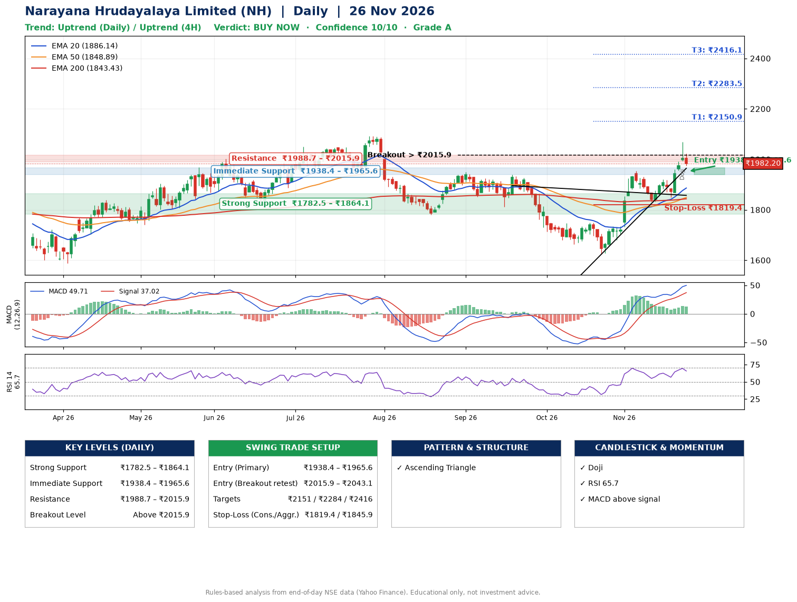

📌 **Narayana Hrudayalaya Limited (NH) – Multi-Timeframe Technical Analysis (Daily + 4H Combined)**
_Data up to 26 Nov 2026 · Close ₹1982.20_

**📍 Daily Timeframe Trend**
- Trend: **Uptrend** (price above rising EMAs)
- Recent swing highs: ₹1940.0, ₹1748.8, ₹1952.9 · swing lows: ₹1622.8, ₹1833.0, ₹1833.0
- EMAs: EMA20 ₹1886.1, EMA50 ₹1848.9, EMA200 ₹1843.4; bullish stack (EMA20 > EMA50 > EMA200); price above EMA20, EMA50, EMA200
- MACD 49.71 above signal 37.02 (above zero); histogram falling
- RSI(14) 65.7; no divergence on the last two swings

**📍 4-Hour Timeframe Trend**
- Structure: **Uptrend** (higher highs and higher lows)
- Pullback/support area: recent 4H swing lows ₹1834.2, ₹1849.3; EMA20 ₹1930.8
- EMA20/50: bullish stack (EMA20 > EMA50); price above EMA20, EMA50
- MACD 40.37 above signal 35.37 (above zero); histogram falling
- RSI(14) 65.8; no divergence

**📍 Pattern Detection (Both Timeframes)**
- Daily: **Ascending Triangle** – converging swing highs and lows over the last ~60 sessions

**📍 Candlestick Patterns (last 3 daily candles)**
- **Doji** – 25 Nov: indecision; wait for the next candle to confirm direction

**📍 Price Action Key Levels (Daily Structure)**

| Zone | Price Level (₹) | Context |
|------|-----------------|---------|
| Strong Support | ₹1782.5 – ₹1864.1 | Cluster of earlier swing lows (demand) |
| Immediate Support | ₹1938.4 – ₹1965.6 | Nearest swing-low / wick area |
| Resistance | ₹1988.7 – ₹2015.9 | Nearest swing-high supply |
| Breakout Level | Above ₹2015.9 | Swing continuation trigger (52-week high ₹2092.9) |

**📍 Swing Trade Setup**

🟢 **Entry Zone**
- Primary: ₹1938.4 – ₹1965.6 (daily support / EMA20 area; enter on a bullish 4H candle)
- Alternate: ₹2015.9 – ₹2043.1 (breakout retest)

🎯 **Profit Targets**
- T1: ₹2150.9
- T2: ₹2283.5
- T3: ₹2416.1

🛑 **Stop-Loss**
- Conservative: below daily swing low (₹1819.4)
- Aggressive: below 4H structure (₹1845.9)
- Risk per share ≈ ₹132.6; reward:risk to T1 ≈ 1.5
- Time to T1: about 25 trading days (it rose this much within 60 trading days 61% of the time in the last 2 years)
- Time to T2: about 31 trading days (it rose this much within 60 trading days 46% of the time in the last 2 years)

**📌 Strategy Notes**
- Higher timeframe: daily trend is uptrend; only take longs while price holds above ₹1782.5.
- Entry timing: wait for a bullish 4H candle (engulfing/hammer) inside ₹1938.4 – ₹1965.6 rather than buying mid-range.
- EMA stacking: bullish stack (EMA20 > EMA50 > EMA200); price above EMA20, EMA50, EMA200.
- Breakout rule: a daily close above ₹2015.9 with volume above its 20-day average (≈226,735) opens T2/T3.
- Momentum: RSI 66 – elevated, prefer dips; no divergence on the last two swings.
- Exit discipline: move the stop to entry once T1 is hit; book partial profits at each target.

**STEP 2 — Marked Up Chart**

**✅ Trade Validation Checklist**
- Trend + momentum aligned: Yes · Price at entry zone: No
- Stop defined (₹1819.4) · Reward:risk ≥ 1.5 to T1: Yes

## 📌 Final Verdict

Recommendation: **🟢 BUY NOW**

Confidence: **10/10**

Trade Quality: **A**

Reason:
• Daily uptrend (price above rising EMAs)
• EMAs stacked bullishly

Next Action:
• Buy now within the entry zone, with the stop-loss in place

_Rules-based analysis from end-of-day data. Educational only, not investment advice. Never place orders without your own confirmation._