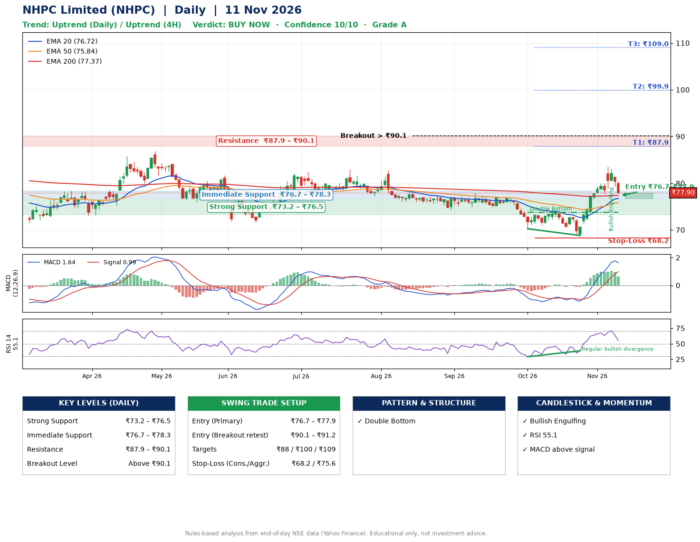

📌 **NHPC Limited (NHPC) – Multi-Timeframe Technical Analysis (Daily + 4H Combined)**
_Data up to 11 Nov 2026 · Close ₹77.90_

**📍 Daily Timeframe Trend**
- Trend: **Uptrend** (price above rising EMAs)
- Recent swing highs: ₹77.3, ₹77.9, ₹73.8 · swing lows: ₹75.0, ₹70.2, ₹68.8
- EMAs: EMA20 ₹76.7, EMA50 ₹75.8, EMA200 ₹77.4; mixed / crossing; price above EMA20, EMA50, EMA200
- MACD 1.64 above signal 0.99 (above zero); histogram falling
- RSI(14) 55.1; Regular bullish divergence

**📍 4-Hour Timeframe Trend**
- Structure: **Uptrend** (higher highs and higher lows)
- Pullback/support area: recent 4H swing lows ₹68.8, ₹77.7; EMA20 ₹78.0
- EMA20/50: bullish stack (EMA20 > EMA50); price above EMA50
- MACD 0.98 below signal 1.54 (above zero), fresh bearish crossover; histogram falling
- RSI(14) 47.3; no divergence

**📍 Pattern Detection (Both Timeframes)**
- Daily: **Double Bottom** – bottoms near ₹70.2/₹68.8, neckline ₹73.8, confirmed (closed above neckline)

**📍 Candlestick Patterns (last 3 daily candles)**
- **Bullish Engulfing** – 06 Nov: buyers fully reversed the prior red candle

**📍 Price Action Key Levels (Daily Structure)**

| Zone | Price Level (₹) | Context |
|------|-----------------|---------|
| Strong Support | ₹73.2 – ₹76.5 | Cluster of earlier swing lows (demand) |
| Immediate Support | ₹76.7 – ₹78.3 | Nearest swing-low / wick area |
| Resistance | ₹87.9 – ₹90.1 | Nearest swing-high supply |
| Breakout Level | Above ₹90.1 | Swing continuation trigger (52-week high ₹86.8) |

**📍 Swing Trade Setup**

🟢 **Entry Zone**
- Primary: ₹76.7 – ₹77.9 (daily support / EMA20 area; enter on a bullish 4H candle)
- Alternate: ₹90.1 – ₹91.2 (breakout retest)

🎯 **Profit Targets**
- T1: ₹87.9
- T2: ₹99.9
- T3: ₹109.0

🛑 **Stop-Loss**
- Conservative: below daily swing low (₹68.2)
- Aggressive: below 4H structure (₹75.6)
- Risk per share ≈ ₹9.1; reward:risk to T1 ≈ 1.2
- Time to T1: about 25 trading days (it rose this much within 60 trading days 19% of the time in the last 2 years)
- Time to T2: it never rose this much within 60 trading days in the price history

**📌 Strategy Notes**
- Higher timeframe: daily trend is uptrend; only take longs while price holds above ₹73.2.
- Entry timing: wait for a bullish 4H candle (engulfing/hammer) inside ₹76.7 – ₹77.9 rather than buying mid-range.
- EMA stacking: mixed / crossing; price above EMA20, EMA50, EMA200.
- Breakout rule: a daily close above ₹90.1 with volume above its 20-day average (≈15,216,258) opens T2/T3.
- Momentum: RSI 55 – room to run; Regular bullish divergence.
- Exit discipline: move the stop to entry once T1 is hit; book partial profits at each target.

**STEP 2 — Marked Up Chart**

**✅ Trade Validation Checklist**
- Trend + momentum aligned: Yes · Price at entry zone: Yes
- Stop defined (₹68.2) · Reward:risk ≥ 1.5 to T1: No

## 📌 Final Verdict

Recommendation: **🟢 BUY NOW**

Confidence: **10/10**

Trade Quality: **A**

Reason:
• Daily uptrend (price above rising EMAs)
• Double Bottom: bottoms near ₹70.2/₹68.8, neckline ₹73.8, confirmed (closed above neckline)

Next Action:
• Buy now within the entry zone, with the stop-loss in place

_Rules-based analysis from end-of-day data. Educational only, not investment advice. Never place orders without your own confirmation._