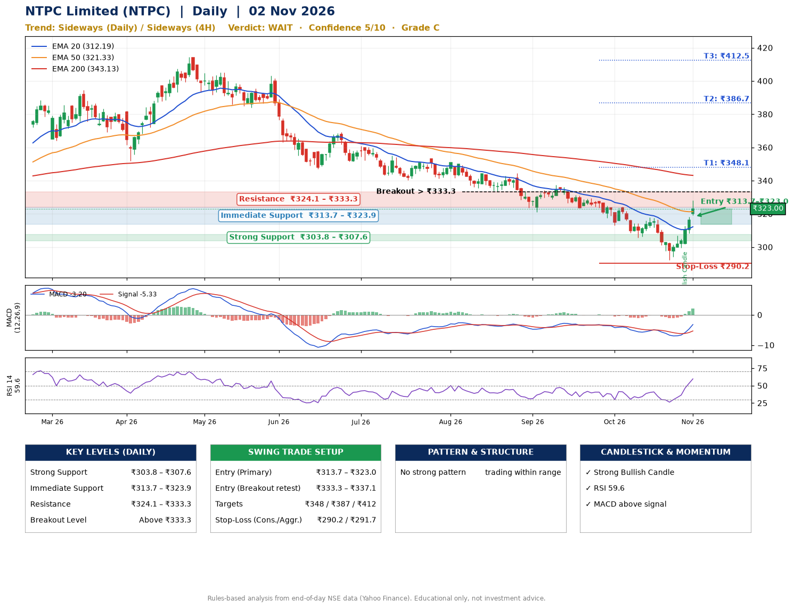

📌 **NTPC Limited (NTPC) – Multi-Timeframe Technical Analysis (Daily + 4H Combined)**
_Data up to 02 Nov 2026 · Close ₹323.00_

**📍 Daily Timeframe Trend**
- Trend: **Sideways** (mixed swing structure)
- Recent swing highs: ₹344.5, ₹337.5, ₹318.0 · swing lows: ₹321.0, ₹305.7, ₹292.0
- EMAs: EMA20 ₹312.2, EMA50 ₹321.3, EMA200 ₹343.1; bearish stack (EMA20 < EMA50 < EMA200); price above EMA20, EMA50
- MACD -3.20 above signal -5.33 (below zero), fresh bullish crossover; histogram rising
- RSI(14) 59.6; no divergence on the last two swings

**📍 4-Hour Timeframe Trend**
- Structure: **Sideways** (mixed swing structure)
- Pullback/support area: recent 4H swing lows ₹305.9, ₹292.2; EMA20 ₹310.8
- EMA20/50: bearish stack (EMA20 < EMA50); price above EMA20, EMA50
- MACD 1.89 above signal -1.09 (above zero); histogram rising
- RSI(14) 65.5; Regular bullish divergence

**📍 Pattern Detection (Both Timeframes)**
- No strong pattern detected. Trading within range.

**📍 Candlestick Patterns (last 3 daily candles)**
- **Strong Bullish Candle** – 29 Oct: wide-range green candle, buyers in control

**📍 Price Action Key Levels (Daily Structure)**

| Zone | Price Level (₹) | Context |
|------|-----------------|---------|
| Strong Support | ₹303.8 – ₹307.6 | Cluster of earlier swing lows (demand) |
| Immediate Support | ₹313.7 – ₹323.9 | Nearest swing-low / wick area |
| Resistance | ₹324.1 – ₹333.3 | Nearest swing-high supply |
| Breakout Level | Above ₹333.3 | Swing continuation trigger (52-week high ₹414.4) |

**📍 Swing Trade Setup**

🟢 **Entry Zone**
- Primary: ₹313.7 – ₹323.0 (daily support / EMA20 area; enter on a bullish 4H candle)
- Alternate: ₹333.3 – ₹337.1 (breakout retest)

🎯 **Profit Targets**
- T1: ₹348.1
- T2: ₹386.7
- T3: ₹412.5

🛑 **Stop-Loss**
- Conservative: below daily swing low (₹290.2)
- Aggressive: below 4H structure (₹291.7)
- Risk per share ≈ ₹28.2; reward:risk to T1 ≈ 1.1

**📌 Strategy Notes**
- Higher timeframe: daily trend is sideways; only take longs while price holds above ₹303.8.
- Entry timing: wait for a bullish 4H candle (engulfing/hammer) inside ₹313.7 – ₹323.0 rather than buying mid-range.
- EMA stacking: bearish stack (EMA20 < EMA50 < EMA200); price above EMA20, EMA50.
- Breakout rule: a daily close above ₹333.3 with volume above its 20-day average (≈9,446,534) opens T2/T3.
- Momentum: RSI 60 – room to run; no divergence on the last two swings.
- Exit discipline: move the stop to entry once T1 is hit; book partial profits at each target.

**STEP 2 — Marked Up Chart**

**✅ Trade Validation Checklist**
- Trend + momentum aligned: No · Price at entry zone: Yes
- Stop defined (₹290.2) · Reward:risk ≥ 1.5 to T1: No

## 📌 Final Verdict

Recommendation: **🟠 WAIT**

Confidence: **5/10**

Trade Quality: **C**

Reason:
• No strong edge from trend, momentum or patterns

Next Action:
• Wait for a breakout above ₹333.3

_Rules-based analysis from end-of-day data. Educational only, not investment advice. Never place orders without your own confirmation._