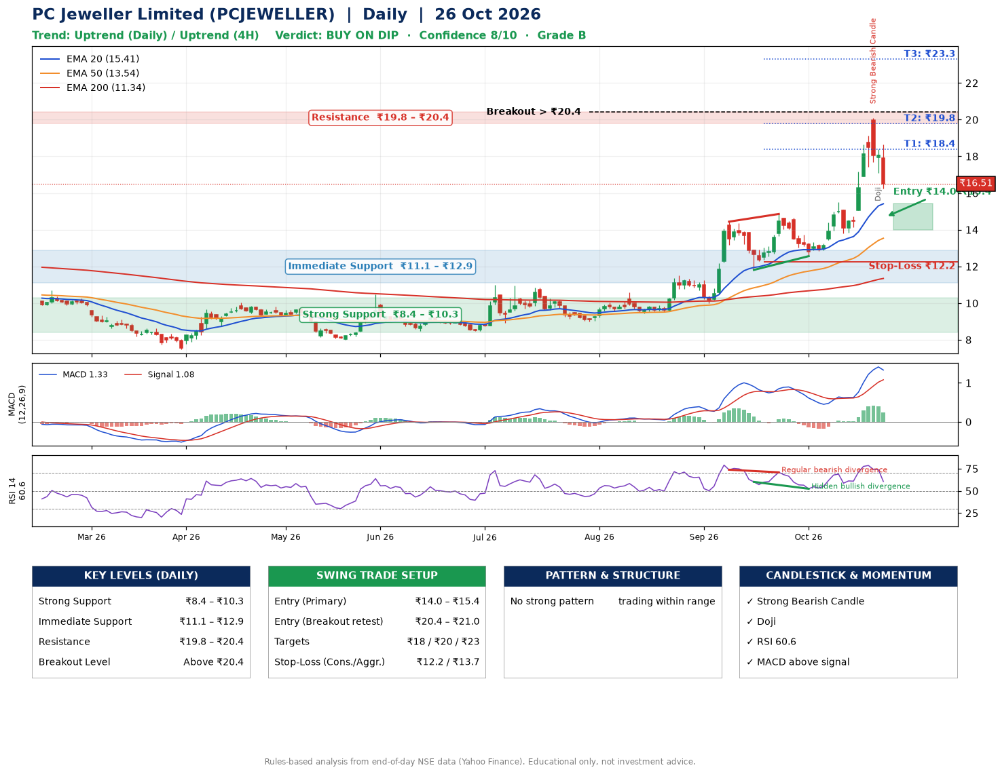

📌 **PC Jeweller Limited (PCJEWELLER) – Multi-Timeframe Technical Analysis (Daily + 4H Combined)**
_Data up to 26 Oct 2026 · Close ₹16.51_

**📍 Daily Timeframe Trend**
- Trend: **Uptrend** (higher highs and higher lows)
- Recent swing highs: ₹11.5, ₹14.4, ₹14.9 · swing lows: ₹10.0, ₹11.8, ₹12.6
- EMAs: EMA20 ₹15.4, EMA50 ₹13.5, EMA200 ₹11.3; bullish stack (EMA20 > EMA50 > EMA200); price above EMA20, EMA50, EMA200
- MACD 1.33 above signal 1.08 (above zero); histogram falling
- RSI(14) 60.6; Hidden bullish divergence; Regular bearish divergence

**📍 4-Hour Timeframe Trend**
- Structure: **Uptrend** (higher highs and higher lows)
- Pullback/support area: recent 4H swing lows ₹12.6, ₹13.8; EMA20 ₹16.5
- EMA20/50: bullish stack (EMA20 > EMA50); price above EMA50
- MACD 0.96 below signal 1.03 (above zero), fresh bearish crossover; histogram falling
- RSI(14) 52.0; Regular bearish divergence

**📍 Pattern Detection (Both Timeframes)**
- No strong pattern detected. Trading within range.

**📍 Candlestick Patterns (last 3 daily candles)**
- **Strong Bearish Candle** – 22 Oct: wide-range red candle, sellers in control
- **Doji** – 23 Oct: indecision; wait for the next candle to confirm direction

**📍 Price Action Key Levels (Daily Structure)**

| Zone | Price Level (₹) | Context |
|------|-----------------|---------|
| Strong Support | ₹8.4 – ₹10.3 | Cluster of earlier swing lows (demand) |
| Immediate Support | ₹11.1 – ₹12.9 | Nearest swing-low / wick area |
| Resistance | ₹19.8 – ₹20.4 | Nearest swing-high supply |
| Breakout Level | Above ₹20.4 | Swing continuation trigger (52-week high ₹20.1) |

**📍 Swing Trade Setup**

🟢 **Entry Zone**
- Primary: ₹14.0 – ₹15.4 (daily support / EMA20 area; enter on a bullish 4H candle)
- Alternate: ₹20.4 – ₹21.0 (breakout retest)

🎯 **Profit Targets**
- T1: ₹18.4
- T2: ₹19.8
- T3: ₹23.3

🛑 **Stop-Loss**
- Conservative: below daily swing low (₹12.2)
- Aggressive: below 4H structure (₹13.7)
- Risk per share ≈ ₹2.5; reward:risk to T1 ≈ 1.5

**📌 Strategy Notes**
- Higher timeframe: daily trend is uptrend; only take longs while price holds above ₹8.4.
- Entry timing: wait for a bullish 4H candle (engulfing/hammer) inside ₹14.0 – ₹15.4 rather than buying mid-range.
- EMA stacking: bullish stack (EMA20 > EMA50 > EMA200); price above EMA20, EMA50, EMA200.
- Breakout rule: a daily close above ₹20.4 with volume above its 20-day average (≈485,206,229) opens T2/T3.
- Momentum: RSI 61 – room to run; Hidden bullish divergence; Regular bearish divergence.
- Exit discipline: move the stop to entry once T1 is hit; book partial profits at each target.

**STEP 2 — Marked Up Chart**

**✅ Trade Validation Checklist**
- Trend + momentum aligned: Yes · Price at entry zone: No
- Stop defined (₹12.2) · Reward:risk ≥ 1.5 to T1: Yes

## 📌 Final Verdict

Recommendation: **🟡 BUY ON DIP**

Confidence: **8/10**

Trade Quality: **B**

Reason:
• Sharp pullback: 18% below the recent ₹20.1 high
• Daily uptrend (higher highs and higher lows)

Next Action:
• Wait for a pullback to ₹14.0–₹15.4

_Rules-based analysis from end-of-day data. Educational only, not investment advice. Never place orders without your own confirmation._