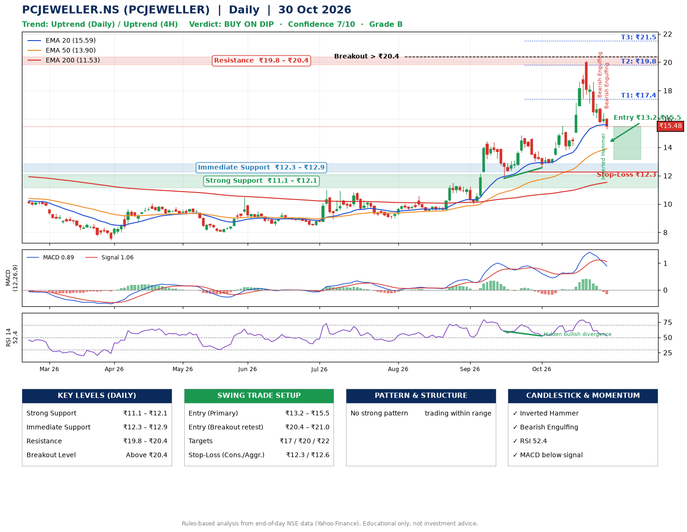

📌 **PCJEWELLER.NS (PCJEWELLER) – Multi-Timeframe Technical Analysis (Daily + 4H Combined)**
_Data up to 30 Oct 2026 · Close ₹15.48_

**📍 Daily Timeframe Trend**
- Trend: **Uptrend** (higher highs and higher lows)
- Recent swing highs: ₹14.4, ₹14.9, ₹20.1 · swing lows: ₹10.0, ₹11.8, ₹12.6
- EMAs: EMA20 ₹15.6, EMA50 ₹13.9, EMA200 ₹11.5; bullish stack (EMA20 > EMA50 > EMA200); price above EMA50, EMA200
- MACD 0.89 below signal 1.06 (above zero), fresh bearish crossover; histogram falling
- RSI(14) 52.4; Hidden bullish divergence

**📍 4-Hour Timeframe Trend**
- Structure: **Uptrend** (higher highs and higher lows)
- Pullback/support area: recent 4H swing lows ₹12.6, ₹13.8; EMA20 ₹16.2
- EMA20/50: bullish stack (EMA20 > EMA50); price above EMA50
- MACD 0.15 below signal 0.48 (above zero); histogram falling
- RSI(14) 45.2; Regular bearish divergence

**📍 Pattern Detection (Both Timeframes)**
- No strong pattern detected. Trading within range.

**📍 Candlestick Patterns (last 3 daily candles)**
- **Bearish Engulfing** – 28 Oct: sellers fully reversed the prior green candle
- **Inverted Hammer** – 29 Oct: long upper wick shows selling near ₹16.4
- **Bearish Engulfing** – 30 Oct: sellers fully reversed the prior green candle

**📍 Price Action Key Levels (Daily Structure)**

| Zone | Price Level (₹) | Context |
|------|-----------------|---------|
| Strong Support | ₹11.1 – ₹12.1 | Cluster of earlier swing lows (demand) |
| Immediate Support | ₹12.3 – ₹12.9 | Nearest swing-low / wick area |
| Resistance | ₹19.8 – ₹20.4 | Nearest swing-high supply |
| Breakout Level | Above ₹20.4 | Swing continuation trigger (52-week high ₹20.1) |

**📍 Swing Trade Setup**

🟢 **Entry Zone**
- Primary: ₹13.2 – ₹15.5 (daily support / EMA20 area; enter on a bullish 4H candle)
- Alternate: ₹20.4 – ₹21.0 (breakout retest)

🎯 **Profit Targets**
- T1: ₹17.4
- T2: ₹19.8
- T3: ₹21.5

🛑 **Stop-Loss**
- Conservative: below daily swing low (₹12.3)
- Aggressive: below 4H structure (₹12.6)
- Risk per share ≈ ₹2.0; reward:risk to T1 ≈ 1.5

**📌 Strategy Notes**
- Higher timeframe: daily trend is uptrend; only take longs while price holds above ₹11.1.
- Entry timing: wait for a bullish 4H candle (engulfing/hammer) inside ₹13.2 – ₹15.5 rather than buying mid-range.
- EMA stacking: bullish stack (EMA20 > EMA50 > EMA200); price above EMA50, EMA200.
- Breakout rule: a daily close above ₹20.4 with volume above its 20-day average (≈511,889,196) opens T2/T3.
- Momentum: RSI 52 – room to run; Hidden bullish divergence.
- Exit discipline: move the stop to entry once T1 is hit; book partial profits at each target.

**STEP 2 — Marked Up Chart**

**✅ Trade Validation Checklist**
- Trend + momentum aligned: No · Price at entry zone: Yes
- Stop defined (₹12.3) · Reward:risk ≥ 1.5 to T1: Yes

## 📌 Final Verdict

Recommendation: **🟡 BUY ON DIP**

Confidence: **7/10**

Trade Quality: **B**

Reason:
• Sharp pullback: 23% below the recent ₹20.1 high
• Daily uptrend (higher highs and higher lows)

Next Action:
• Wait for a pullback to ₹13.2–₹15.5, or a breakout above ₹20.4

_Rules-based analysis from end-of-day data. Educational only, not investment advice. Never place orders without your own confirmation._