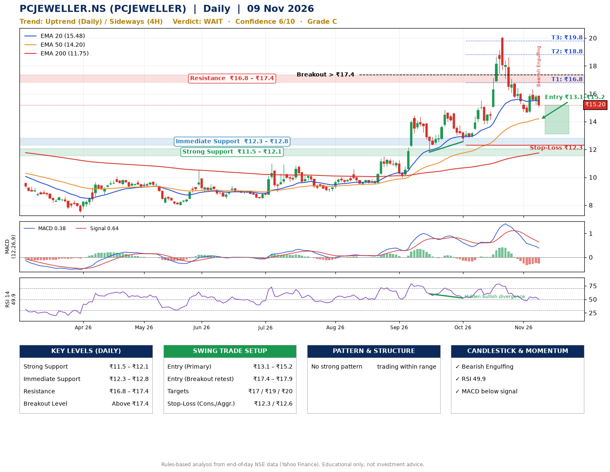

📌 **PCJEWELLER.NS (PCJEWELLER) – Multi-Timeframe Technical Analysis (Daily + 4H Combined)**
_Data up to 09 Nov 2026 · Close ₹15.20_

**📍 Daily Timeframe Trend**
- Trend: **Uptrend** (higher highs and higher lows)
- Recent swing highs: ₹14.4, ₹14.9, ₹20.1 · swing lows: ₹10.0, ₹11.8, ₹12.6
- EMAs: EMA20 ₹15.5, EMA50 ₹14.2, EMA200 ₹11.7; bullish stack (EMA20 > EMA50 > EMA200); price above EMA50, EMA200
- MACD 0.38 below signal 0.64 (above zero); histogram falling
- RSI(14) 49.9; Hidden bullish divergence

**📍 4-Hour Timeframe Trend**
- Structure: **Sideways** (mixed swing structure)
- Pullback/support area: recent 4H swing lows ₹13.8, ₹14.6; EMA20 ₹15.7
- EMA20/50: bullish stack (EMA20 > EMA50); price below all EMAs
- MACD -0.11 below signal -0.07 (below zero); histogram falling
- RSI(14) 45.7; Hidden bullish divergence

**📍 Pattern Detection (Both Timeframes)**
- 4H: **Ascending Triangle** – converging swing highs and lows over the last ~60 sessions

**📍 Candlestick Patterns (last 3 daily candles)**
- **Bearish Engulfing** – 09 Nov: sellers fully reversed the prior green candle

**📍 Price Action Key Levels (Daily Structure)**

| Zone | Price Level (₹) | Context |
|------|-----------------|---------|
| Strong Support | ₹11.5 – ₹12.1 | Cluster of earlier swing lows (demand) |
| Immediate Support | ₹12.3 – ₹12.8 | Nearest swing-low / wick area |
| Resistance | ₹16.8 – ₹17.4 | Nearest swing-high supply |
| Breakout Level | Above ₹17.4 | Swing continuation trigger (52-week high ₹20.1) |

**📍 Swing Trade Setup**

🟢 **Entry Zone**
- Primary: ₹13.1 – ₹15.2 (daily support / EMA20 area; enter on a bullish 4H candle)
- Alternate: ₹17.4 – ₹17.9 (breakout retest)

🎯 **Profit Targets**
- T1: ₹16.8
- T2: ₹18.8
- T3: ₹19.8

🛑 **Stop-Loss**
- Conservative: below daily swing low (₹12.3)
- Aggressive: below 4H structure (₹12.6)
- Risk per share ≈ ₹1.9; reward:risk to T1 ≈ 1.4

**📌 Strategy Notes**
- Higher timeframe: daily trend is uptrend; only take longs while price holds above ₹11.5.
- Entry timing: wait for a bullish 4H candle (engulfing/hammer) inside ₹13.1 – ₹15.2 rather than buying mid-range.
- EMA stacking: bullish stack (EMA20 > EMA50 > EMA200); price above EMA50, EMA200.
- Breakout rule: a daily close above ₹17.4 with volume above its 20-day average (≈518,529,799) opens T2/T3.
- Momentum: RSI 50 – room to run; Hidden bullish divergence.
- Exit discipline: move the stop to entry once T1 is hit; book partial profits at each target.

**STEP 2 — Marked Up Chart**

**✅ Trade Validation Checklist**
- Trend + momentum aligned: No · Price at entry zone: Yes
- Stop defined (₹12.3) · Reward:risk ≥ 1.5 to T1: No

## 📌 Final Verdict

Recommendation: **🟠 WAIT**

Confidence: **6/10**

Trade Quality: **C**

Reason:
• Sharp pullback: 11% below the recent ₹17.1 high
• Daily uptrend (higher highs and higher lows)

Next Action:
• Wait for a breakout above ₹17.4

_Rules-based analysis from end-of-day data. Educational only, not investment advice. Never place orders without your own confirmation._