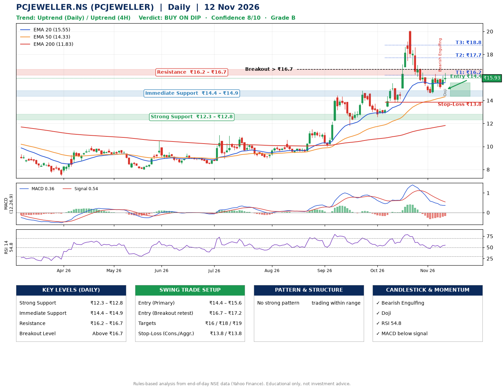

📌 **PCJEWELLER.NS (PCJEWELLER) – Multi-Timeframe Technical Analysis (Daily + 4H Combined)**
_Data up to 12 Nov 2026 · Close ₹15.93_

**📍 Daily Timeframe Trend**
- Trend: **Uptrend** (higher highs and higher lows)
- Recent swing highs: ₹14.4, ₹14.9, ₹20.1 · swing lows: ₹11.8, ₹12.6, ₹14.6
- EMAs: EMA20 ₹15.6, EMA50 ₹14.3, EMA200 ₹11.8; bullish stack (EMA20 > EMA50 > EMA200); price above EMA20, EMA50, EMA200
- MACD 0.36 below signal 0.54 (above zero); histogram rising
- RSI(14) 54.8; no divergence on the last two swings

**📍 4-Hour Timeframe Trend**
- Structure: **Uptrend** (price above rising EMAs)
- Pullback/support area: recent 4H swing lows ₹14.6, ₹15.1; EMA20 ₹15.8
- EMA20/50: bullish stack (EMA20 > EMA50); price above EMA20, EMA50
- MACD -0.00 above signal -0.05 (below zero), fresh bullish crossover; histogram rising
- RSI(14) 51.9; Hidden bullish divergence

**📍 Pattern Detection (Both Timeframes)**
- 4H: **Ascending Triangle** – converging swing highs and lows over the last ~60 sessions

**📍 Candlestick Patterns (last 3 daily candles)**
- **Bearish Engulfing** – 09 Nov: sellers fully reversed the prior green candle
- **Doji** – 12 Nov: indecision; wait for the next candle to confirm direction

**📍 Price Action Key Levels (Daily Structure)**

| Zone | Price Level (₹) | Context |
|------|-----------------|---------|
| Strong Support | ₹12.3 – ₹12.8 | Cluster of earlier swing lows (demand) |
| Immediate Support | ₹14.4 – ₹14.9 | Nearest swing-low / wick area |
| Resistance | ₹16.2 – ₹16.7 | Nearest swing-high supply |
| Breakout Level | Above ₹16.7 | Swing continuation trigger (52-week high ₹20.1) |

**📍 Swing Trade Setup**

🟢 **Entry Zone**
- Primary: ₹14.4 – ₹15.6 (daily support / EMA20 area; enter on a bullish 4H candle)
- Alternate: ₹16.7 – ₹17.2 (breakout retest)

🎯 **Profit Targets**
- T1: ₹16.2
- T2: ₹17.7
- T3: ₹18.8

🛑 **Stop-Loss**
- Conservative: below daily swing low (₹13.8)
- Aggressive: below 4H structure (₹13.8)
- Risk per share ≈ ₹1.1; reward:risk to T1 ≈ 1.1
- Time to T1: about 8 trading days (it rose this much within 60 trading days 70% of the time in the last 2 years)
- Time to T2: about 18 trading days (it rose this much within 60 trading days 42% of the time in the last 2 years)

**📌 Strategy Notes**
- Higher timeframe: daily trend is uptrend; only take longs while price holds above ₹12.3.
- Entry timing: wait for a bullish 4H candle (engulfing/hammer) inside ₹14.4 – ₹15.6 rather than buying mid-range.
- EMA stacking: bullish stack (EMA20 > EMA50 > EMA200); price above EMA20, EMA50, EMA200.
- Breakout rule: a daily close above ₹16.7 with volume above its 20-day average (≈504,547,833) opens T2/T3.
- Momentum: RSI 55 – room to run; no divergence on the last two swings.
- Exit discipline: move the stop to entry once T1 is hit; book partial profits at each target.

**STEP 2 — Marked Up Chart**

**✅ Trade Validation Checklist**
- Trend + momentum aligned: No · Price at entry zone: No
- Stop defined (₹13.8) · Reward:risk ≥ 1.5 to T1: No

## 📌 Final Verdict

Recommendation: **🟡 BUY ON DIP**

Confidence: **8/10**

Trade Quality: **B**

Reason:
• Daily uptrend (higher highs and higher lows)
• EMAs stacked bullishly

Next Action:
• Wait for a pullback to ₹14.4–₹15.6, or a breakout above ₹16.7

_Rules-based analysis from end-of-day data. Educational only, not investment advice. Never place orders without your own confirmation._