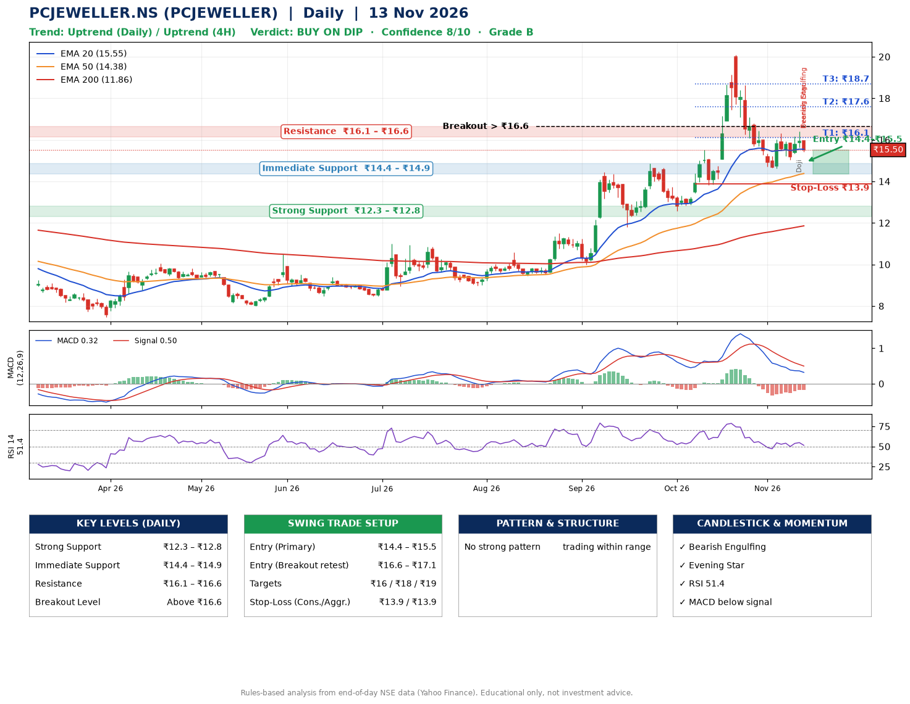

📌 **PCJEWELLER.NS (PCJEWELLER) – Multi-Timeframe Technical Analysis (Daily + 4H Combined)**
_Data up to 13 Nov 2026 · Close ₹15.50_

**📍 Daily Timeframe Trend**
- Trend: **Uptrend** (higher highs and higher lows)
- Recent swing highs: ₹14.4, ₹14.9, ₹20.1 · swing lows: ₹11.8, ₹12.6, ₹14.6
- EMAs: EMA20 ₹15.5, EMA50 ₹14.4, EMA200 ₹11.9; bullish stack (EMA20 > EMA50 > EMA200); price above EMA50, EMA200
- MACD 0.32 below signal 0.50 (above zero); histogram rising
- RSI(14) 51.4; no divergence on the last two swings

**📍 4-Hour Timeframe Trend**
- Structure: **Uptrend** (higher highs and higher lows)
- Pullback/support area: recent 4H swing lows ₹14.6, ₹15.1; EMA20 ₹15.7
- EMA20/50: bullish stack (EMA20 > EMA50); price above EMA50
- MACD -0.03 above signal -0.04 (below zero), fresh bullish crossover; histogram falling
- RSI(14) 48.1; Hidden bullish divergence

**📍 Pattern Detection (Both Timeframes)**
- 4H: **Symmetrical Triangle** – converging swing highs and lows over the last ~60 sessions

**📍 Candlestick Patterns (last 3 daily candles)**
- **Doji** – 12 Nov: indecision; wait for the next candle to confirm direction
- **Bearish Engulfing** – 13 Nov: sellers fully reversed the prior green candle
- **Evening Star** – 13 Nov: three-candle bearish reversal

**📍 Price Action Key Levels (Daily Structure)**

| Zone | Price Level (₹) | Context |
|------|-----------------|---------|
| Strong Support | ₹12.3 – ₹12.8 | Cluster of earlier swing lows (demand) |
| Immediate Support | ₹14.4 – ₹14.9 | Nearest swing-low / wick area |
| Resistance | ₹16.1 – ₹16.6 | Nearest swing-high supply |
| Breakout Level | Above ₹16.6 | Swing continuation trigger (52-week high ₹20.1) |

**📍 Swing Trade Setup**

🟢 **Entry Zone**
- Primary: ₹14.4 – ₹15.5 (daily support / EMA20 area; enter on a bullish 4H candle)
- Alternate: ₹16.6 – ₹17.1 (breakout retest)

🎯 **Profit Targets**
- T1: ₹16.1
- T2: ₹17.6
- T3: ₹18.7

🛑 **Stop-Loss**
- Conservative: below daily swing low (₹13.9)
- Aggressive: below 4H structure (₹13.9)
- Risk per share ≈ ₹1.1; reward:risk to T1 ≈ 1.1
- Time to T1: about 7 trading days (it rose this much within 60 trading days 71% of the time in the last 2 years)
- Time to T2: about 17 trading days (it rose this much within 60 trading days 43% of the time in the last 2 years)

**📌 Strategy Notes**
- Higher timeframe: daily trend is uptrend; only take longs while price holds above ₹12.3.
- Entry timing: wait for a bullish 4H candle (engulfing/hammer) inside ₹14.4 – ₹15.5 rather than buying mid-range.
- EMA stacking: bullish stack (EMA20 > EMA50 > EMA200); price above EMA50, EMA200.
- Breakout rule: a daily close above ₹16.6 with volume above its 20-day average (≈495,707,134) opens T2/T3.
- Momentum: RSI 51 – room to run; no divergence on the last two swings.
- Exit discipline: move the stop to entry once T1 is hit; book partial profits at each target.

**STEP 2 — Marked Up Chart**

**✅ Trade Validation Checklist**
- Trend + momentum aligned: No · Price at entry zone: Yes
- Stop defined (₹13.9) · Reward:risk ≥ 1.5 to T1: No

## 📌 Final Verdict

Recommendation: **🟡 BUY ON DIP**

Confidence: **8/10**

Trade Quality: **B**

Reason:
• Daily uptrend (higher highs and higher lows)
• EMAs stacked bullishly

Next Action:
• Wait for a pullback to ₹14.4–₹15.5, or a breakout above ₹16.6

_Rules-based analysis from end-of-day data. Educational only, not investment advice. Never place orders without your own confirmation._