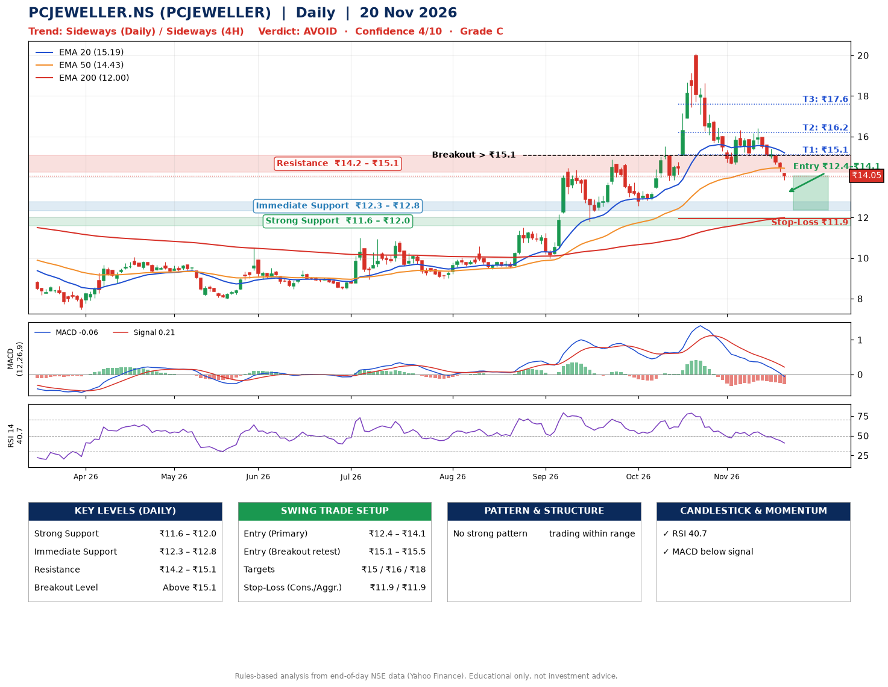

📌 **PCJEWELLER.NS (PCJEWELLER) – Multi-Timeframe Technical Analysis (Daily + 4H Combined)**
_Data up to 20 Nov 2026 · Close ₹14.05_

**📍 Daily Timeframe Trend**
- Trend: **Sideways** (mixed swing structure)
- Recent swing highs: ₹14.9, ₹20.1, ₹16.4 · swing lows: ₹11.8, ₹12.6, ₹14.6
- EMAs: EMA20 ₹15.2, EMA50 ₹14.4, EMA200 ₹12.0; bullish stack (EMA20 > EMA50 > EMA200); price above EMA200
- MACD -0.06 below signal 0.21 (below zero); histogram falling
- RSI(14) 40.7; no divergence on the last two swings

**📍 4-Hour Timeframe Trend**
- Structure: **Sideways** (mixed swing structure)
- Pullback/support area: recent 4H swing lows ₹14.6, ₹15.1; EMA20 ₹15.0
- EMA20/50: bearish stack (EMA20 < EMA50); price below all EMAs
- MACD -0.38 below signal -0.25 (below zero); histogram falling
- RSI(14) 33.5; Hidden bullish divergence

**📍 Pattern Detection (Both Timeframes)**
- 4H: **Symmetrical Triangle** – converging swing highs and lows over the last ~60 sessions

**📍 Candlestick Patterns (last 3 daily candles)**
- No notable candlestick signal in the last 3 sessions.

**📍 Price Action Key Levels (Daily Structure)**

| Zone | Price Level (₹) | Context |
|------|-----------------|---------|
| Strong Support | ₹11.6 – ₹12.0 | Cluster of earlier swing lows (demand) |
| Immediate Support | ₹12.3 – ₹12.8 | Nearest swing-low / wick area |
| Resistance | ₹14.2 – ₹15.1 | Nearest swing-high supply |
| Breakout Level | Above ₹15.1 | Swing continuation trigger (52-week high ₹20.1) |

**📍 Swing Trade Setup**

🟢 **Entry Zone**
- Primary: ₹12.4 – ₹14.1 (daily support / EMA20 area; enter on a bullish 4H candle)
- Alternate: ₹15.1 – ₹15.5 (breakout retest)

🎯 **Profit Targets**
- T1: ₹15.1
- T2: ₹16.2
- T3: ₹17.6

🛑 **Stop-Loss**
- Conservative: below daily swing low (₹11.9)
- Aggressive: below 4H structure (₹11.9)
- Risk per share ≈ ₹1.3; reward:risk to T1 ≈ 1.5
- Time to T1: about 13 trading days (it rose this much within 60 trading days 56% of the time in the last 2 years)
- Time to T2: about 21 trading days (it rose this much within 60 trading days 37% of the time in the last 2 years)

**📌 Strategy Notes**
- Higher timeframe: daily trend is sideways; only take longs while price holds above ₹11.6.
- Entry timing: wait for a bullish 4H candle (engulfing/hammer) inside ₹12.4 – ₹14.1 rather than buying mid-range.
- EMA stacking: bullish stack (EMA20 > EMA50 > EMA200); price above EMA200.
- Breakout rule: a daily close above ₹15.1 with volume above its 20-day average (≈404,458,638) opens T2/T3.
- Momentum: RSI 41 – room to run; no divergence on the last two swings.
- Exit discipline: move the stop to entry once T1 is hit; book partial profits at each target.

**STEP 2 — Marked Up Chart**

**✅ Trade Validation Checklist**
- Trend + momentum aligned: No · Price at entry zone: Yes
- Stop defined (₹11.9) · Reward:risk ≥ 1.5 to T1: No

## 📌 Final Verdict

Recommendation: **🔴 AVOID**

Confidence: **4/10**

Trade Quality: **C**

Reason:
• Sharp pullback: 14% below the recent ₹16.4 high
• EMAs stacked bullishly

Next Action:
• Avoid until the trend changes (reclaim EMA50 and a higher low)

_Rules-based analysis from end-of-day data. Educational only, not investment advice. Never place orders without your own confirmation._