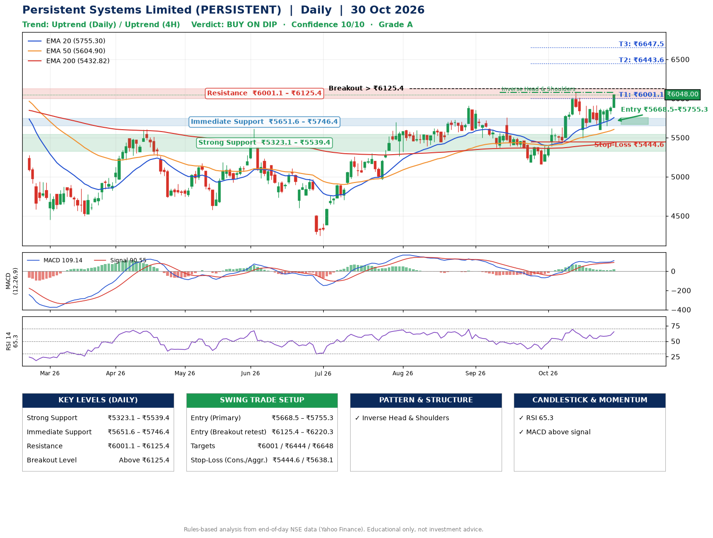

📌 **Persistent Systems Limited (PERSISTENT) – Multi-Timeframe Technical Analysis (Daily + 4H Combined)**
_Data up to 30 Oct 2026 · Close ₹6048.00_

**📍 Daily Timeframe Trend**
- Trend: **Uptrend** (higher highs and higher lows)
- Recent swing highs: ₹5910.0, ₹5759.0, ₹6078.0 · swing lows: ₹5370.5, ₹5162.0, ₹5492.0
- EMAs: EMA20 ₹5755.3, EMA50 ₹5604.9, EMA200 ₹5432.8; bullish stack (EMA20 > EMA50 > EMA200); price above EMA20, EMA50, EMA200
- MACD 109.14 above signal 90.55 (above zero); histogram rising
- RSI(14) 65.3; no divergence on the last two swings

**📍 4-Hour Timeframe Trend**
- Structure: **Uptrend** (higher highs and higher lows)
- Pullback/support area: recent 4H swing lows ₹5610.5, ₹5650.0; EMA20 ₹5834.3
- EMA20/50: bullish stack (EMA20 > EMA50); price above EMA20, EMA50
- MACD 75.66 above signal 61.87 (above zero), fresh bullish crossover; histogram rising
- RSI(14) 68.7; no divergence

**📍 Pattern Detection (Both Timeframes)**
- Daily: **Inverse Head & Shoulders** – head ₹5162.0, neckline ₹6078.0
- 4H: **Symmetrical Triangle** – converging swing highs and lows over the last ~60 sessions

**📍 Candlestick Patterns (last 3 daily candles)**
- No notable candlestick signal in the last 3 sessions.

**📍 Price Action Key Levels (Daily Structure)**

| Zone | Price Level (₹) | Context |
|------|-----------------|---------|
| Strong Support | ₹5323.1 – ₹5539.4 | Cluster of earlier swing lows (demand) |
| Immediate Support | ₹5651.6 – ₹5746.4 | Nearest swing-low / wick area |
| Resistance | ₹6001.1 – ₹6125.4 | Nearest swing-high supply |
| Breakout Level | Above ₹6125.4 | Swing continuation trigger (52-week high ₹6599.0) |

**📍 Swing Trade Setup**

🟢 **Entry Zone**
- Primary: ₹5668.5 – ₹5755.3 (daily support / EMA20 area; enter on a bullish 4H candle)
- Alternate: ₹6125.4 – ₹6220.3 (breakout retest)

🎯 **Profit Targets**
- T1: ₹6001.1
- T2: ₹6443.6
- T3: ₹6647.5

🛑 **Stop-Loss**
- Conservative: below daily swing low (₹5444.6)
- Aggressive: below 4H structure (₹5638.1)
- Risk per share ≈ ₹267.3; reward:risk to T1 ≈ 1.1

**📌 Strategy Notes**
- Higher timeframe: daily trend is uptrend; only take longs while price holds above ₹5323.1.
- Entry timing: wait for a bullish 4H candle (engulfing/hammer) inside ₹5668.5 – ₹5755.3 rather than buying mid-range.
- EMA stacking: bullish stack (EMA20 > EMA50 > EMA200); price above EMA20, EMA50, EMA200.
- Breakout rule: a daily close above ₹6125.4 with volume above its 20-day average (≈793,742) opens T2/T3.
- Momentum: RSI 65 – elevated, prefer dips; no divergence on the last two swings.
- Exit discipline: move the stop to entry once T1 is hit; book partial profits at each target.

**STEP 2 — Marked Up Chart**

**✅ Trade Validation Checklist**
- Trend + momentum aligned: Yes · Price at entry zone: No
- Stop defined (₹5444.6) · Reward:risk ≥ 1.5 to T1: No

## 📌 Final Verdict

Recommendation: **🟡 BUY ON DIP**

Confidence: **10/10**

Trade Quality: **A**

Reason:
• Daily uptrend (higher highs and higher lows)
• EMAs stacked bullishly

Next Action:
• Wait for a pullback to ₹5668.5–₹5755.3

_Rules-based analysis from end-of-day data. Educational only, not investment advice. Never place orders without your own confirmation._