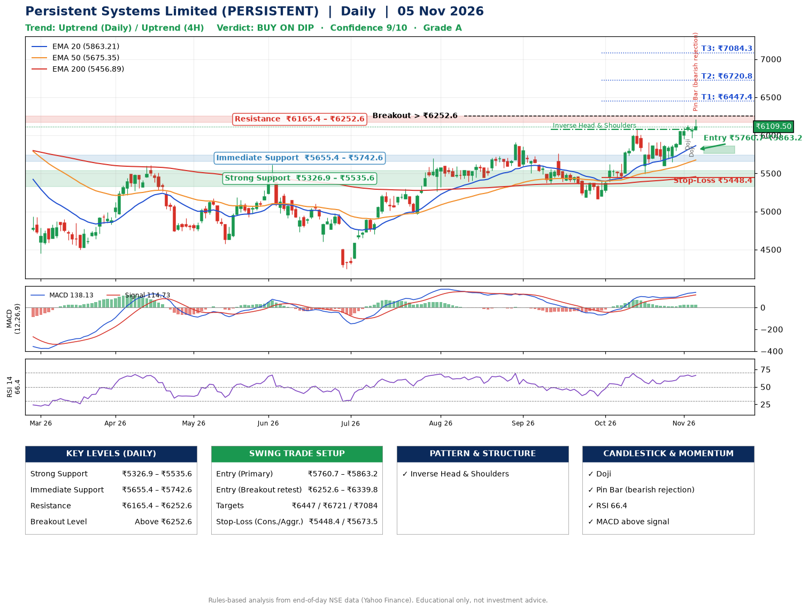

📌 **Persistent Systems Limited (PERSISTENT) – Multi-Timeframe Technical Analysis (Daily + 4H Combined)**
_Data up to 05 Nov 2026 · Close ₹6109.50_

**📍 Daily Timeframe Trend**
- Trend: **Uptrend** (higher highs and higher lows)
- Recent swing highs: ₹5910.0, ₹5759.0, ₹6078.0 · swing lows: ₹5370.5, ₹5162.0, ₹5492.0
- EMAs: EMA20 ₹5863.2, EMA50 ₹5675.4, EMA200 ₹5456.9; bullish stack (EMA20 > EMA50 > EMA200); price above EMA20, EMA50, EMA200
- MACD 138.13 above signal 114.73 (above zero); histogram falling
- RSI(14) 66.4; no divergence on the last two swings

**📍 4-Hour Timeframe Trend**
- Structure: **Uptrend** (higher highs and higher lows)
- Pullback/support area: recent 4H swing lows ₹5650.0, ₹5963.0; EMA20 ₹5971.7
- EMA20/50: bullish stack (EMA20 > EMA50); price above EMA20, EMA50
- MACD 99.29 above signal 91.18 (above zero); histogram falling
- RSI(14) 63.4; Hidden bullish divergence

**📍 Pattern Detection (Both Timeframes)**
- Daily: **Inverse Head & Shoulders** – head ₹5162.0, neckline ₹6078.0

**📍 Candlestick Patterns (last 3 daily candles)**
- **Doji** – 03 Nov: indecision; wait for the next candle to confirm direction
- **Doji** – 04 Nov: indecision; wait for the next candle to confirm direction
- **Pin Bar (bearish rejection)** – 05 Nov: long upper wick shows selling near ₹6209.0

**📍 Price Action Key Levels (Daily Structure)**

| Zone | Price Level (₹) | Context |
|------|-----------------|---------|
| Strong Support | ₹5326.9 – ₹5535.6 | Cluster of earlier swing lows (demand) |
| Immediate Support | ₹5655.4 – ₹5742.6 | Nearest swing-low / wick area |
| Resistance | ₹6165.4 – ₹6252.6 | Nearest swing-high supply |
| Breakout Level | Above ₹6252.6 | Swing continuation trigger (52-week high ₹6599.0) |

**📍 Swing Trade Setup**

🟢 **Entry Zone**
- Primary: ₹5760.7 – ₹5863.2 (daily support / EMA20 area; enter on a bullish 4H candle)
- Alternate: ₹6252.6 – ₹6339.8 (breakout retest)

🎯 **Profit Targets**
- T1: ₹6447.4
- T2: ₹6720.8
- T3: ₹7084.3

🛑 **Stop-Loss**
- Conservative: below daily swing low (₹5448.4)
- Aggressive: below 4H structure (₹5673.5)
- Risk per share ≈ ₹363.5; reward:risk to T1 ≈ 1.7

**📌 Strategy Notes**
- Higher timeframe: daily trend is uptrend; only take longs while price holds above ₹5326.9.
- Entry timing: wait for a bullish 4H candle (engulfing/hammer) inside ₹5760.7 – ₹5863.2 rather than buying mid-range.
- EMA stacking: bullish stack (EMA20 > EMA50 > EMA200); price above EMA20, EMA50, EMA200.
- Breakout rule: a daily close above ₹6252.6 with volume above its 20-day average (≈813,859) opens T2/T3.
- Momentum: RSI 66 – elevated, prefer dips; no divergence on the last two swings.
- Exit discipline: move the stop to entry once T1 is hit; book partial profits at each target.

**STEP 2 — Marked Up Chart**

**✅ Trade Validation Checklist**
- Trend + momentum aligned: Yes · Price at entry zone: No
- Stop defined (₹5448.4) · Reward:risk ≥ 1.5 to T1: Yes

## 📌 Final Verdict

Recommendation: **🟡 BUY ON DIP**

Confidence: **9/10**

Trade Quality: **A**

Reason:
• Daily uptrend (higher highs and higher lows)
• EMAs stacked bullishly

Next Action:
• Wait for a pullback to ₹5760.7–₹5863.2

_Rules-based analysis from end-of-day data. Educational only, not investment advice. Never place orders without your own confirmation._