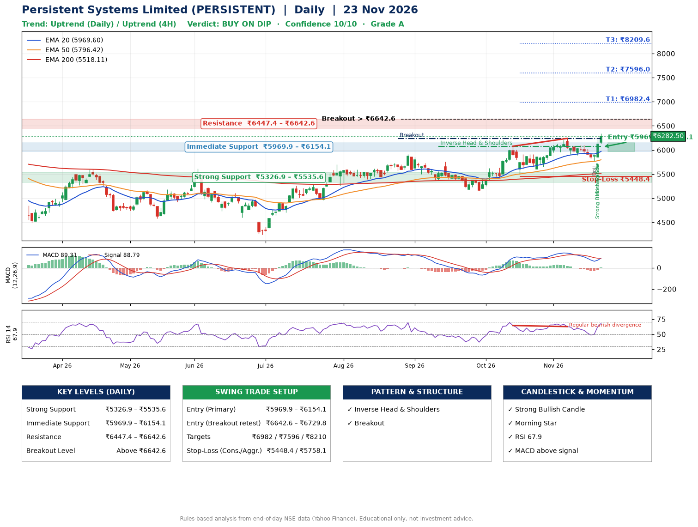

📌 **Persistent Systems Limited (PERSISTENT) – Multi-Timeframe Technical Analysis (Daily + 4H Combined)**
_Data up to 23 Nov 2026 · Close ₹6282.50_

**📍 Daily Timeframe Trend**
- Trend: **Uptrend** (higher highs and higher lows)
- Recent swing highs: ₹5759.0, ₹6078.0, ₹6240.0 · swing lows: ₹5370.5, ₹5162.0, ₹5492.0
- EMAs: EMA20 ₹5969.6, EMA50 ₹5796.4, EMA200 ₹5518.1; bullish stack (EMA20 > EMA50 > EMA200); price above EMA20, EMA50, EMA200
- MACD 89.31 above signal 88.79 (above zero), fresh bullish crossover; histogram rising
- RSI(14) 67.9; Regular bearish divergence

**📍 4-Hour Timeframe Trend**
- Structure: **Uptrend** (price above rising EMAs)
- Pullback/support area: recent 4H swing lows ₹5900.0, ₹5769.0; EMA20 ₹6029.4
- EMA20/50: bullish stack (EMA20 > EMA50); price above EMA20, EMA50
- MACD 53.24 above signal 20.82 (above zero), fresh bullish crossover; histogram rising
- RSI(14) 69.6; no divergence

**📍 Pattern Detection (Both Timeframes)**
- Daily: **Inverse Head & Shoulders** – head ₹5162.0, neckline ₹6078.0
- Daily: **Breakout** – closed above the 60-session high ₹6240.0 on strong volume
- 4H: **Double Bottom** – bottoms near ₹5900.0/₹5769.0, neckline ₹6101.5, confirmed (closed above neckline)

**📍 Candlestick Patterns (last 3 daily candles)**
- **Doji** – 19 Nov: indecision; wait for the next candle to confirm direction
- **Strong Bullish Candle** – 20 Nov: wide-range green candle, buyers in control
- **Morning Star** – 20 Nov: three-candle bullish reversal

**📍 Price Action Key Levels (Daily Structure)**

| Zone | Price Level (₹) | Context |
|------|-----------------|---------|
| Strong Support | ₹5326.9 – ₹5535.6 | Cluster of earlier swing lows (demand) |
| Immediate Support | ₹5969.9 – ₹6154.1 | Nearest swing-low / wick area |
| Resistance | ₹6447.4 – ₹6642.6 | Nearest swing-high supply |
| Breakout Level | Above ₹6642.6 | Swing continuation trigger (52-week high ₹6599.0) |

**📍 Swing Trade Setup**

🟢 **Entry Zone**
- Primary: ₹5969.9 – ₹6154.1 (daily support / EMA20 area; enter on a bullish 4H candle)
- Alternate: ₹6642.6 – ₹6729.8 (breakout retest)

🎯 **Profit Targets**
- T1: ₹6982.4
- T2: ₹7596.0
- T3: ₹8209.6

🛑 **Stop-Loss**
- Conservative: below daily swing low (₹5448.4)
- Aggressive: below 4H structure (₹5758.1)
- Risk per share ≈ ₹613.6; reward:risk to T1 ≈ 1.5
- Time to T1: about 31 trading days (it rose this much within 60 trading days 35% of the time in the last 2 years)
- Time to T2: about 33 trading days (it rose this much within 60 trading days 6% of the time in the last 2 years)

**📌 Strategy Notes**
- Higher timeframe: daily trend is uptrend; only take longs while price holds above ₹5326.9.
- Entry timing: wait for a bullish 4H candle (engulfing/hammer) inside ₹5969.9 – ₹6154.1 rather than buying mid-range.
- EMA stacking: bullish stack (EMA20 > EMA50 > EMA200); price above EMA20, EMA50, EMA200.
- Breakout rule: a daily close above ₹6642.6 with volume above its 20-day average (≈608,898) opens T2/T3.
- Momentum: RSI 68 – elevated, prefer dips; Regular bearish divergence.
- Exit discipline: move the stop to entry once T1 is hit; book partial profits at each target.

**STEP 2 — Marked Up Chart**

**✅ Trade Validation Checklist**
- Trend + momentum aligned: Yes · Price at entry zone: No
- Stop defined (₹5448.4) · Reward:risk ≥ 1.5 to T1: Yes

## 📌 Final Verdict

Recommendation: **🟡 BUY ON DIP**

Confidence: **10/10**

Trade Quality: **A**

Reason:
• Daily uptrend (higher highs and higher lows)
• EMAs stacked bullishly

Next Action:
• Wait for a pullback to ₹5969.9–₹6154.1, or a breakout above ₹6642.6

_Rules-based analysis from end-of-day data. Educational only, not investment advice. Never place orders without your own confirmation._