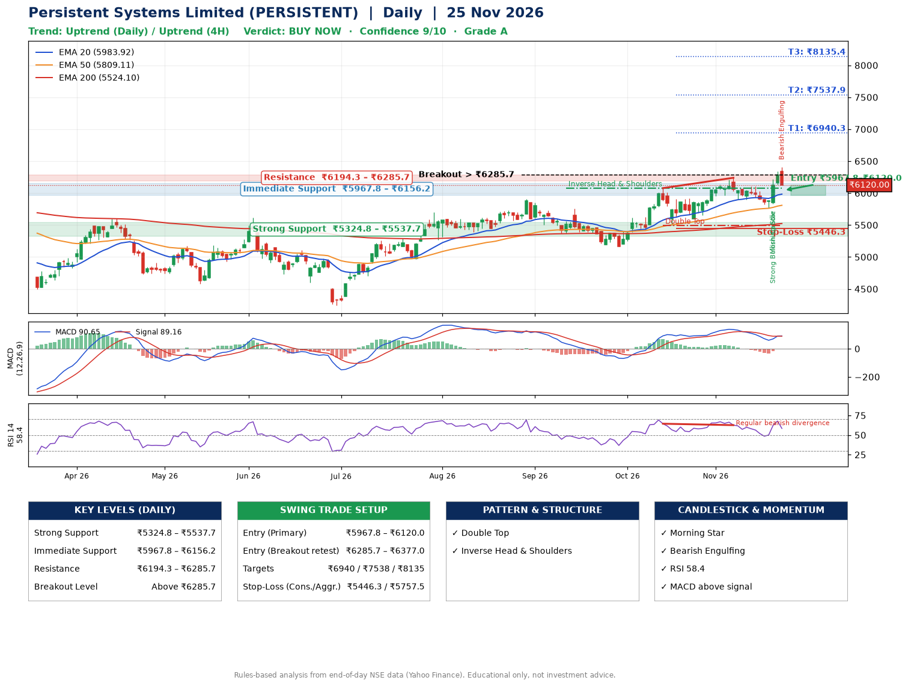

📌 **Persistent Systems Limited (PERSISTENT) – Multi-Timeframe Technical Analysis (Daily + 4H Combined)**
_Data up to 25 Nov 2026 · Close ₹6120.00_

**📍 Daily Timeframe Trend**
- Trend: **Uptrend** (higher highs and higher lows)
- Recent swing highs: ₹5759.0, ₹6078.0, ₹6240.0 · swing lows: ₹5370.5, ₹5162.0, ₹5492.0
- EMAs: EMA20 ₹5983.9, EMA50 ₹5809.1, EMA200 ₹5524.1; bullish stack (EMA20 > EMA50 > EMA200); price above EMA20, EMA50, EMA200
- MACD 90.65 above signal 89.16 (above zero), fresh bullish crossover; histogram rising
- RSI(14) 58.4; Regular bearish divergence

**📍 4-Hour Timeframe Trend**
- Structure: **Uptrend** (price above rising EMAs)
- Pullback/support area: recent 4H swing lows ₹5900.0, ₹5769.0; EMA20 ₹6048.4
- EMA20/50: bullish stack (EMA20 > EMA50); price above EMA20, EMA50
- MACD 55.41 above signal 33.39 (above zero), fresh bullish crossover; histogram falling
- RSI(14) 56.3; no divergence

**📍 Pattern Detection (Both Timeframes)**
- Daily: **Double Top** – tops near ₹6078.0/₹6240.0, neckline ₹5492.0, forming
- Daily: **Inverse Head & Shoulders** – head ₹5162.0, neckline ₹6078.0
- 4H: **Double Bottom** – bottoms near ₹5900.0/₹5769.0, neckline ₹6101.5, confirmed (closed above neckline)

**📍 Candlestick Patterns (last 3 daily candles)**
- **Strong Bullish Candle** – 20 Nov: wide-range green candle, buyers in control
- **Morning Star** – 20 Nov: three-candle bullish reversal
- **Bearish Engulfing** – 25 Nov: sellers fully reversed the prior green candle

**📍 Price Action Key Levels (Daily Structure)**

| Zone | Price Level (₹) | Context |
|------|-----------------|---------|
| Strong Support | ₹5324.8 – ₹5537.7 | Cluster of earlier swing lows (demand) |
| Immediate Support | ₹5967.8 – ₹6156.2 | Nearest swing-low / wick area |
| Resistance | ₹6194.3 – ₹6285.7 | Nearest swing-high supply |
| Breakout Level | Above ₹6285.7 | Swing continuation trigger (52-week high ₹6599.0) |

**📍 Swing Trade Setup**

🟢 **Entry Zone**
- Primary: ₹5967.8 – ₹6120.0 (daily support / EMA20 area; enter on a bullish 4H candle)
- Alternate: ₹6285.7 – ₹6377.0 (breakout retest)

🎯 **Profit Targets**
- T1: ₹6940.3
- T2: ₹7537.9
- T3: ₹8135.4

🛑 **Stop-Loss**
- Conservative: below daily swing low (₹5446.3)
- Aggressive: below 4H structure (₹5757.5)
- Risk per share ≈ ₹597.6; reward:risk to T1 ≈ 1.5
- Time to T1: about 29 trading days (it rose this much within 60 trading days 36% of the time in the last 2 years)
- Time to T2: about 33 trading days (it rose this much within 60 trading days 7% of the time in the last 2 years)

**📌 Strategy Notes**
- Higher timeframe: daily trend is uptrend; only take longs while price holds above ₹5324.8.
- Entry timing: wait for a bullish 4H candle (engulfing/hammer) inside ₹5967.8 – ₹6120.0 rather than buying mid-range.
- EMA stacking: bullish stack (EMA20 > EMA50 > EMA200); price above EMA20, EMA50, EMA200.
- Breakout rule: a daily close above ₹6285.7 with volume above its 20-day average (≈600,834) opens T2/T3.
- Momentum: RSI 58 – room to run; Regular bearish divergence.
- Exit discipline: move the stop to entry once T1 is hit; book partial profits at each target.

**STEP 2 — Marked Up Chart**

**✅ Trade Validation Checklist**
- Trend + momentum aligned: Yes · Price at entry zone: Yes
- Stop defined (₹5446.3) · Reward:risk ≥ 1.5 to T1: Yes

## 📌 Final Verdict

Recommendation: **🟢 BUY NOW**

Confidence: **9/10**

Trade Quality: **A**

Reason:
• Daily uptrend (higher highs and higher lows)
• EMAs stacked bullishly

Next Action:
• Buy now within the entry zone, with the stop-loss in place

_Rules-based analysis from end-of-day data. Educational only, not investment advice. Never place orders without your own confirmation._