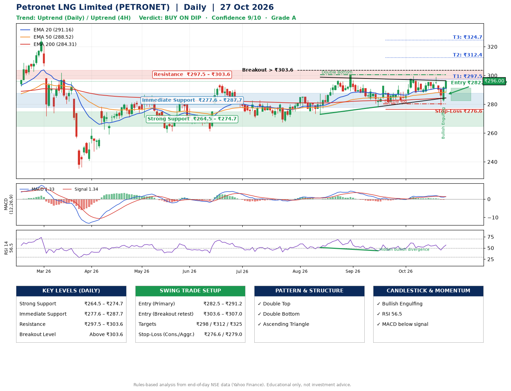

📌 **Petronet LNG Limited (PETRONET) – Multi-Timeframe Technical Analysis (Daily + 4H Combined)**
_Data up to 27 Oct 2026 · Close ₹296.00_

**📍 Daily Timeframe Trend**
- Trend: **Uptrend** (higher highs and higher lows)
- Recent swing highs: ₹300.6, ₹292.6, ₹299.6 · swing lows: ₹267.4, ₹273.0, ₹278.2
- EMAs: EMA20 ₹291.2, EMA50 ₹288.5, EMA200 ₹284.3; bullish stack (EMA20 > EMA50 > EMA200); price above EMA20, EMA50, EMA200
- MACD 1.33 below signal 1.34 (above zero), fresh bearish crossover; histogram rising
- RSI(14) 56.5; Hidden bullish divergence

**📍 4-Hour Timeframe Trend**
- Structure: **Uptrend** (price above rising EMAs)
- Pullback/support area: recent 4H swing lows ₹290.1, ₹279.5; EMA20 ₹291.2
- EMA20/50: bullish stack (EMA20 > EMA50); price above EMA20, EMA50
- MACD 0.22 above signal 0.15 (above zero), fresh bullish crossover; histogram rising
- RSI(14) 57.6; no divergence

**📍 Pattern Detection (Both Timeframes)**
- Daily: **Double Top** – tops near ₹292.6/₹299.6, neckline ₹280.3, forming
- Daily: **Double Bottom** – bottoms near ₹273.0/₹278.2, neckline ₹300.6, forming
- Daily: **Ascending Triangle** – converging swing highs and lows over the last ~60 sessions
- 4H: **Double Top** – tops near ₹299.5/₹299.2, neckline ₹288.0, forming

**📍 Candlestick Patterns (last 3 daily candles)**
- **Bullish Engulfing** – 26 Oct: buyers fully reversed the prior red candle

**📍 Price Action Key Levels (Daily Structure)**

| Zone | Price Level (₹) | Context |
|------|-----------------|---------|
| Strong Support | ₹264.5 – ₹274.7 | Cluster of earlier swing lows (demand) |
| Immediate Support | ₹277.6 – ₹287.7 | Nearest swing-low / wick area |
| Resistance | ₹297.5 – ₹303.6 | Nearest swing-high supply |
| Breakout Level | Above ₹303.6 | Swing continuation trigger (52-week high ₹326.4) |

**📍 Swing Trade Setup**

🟢 **Entry Zone**
- Primary: ₹282.5 – ₹291.2 (daily support / EMA20 area; enter on a bullish 4H candle)
- Alternate: ₹303.6 – ₹307.0 (breakout retest)

🎯 **Profit Targets**
- T1: ₹297.5
- T2: ₹312.4
- T3: ₹324.7

🛑 **Stop-Loss**
- Conservative: below daily swing low (₹276.6)
- Aggressive: below 4H structure (₹279.0)
- Risk per share ≈ ₹10.3; reward:risk to T1 ≈ 1.0

**📌 Strategy Notes**
- Higher timeframe: daily trend is uptrend; only take longs while price holds above ₹264.5.
- Entry timing: wait for a bullish 4H candle (engulfing/hammer) inside ₹282.5 – ₹291.2 rather than buying mid-range.
- EMA stacking: bullish stack (EMA20 > EMA50 > EMA200); price above EMA20, EMA50, EMA200.
- Breakout rule: a daily close above ₹303.6 with volume above its 20-day average (≈2,445,888) opens T2/T3.
- Momentum: RSI 56 – room to run; Hidden bullish divergence.
- Exit discipline: move the stop to entry once T1 is hit; book partial profits at each target.

**STEP 2 — Marked Up Chart**

**✅ Trade Validation Checklist**
- Trend + momentum aligned: No · Price at entry zone: No
- Stop defined (₹276.6) · Reward:risk ≥ 1.5 to T1: No

## 📌 Final Verdict

Recommendation: **🟡 BUY ON DIP**

Confidence: **9/10**

Trade Quality: **A**

Reason:
• Daily uptrend (higher highs and higher lows)
• EMAs stacked bullishly

Next Action:
• Wait for a pullback to ₹282.5–₹291.2, or a breakout above ₹303.6

_Rules-based analysis from end-of-day data. Educational only, not investment advice. Never place orders without your own confirmation._