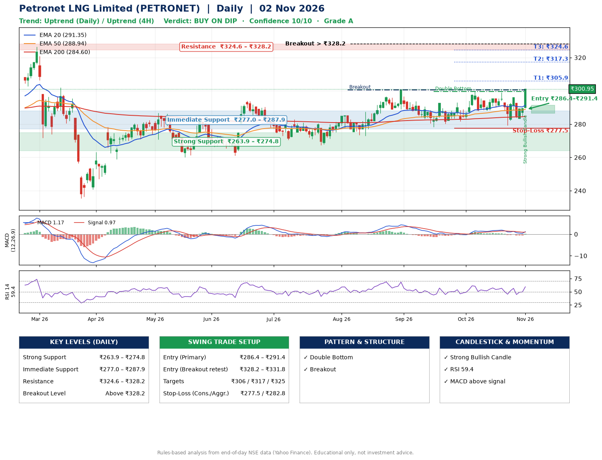

📌 **Petronet LNG Limited (PETRONET) – Multi-Timeframe Technical Analysis (Daily + 4H Combined)**
_Data up to 02 Nov 2026 · Close ₹300.95_

**📍 Daily Timeframe Trend**
- Trend: **Uptrend** (price above rising EMAs)
- Recent swing highs: ₹292.6, ₹299.6, ₹299.2 · swing lows: ₹273.0, ₹278.2, ₹279.4
- EMAs: EMA20 ₹291.4, EMA50 ₹288.9, EMA200 ₹284.6; bullish stack (EMA20 > EMA50 > EMA200); price above EMA20, EMA50, EMA200
- MACD 1.17 above signal 0.97 (above zero), fresh bullish crossover; histogram rising
- RSI(14) 59.4; no divergence on the last two swings

**📍 4-Hour Timeframe Trend**
- Structure: **Uptrend** (price above rising EMAs)
- Pullback/support area: recent 4H swing lows ₹279.5, ₹283.2; EMA20 ₹291.6
- EMA20/50: bullish stack (EMA20 > EMA50); price above EMA20, EMA50
- MACD 0.98 above signal -0.06 (above zero), fresh bullish crossover; histogram rising
- RSI(14) 62.4; no divergence

**📍 Pattern Detection (Both Timeframes)**
- Daily: **Double Bottom** – bottoms near ₹278.2/₹279.4, neckline ₹299.6, confirmed (closed above neckline)
- Daily: **Breakout** – closed above the 60-session high ₹300.6 on strong volume

**📍 Candlestick Patterns (last 3 daily candles)**
- **Strong Bullish Candle** – 02 Nov: wide-range green candle, buyers in control

**📍 Price Action Key Levels (Daily Structure)**

| Zone | Price Level (₹) | Context |
|------|-----------------|---------|
| Strong Support | ₹263.9 – ₹274.8 | Cluster of earlier swing lows (demand) |
| Immediate Support | ₹277.0 – ₹287.9 | Nearest swing-low / wick area |
| Resistance | ₹324.6 – ₹328.2 | Nearest swing-high supply |
| Breakout Level | Above ₹328.2 | Swing continuation trigger (52-week high ₹326.4) |

**📍 Swing Trade Setup**

🟢 **Entry Zone**
- Primary: ₹286.4 – ₹291.4 (daily support / EMA20 area; enter on a bullish 4H candle)
- Alternate: ₹328.2 – ₹331.8 (breakout retest)

🎯 **Profit Targets**
- T1: ₹305.9
- T2: ₹317.3
- T3: ₹324.6

🛑 **Stop-Loss**
- Conservative: below daily swing low (₹277.5)
- Aggressive: below 4H structure (₹282.8)
- Risk per share ≈ ₹11.4; reward:risk to T1 ≈ 1.5

**📌 Strategy Notes**
- Higher timeframe: daily trend is uptrend; only take longs while price holds above ₹263.9.
- Entry timing: wait for a bullish 4H candle (engulfing/hammer) inside ₹286.4 – ₹291.4 rather than buying mid-range.
- EMA stacking: bullish stack (EMA20 > EMA50 > EMA200); price above EMA20, EMA50, EMA200.
- Breakout rule: a daily close above ₹328.2 with volume above its 20-day average (≈2,460,087) opens T2/T3.
- Momentum: RSI 59 – room to run; no divergence on the last two swings.
- Exit discipline: move the stop to entry once T1 is hit; book partial profits at each target.

**STEP 2 — Marked Up Chart**

**✅ Trade Validation Checklist**
- Trend + momentum aligned: Yes · Price at entry zone: No
- Stop defined (₹277.5) · Reward:risk ≥ 1.5 to T1: No

## 📌 Final Verdict

Recommendation: **🟡 BUY ON DIP**

Confidence: **10/10**

Trade Quality: **A**

Reason:
• Daily uptrend (price above rising EMAs)
• EMAs stacked bullishly

Next Action:
• Wait for a pullback to ₹286.4–₹291.4

_Rules-based analysis from end-of-day data. Educational only, not investment advice. Never place orders without your own confirmation._