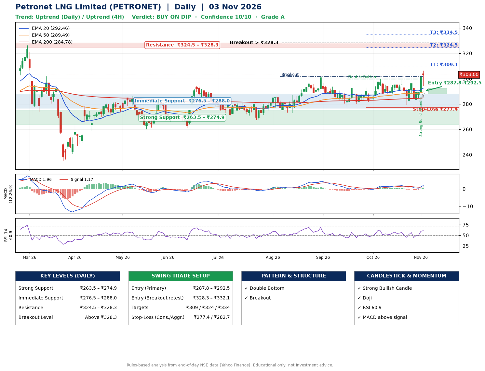

📌 **Petronet LNG Limited (PETRONET) – Multi-Timeframe Technical Analysis (Daily + 4H Combined)**
_Data up to 03 Nov 2026 · Close ₹303.00_

**📍 Daily Timeframe Trend**
- Trend: **Uptrend** (price above rising EMAs)
- Recent swing highs: ₹292.6, ₹299.6, ₹299.2 · swing lows: ₹273.0, ₹278.2, ₹279.4
- EMAs: EMA20 ₹292.5, EMA50 ₹289.5, EMA200 ₹284.8; bullish stack (EMA20 > EMA50 > EMA200); price above EMA20, EMA50, EMA200
- MACD 1.96 above signal 1.17 (above zero), fresh bullish crossover; histogram rising
- RSI(14) 60.9; no divergence on the last two swings

**📍 4-Hour Timeframe Trend**
- Structure: **Uptrend** (price above rising EMAs)
- Pullback/support area: recent 4H swing lows ₹279.5, ₹283.2; EMA20 ₹293.7
- EMA20/50: bullish stack (EMA20 > EMA50); price above EMA20, EMA50
- MACD 2.34 above signal 0.71 (above zero), fresh bullish crossover; histogram rising
- RSI(14) 64.3; no divergence

**📍 Pattern Detection (Both Timeframes)**
- Daily: **Double Bottom** – bottoms near ₹278.2/₹279.4, neckline ₹299.6, confirmed (closed above neckline)
- Daily: **Breakout** – closed above the 60-session high ₹301.4 on strong volume

**📍 Candlestick Patterns (last 3 daily candles)**
- **Strong Bullish Candle** – 02 Nov: wide-range green candle, buyers in control
- **Doji** – 03 Nov: indecision; wait for the next candle to confirm direction

**📍 Price Action Key Levels (Daily Structure)**

| Zone | Price Level (₹) | Context |
|------|-----------------|---------|
| Strong Support | ₹263.5 – ₹274.9 | Cluster of earlier swing lows (demand) |
| Immediate Support | ₹276.5 – ₹288.0 | Nearest swing-low / wick area |
| Resistance | ₹324.5 – ₹328.3 | Nearest swing-high supply |
| Breakout Level | Above ₹328.3 | Swing continuation trigger (52-week high ₹326.4) |

**📍 Swing Trade Setup**

🟢 **Entry Zone**
- Primary: ₹287.8 – ₹292.5 (daily support / EMA20 area; enter on a bullish 4H candle)
- Alternate: ₹328.3 – ₹332.1 (breakout retest)

🎯 **Profit Targets**
- T1: ₹309.1
- T2: ₹324.5
- T3: ₹334.5

🛑 **Stop-Loss**
- Conservative: below daily swing low (₹277.4)
- Aggressive: below 4H structure (₹282.7)
- Risk per share ≈ ₹12.7; reward:risk to T1 ≈ 1.5

**📌 Strategy Notes**
- Higher timeframe: daily trend is uptrend; only take longs while price holds above ₹263.5.
- Entry timing: wait for a bullish 4H candle (engulfing/hammer) inside ₹287.8 – ₹292.5 rather than buying mid-range.
- EMA stacking: bullish stack (EMA20 > EMA50 > EMA200); price above EMA20, EMA50, EMA200.
- Breakout rule: a daily close above ₹328.3 with volume above its 20-day average (≈2,619,972) opens T2/T3.
- Momentum: RSI 61 – room to run; no divergence on the last two swings.
- Exit discipline: move the stop to entry once T1 is hit; book partial profits at each target.

**STEP 2 — Marked Up Chart**

**✅ Trade Validation Checklist**
- Trend + momentum aligned: Yes · Price at entry zone: No
- Stop defined (₹277.4) · Reward:risk ≥ 1.5 to T1: No

## 📌 Final Verdict

Recommendation: **🟡 BUY ON DIP**

Confidence: **10/10**

Trade Quality: **A**

Reason:
• Daily uptrend (price above rising EMAs)
• EMAs stacked bullishly

Next Action:
• Wait for a pullback to ₹287.8–₹292.5

_Rules-based analysis from end-of-day data. Educational only, not investment advice. Never place orders without your own confirmation._