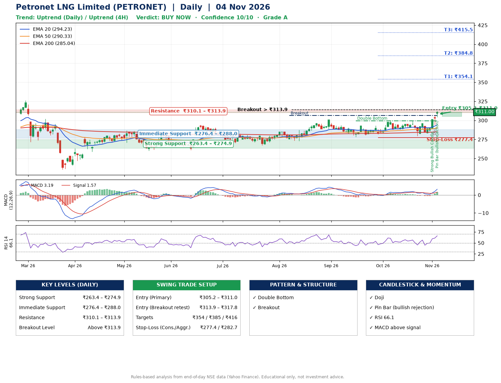

📌 **Petronet LNG Limited (PETRONET) – Multi-Timeframe Technical Analysis (Daily + 4H Combined)**
_Data up to 04 Nov 2026 · Close ₹311.00_

**📍 Daily Timeframe Trend**
- Trend: **Uptrend** (price above rising EMAs)
- Recent swing highs: ₹292.6, ₹299.6, ₹299.2 · swing lows: ₹273.0, ₹278.2, ₹279.4
- EMAs: EMA20 ₹294.2, EMA50 ₹290.3, EMA200 ₹285.0; bullish stack (EMA20 > EMA50 > EMA200); price above EMA20, EMA50, EMA200
- MACD 3.19 above signal 1.57 (above zero), fresh bullish crossover; histogram rising
- RSI(14) 66.1; no divergence on the last two swings

**📍 4-Hour Timeframe Trend**
- Structure: **Uptrend** (price above rising EMAs)
- Pullback/support area: recent 4H swing lows ₹279.5, ₹283.2; EMA20 ₹296.7
- EMA20/50: bullish stack (EMA20 > EMA50); price above EMA20, EMA50
- MACD 4.14 above signal 1.81 (above zero); histogram rising
- RSI(14) 71.0; no divergence

**📍 Pattern Detection (Both Timeframes)**
- Daily: **Double Bottom** – bottoms near ₹278.2/₹279.4, neckline ₹299.6, confirmed (closed above neckline)
- Daily: **Breakout** – closed above the 60-session high ₹306.4 on strong volume

**📍 Candlestick Patterns (last 3 daily candles)**
- **Strong Bullish Candle** – 02 Nov: wide-range green candle, buyers in control
- **Doji** – 03 Nov: indecision; wait for the next candle to confirm direction
- **Pin Bar (bullish rejection)** – 04 Nov: long lower wick shows dip-buying near ₹304.1

**📍 Price Action Key Levels (Daily Structure)**

| Zone | Price Level (₹) | Context |
|------|-----------------|---------|
| Strong Support | ₹263.4 – ₹274.9 | Cluster of earlier swing lows (demand) |
| Immediate Support | ₹276.4 – ₹288.0 | Nearest swing-low / wick area |
| Resistance | ₹310.1 – ₹313.9 | Nearest swing-high supply |
| Breakout Level | Above ₹313.9 | Swing continuation trigger (52-week high ₹326.4) |

**📍 Swing Trade Setup**

🟢 **Entry Zone**
- Primary: ₹305.2 – ₹311.0 (daily support / EMA20 area; enter on a bullish 4H candle)
- Alternate: ₹313.9 – ₹317.8 (breakout retest)

🎯 **Profit Targets**
- T1: ₹354.1
- T2: ₹384.8
- T3: ₹415.5

🛑 **Stop-Loss**
- Conservative: below daily swing low (₹277.4)
- Aggressive: below 4H structure (₹282.7)
- Risk per share ≈ ₹30.7; reward:risk to T1 ≈ 1.5

**📌 Strategy Notes**
- Higher timeframe: daily trend is uptrend; only take longs while price holds above ₹263.4.
- Entry timing: wait for a bullish 4H candle (engulfing/hammer) inside ₹305.2 – ₹311.0 rather than buying mid-range.
- EMA stacking: bullish stack (EMA20 > EMA50 > EMA200); price above EMA20, EMA50, EMA200.
- Breakout rule: a daily close above ₹313.9 with volume above its 20-day average (≈2,591,374) opens T2/T3.
- Momentum: RSI 66 – elevated, prefer dips; no divergence on the last two swings.
- Exit discipline: move the stop to entry once T1 is hit; book partial profits at each target.

**STEP 2 — Marked Up Chart**

**✅ Trade Validation Checklist**
- Trend + momentum aligned: Yes · Price at entry zone: Yes
- Stop defined (₹277.4) · Reward:risk ≥ 1.5 to T1: No

## 📌 Final Verdict

Recommendation: **🟢 BUY NOW**

Confidence: **10/10**

Trade Quality: **A**

Reason:
• Daily uptrend (price above rising EMAs)
• EMAs stacked bullishly

Next Action:
• Buy now within the entry zone, with the stop-loss in place

_Rules-based analysis from end-of-day data. Educational only, not investment advice. Never place orders without your own confirmation._