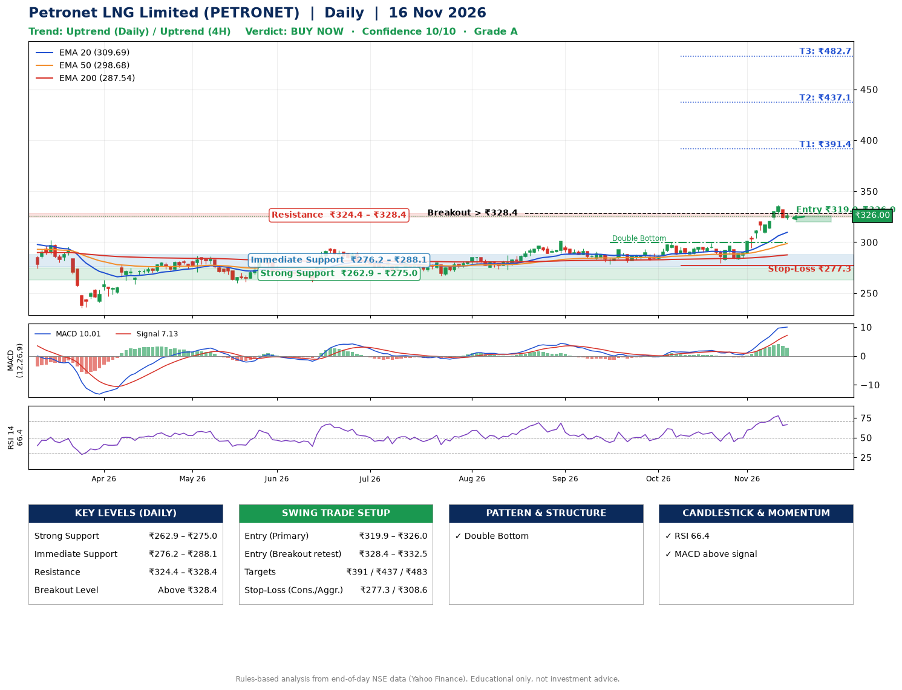

📌 **Petronet LNG Limited (PETRONET) – Multi-Timeframe Technical Analysis (Daily + 4H Combined)**
_Data up to 16 Nov 2026 · Close ₹326.00_

**📍 Daily Timeframe Trend**
- Trend: **Uptrend** (price above rising EMAs)
- Recent swing highs: ₹292.6, ₹299.6, ₹299.2 · swing lows: ₹273.0, ₹278.2, ₹279.4
- EMAs: EMA20 ₹309.7, EMA50 ₹298.7, EMA200 ₹287.5; bullish stack (EMA20 > EMA50 > EMA200); price above EMA20, EMA50, EMA200
- MACD 10.01 above signal 7.13 (above zero); histogram falling
- RSI(14) 66.4; no divergence on the last two swings

**📍 4-Hour Timeframe Trend**
- Structure: **Uptrend** (higher highs and higher lows)
- Pullback/support area: recent 4H swing lows ₹283.2, ₹309.1; EMA20 ₹318.4
- EMA20/50: bullish stack (EMA20 > EMA50); price above EMA20, EMA50
- MACD 8.59 below signal 8.60 (above zero), fresh bearish crossover; histogram falling
- RSI(14) 64.0; no divergence

**📍 Pattern Detection (Both Timeframes)**
- Daily: **Double Bottom** – bottoms near ₹278.2/₹279.4, neckline ₹299.6, confirmed (closed above neckline)

**📍 Candlestick Patterns (last 3 daily candles)**
- No notable candlestick signal in the last 3 sessions.

**📍 Price Action Key Levels (Daily Structure)**

| Zone | Price Level (₹) | Context |
|------|-----------------|---------|
| Strong Support | ₹262.9 – ₹275.0 | Cluster of earlier swing lows (demand) |
| Immediate Support | ₹276.2 – ₹288.1 | Nearest swing-low / wick area |
| Resistance | ₹324.4 – ₹328.4 | Nearest swing-high supply |
| Breakout Level | Above ₹328.4 | Swing continuation trigger (52-week high ₹336.3) |

**📍 Swing Trade Setup**

🟢 **Entry Zone**
- Primary: ₹319.9 – ₹326.0 (daily support / EMA20 area; enter on a bullish 4H candle)
- Alternate: ₹328.4 – ₹332.5 (breakout retest)

🎯 **Profit Targets**
- T1: ₹391.4
- T2: ₹437.1
- T3: ₹482.7

🛑 **Stop-Loss**
- Conservative: below daily swing low (₹277.3)
- Aggressive: below 4H structure (₹308.6)
- Risk per share ≈ ₹45.6; reward:risk to T1 ≈ 1.5
- Time to T1: about 53 trading days (it rose this much within 60 trading days 2% of the time in the last 2 years)
- Time to T2: it never rose this much within 60 trading days in the price history

**📌 Strategy Notes**
- Higher timeframe: daily trend is uptrend; only take longs while price holds above ₹262.9.
- Entry timing: wait for a bullish 4H candle (engulfing/hammer) inside ₹319.9 – ₹326.0 rather than buying mid-range.
- EMA stacking: bullish stack (EMA20 > EMA50 > EMA200); price above EMA20, EMA50, EMA200.
- Breakout rule: a daily close above ₹328.4 with volume above its 20-day average (≈3,367,729) opens T2/T3.
- Momentum: RSI 66 – elevated, prefer dips; no divergence on the last two swings.
- Exit discipline: move the stop to entry once T1 is hit; book partial profits at each target.

**STEP 2 — Marked Up Chart**

**✅ Trade Validation Checklist**
- Trend + momentum aligned: Yes · Price at entry zone: Yes
- Stop defined (₹277.3) · Reward:risk ≥ 1.5 to T1: No

## 📌 Final Verdict

Recommendation: **🟢 BUY NOW**

Confidence: **10/10**

Trade Quality: **A**

Reason:
• Daily uptrend (price above rising EMAs)
• EMAs stacked bullishly

Next Action:
• Buy now within the entry zone, with the stop-loss in place

_Rules-based analysis from end-of-day data. Educational only, not investment advice. Never place orders without your own confirmation._