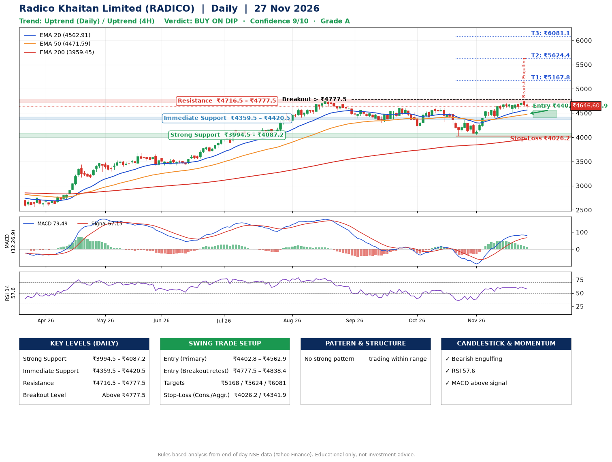

📌 **Radico Khaitan Limited (RADICO) – Multi-Timeframe Technical Analysis (Daily + 4H Combined)**
_Data up to 27 Nov 2026 · Close ₹4646.60_

**📍 Daily Timeframe Trend**
- Trend: **Uptrend** (price above rising EMAs)
- Recent swing highs: ₹4747.0, ₹4614.1, ₹4613.0 · swing lows: ₹4234.8, ₹4025.0, ₹4056.7
- EMAs: EMA20 ₹4562.9, EMA50 ₹4471.6, EMA200 ₹3959.5; bullish stack (EMA20 > EMA50 > EMA200); price above EMA20, EMA50, EMA200
- MACD 79.49 above signal 67.15 (above zero); histogram falling
- RSI(14) 57.6; no divergence on the last two swings

**📍 4-Hour Timeframe Trend**
- Structure: **Uptrend** (higher highs and higher lows)
- Pullback/support area: recent 4H swing lows ₹4502.2, ₹4591.7; EMA20 ₹4629.3
- EMA20/50: bullish stack (EMA20 > EMA50); price above EMA20, EMA50
- MACD 50.13 below signal 63.48 (above zero); histogram falling
- RSI(14) 56.2; Hidden bullish divergence

**📍 Pattern Detection (Both Timeframes)**
- 4H: **Double Top** – tops near ₹4703.2/₹4746.0, neckline ₹4502.2, forming

**📍 Candlestick Patterns (last 3 daily candles)**
- **Bearish Engulfing** – 26 Nov: sellers fully reversed the prior green candle

**📍 Price Action Key Levels (Daily Structure)**

| Zone | Price Level (₹) | Context |
|------|-----------------|---------|
| Strong Support | ₹3994.5 – ₹4087.2 | Cluster of earlier swing lows (demand) |
| Immediate Support | ₹4359.5 – ₹4420.5 | Nearest swing-low / wick area |
| Resistance | ₹4716.5 – ₹4777.5 | Nearest swing-high supply |
| Breakout Level | Above ₹4777.5 | Swing continuation trigger (52-week high ₹4747.0) |

**📍 Swing Trade Setup**

🟢 **Entry Zone**
- Primary: ₹4402.8 – ₹4562.9 (daily support / EMA20 area; enter on a bullish 4H candle)
- Alternate: ₹4777.5 – ₹4838.4 (breakout retest)

🎯 **Profit Targets**
- T1: ₹5167.8
- T2: ₹5624.4
- T3: ₹6081.1

🛑 **Stop-Loss**
- Conservative: below daily swing low (₹4026.2)
- Aggressive: below 4H structure (₹4341.9)
- Risk per share ≈ ₹456.6; reward:risk to T1 ≈ 1.5
- Time to T1: about 32 trading days (it rose this much within 60 trading days 58% of the time in the last 2 years)
- Time to T2: about 44 trading days (it rose this much within 60 trading days 29% of the time in the last 2 years)

**📌 Strategy Notes**
- Higher timeframe: daily trend is uptrend; only take longs while price holds above ₹3994.5.
- Entry timing: wait for a bullish 4H candle (engulfing/hammer) inside ₹4402.8 – ₹4562.9 rather than buying mid-range.
- EMA stacking: bullish stack (EMA20 > EMA50 > EMA200); price above EMA20, EMA50, EMA200.
- Breakout rule: a daily close above ₹4777.5 with volume above its 20-day average (≈419,093) opens T2/T3.
- Momentum: RSI 58 – room to run; no divergence on the last two swings.
- Exit discipline: move the stop to entry once T1 is hit; book partial profits at each target.

**STEP 2 — Marked Up Chart**

**✅ Trade Validation Checklist**
- Trend + momentum aligned: Yes · Price at entry zone: No
- Stop defined (₹4026.2) · Reward:risk ≥ 1.5 to T1: Yes

## 📌 Final Verdict

Recommendation: **🟡 BUY ON DIP**

Confidence: **9/10**

Trade Quality: **A**

Reason:
• Daily uptrend (price above rising EMAs)
• EMAs stacked bullishly

Next Action:
• Wait for a pullback to ₹4402.8–₹4562.9, or a breakout above ₹4777.5

_Rules-based analysis from end-of-day data. Educational only, not investment advice. Never place orders without your own confirmation._