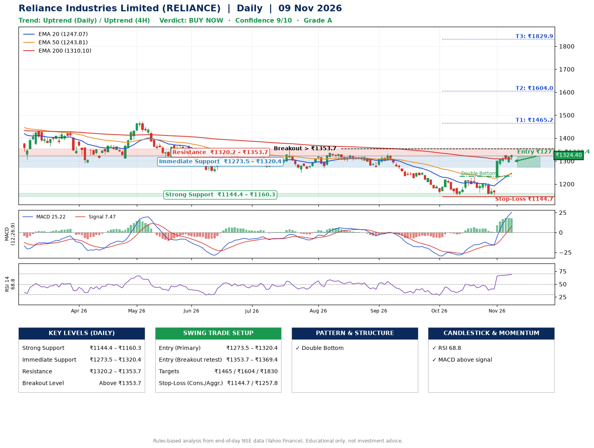

📌 **Reliance Industries Limited (RELIANCE) – Multi-Timeframe Technical Analysis (Daily + 4H Combined)**
_Data up to 09 Nov 2026 · Close ₹1324.40_

**📍 Daily Timeframe Trend**
- Trend: **Uptrend** (higher highs and higher lows)
- Recent swing highs: ₹1333.0, ₹1220.8, ₹1234.3 · swing lows: ₹1271.0, ₹1152.2, ₹1152.5
- EMAs: EMA20 ₹1247.1, EMA50 ₹1243.8, EMA200 ₹1310.1; mixed / crossing; price above EMA20, EMA50, EMA200
- MACD 25.22 above signal 7.47 (above zero); histogram falling
- RSI(14) 68.8; no divergence on the last two swings

**📍 4-Hour Timeframe Trend**
- Structure: **Uptrend** (higher highs and higher lows)
- Pullback/support area: recent 4H swing lows ₹1152.6, ₹1295.6; EMA20 ₹1271.3
- EMA20/50: bullish stack (EMA20 > EMA50); price above EMA20, EMA50
- MACD 34.89 above signal 28.17 (above zero); histogram falling
- RSI(14) 73.8; no divergence

**📍 Pattern Detection (Both Timeframes)**
- Daily: **Double Bottom** – bottoms near ₹1152.2/₹1152.5, neckline ₹1234.3, confirmed (closed above neckline)

**📍 Candlestick Patterns (last 3 daily candles)**
- No notable candlestick signal in the last 3 sessions.

**📍 Price Action Key Levels (Daily Structure)**

| Zone | Price Level (₹) | Context |
|------|-----------------|---------|
| Strong Support | ₹1144.4 – ₹1160.3 | Cluster of earlier swing lows (demand) |
| Immediate Support | ₹1273.5 – ₹1320.4 | Nearest swing-low / wick area |
| Resistance | ₹1320.2 – ₹1353.7 | Nearest swing-high supply |
| Breakout Level | Above ₹1353.7 | Swing continuation trigger (52-week high ₹1611.8) |

**📍 Swing Trade Setup**

🟢 **Entry Zone**
- Primary: ₹1273.5 – ₹1320.4 (daily support / EMA20 area; enter on a bullish 4H candle)
- Alternate: ₹1353.7 – ₹1369.4 (breakout retest)

🎯 **Profit Targets**
- T1: ₹1465.2
- T2: ₹1604.0
- T3: ₹1829.9

🛑 **Stop-Loss**
- Conservative: below daily swing low (₹1144.7)
- Aggressive: below 4H structure (₹1257.8)
- Risk per share ≈ ₹152.3; reward:risk to T1 ≈ 1.1

**📌 Strategy Notes**
- Higher timeframe: daily trend is uptrend; only take longs while price holds above ₹1144.4.
- Entry timing: wait for a bullish 4H candle (engulfing/hammer) inside ₹1273.5 – ₹1320.4 rather than buying mid-range.
- EMA stacking: mixed / crossing; price above EMA20, EMA50, EMA200.
- Breakout rule: a daily close above ₹1353.7 with volume above its 20-day average (≈21,349,112) opens T2/T3.
- Momentum: RSI 69 – elevated, prefer dips; no divergence on the last two swings.
- Exit discipline: move the stop to entry once T1 is hit; book partial profits at each target.

**STEP 2 — Marked Up Chart**

**✅ Trade Validation Checklist**
- Trend + momentum aligned: Yes · Price at entry zone: No
- Stop defined (₹1144.7) · Reward:risk ≥ 1.5 to T1: No

## 📌 Final Verdict

Recommendation: **🟢 BUY NOW**

Confidence: **9/10**

Trade Quality: **A**

Reason:
• Daily uptrend (higher highs and higher lows)
• Double Bottom: bottoms near ₹1152.2/₹1152.5, neckline ₹1234.3, confirmed (closed above neckline)

Next Action:
• Buy now within the entry zone, with the stop-loss in place

_Rules-based analysis from end-of-day data. Educational only, not investment advice. Never place orders without your own confirmation._