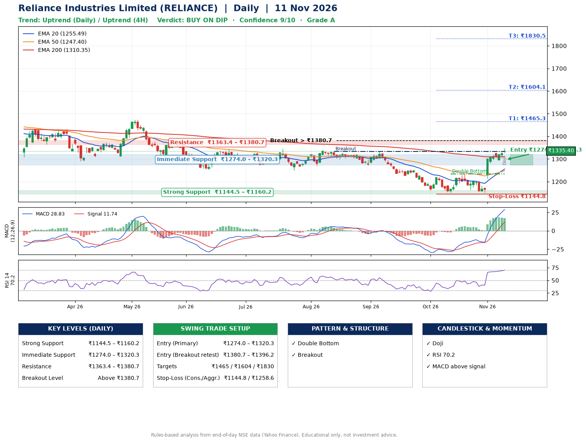

📌 **Reliance Industries Limited (RELIANCE) – Multi-Timeframe Technical Analysis (Daily + 4H Combined)**
_Data up to 11 Nov 2026 · Close ₹1335.40_

**📍 Daily Timeframe Trend**
- Trend: **Uptrend** (higher highs and higher lows)
- Recent swing highs: ₹1333.0, ₹1220.8, ₹1234.3 · swing lows: ₹1271.0, ₹1152.2, ₹1152.5
- EMAs: EMA20 ₹1255.5, EMA50 ₹1247.4, EMA200 ₹1310.3; mixed / crossing; price above EMA20, EMA50, EMA200
- MACD 28.83 above signal 11.74 (above zero); histogram falling
- RSI(14) 70.2; no divergence on the last two swings

**📍 4-Hour Timeframe Trend**
- Structure: **Uptrend** (higher highs and higher lows)
- Pullback/support area: recent 4H swing lows ₹1152.6, ₹1295.6; EMA20 ₹1283.2
- EMA20/50: bullish stack (EMA20 > EMA50); price above EMA20, EMA50
- MACD 35.91 above signal 30.94 (above zero); histogram falling
- RSI(14) 74.6; no divergence

**📍 Pattern Detection (Both Timeframes)**
- Daily: **Double Bottom** – bottoms near ₹1152.2/₹1152.5, neckline ₹1234.3, confirmed (closed above neckline)
- Daily: **Breakout** – closed above the 60-session high ₹1333.0 (volume not confirming yet)

**📍 Candlestick Patterns (last 3 daily candles)**
- **Doji** – 11 Nov: indecision; wait for the next candle to confirm direction

**📍 Price Action Key Levels (Daily Structure)**

| Zone | Price Level (₹) | Context |
|------|-----------------|---------|
| Strong Support | ₹1144.5 – ₹1160.2 | Cluster of earlier swing lows (demand) |
| Immediate Support | ₹1274.0 – ₹1320.3 | Nearest swing-low / wick area |
| Resistance | ₹1363.4 – ₹1380.7 | Nearest swing-high supply |
| Breakout Level | Above ₹1380.7 | Swing continuation trigger (52-week high ₹1611.8) |

**📍 Swing Trade Setup**

🟢 **Entry Zone**
- Primary: ₹1274.0 – ₹1320.3 (daily support / EMA20 area; enter on a bullish 4H candle)
- Alternate: ₹1380.7 – ₹1396.2 (breakout retest)

🎯 **Profit Targets**
- T1: ₹1465.3
- T2: ₹1604.1
- T3: ₹1830.5

🛑 **Stop-Loss**
- Conservative: below daily swing low (₹1144.8)
- Aggressive: below 4H structure (₹1258.6)
- Risk per share ≈ ₹152.4; reward:risk to T1 ≈ 1.1

**📌 Strategy Notes**
- Higher timeframe: daily trend is uptrend; only take longs while price holds above ₹1144.5.
- Entry timing: wait for a bullish 4H candle (engulfing/hammer) inside ₹1274.0 – ₹1320.3 rather than buying mid-range.
- EMA stacking: mixed / crossing; price above EMA20, EMA50, EMA200.
- Breakout rule: a daily close above ₹1380.7 with volume above its 20-day average (≈21,659,737) opens T2/T3.
- Momentum: RSI 70 – elevated, prefer dips; no divergence on the last two swings.
- Exit discipline: move the stop to entry once T1 is hit; book partial profits at each target.

**STEP 2 — Marked Up Chart**

**✅ Trade Validation Checklist**
- Trend + momentum aligned: Yes · Price at entry zone: No
- Stop defined (₹1144.8) · Reward:risk ≥ 1.5 to T1: No

## 📌 Final Verdict

Recommendation: **🟡 BUY ON DIP**

Confidence: **9/10**

Trade Quality: **A**

Reason:
• Daily uptrend (higher highs and higher lows)
• Double Bottom: bottoms near ₹1152.2/₹1152.5, neckline ₹1234.3, confirmed (closed above neckline)

Next Action:
• Wait for a pullback to ₹1274.0–₹1320.3, or a breakout above ₹1380.7

_Rules-based analysis from end-of-day data. Educational only, not investment advice. Never place orders without your own confirmation._