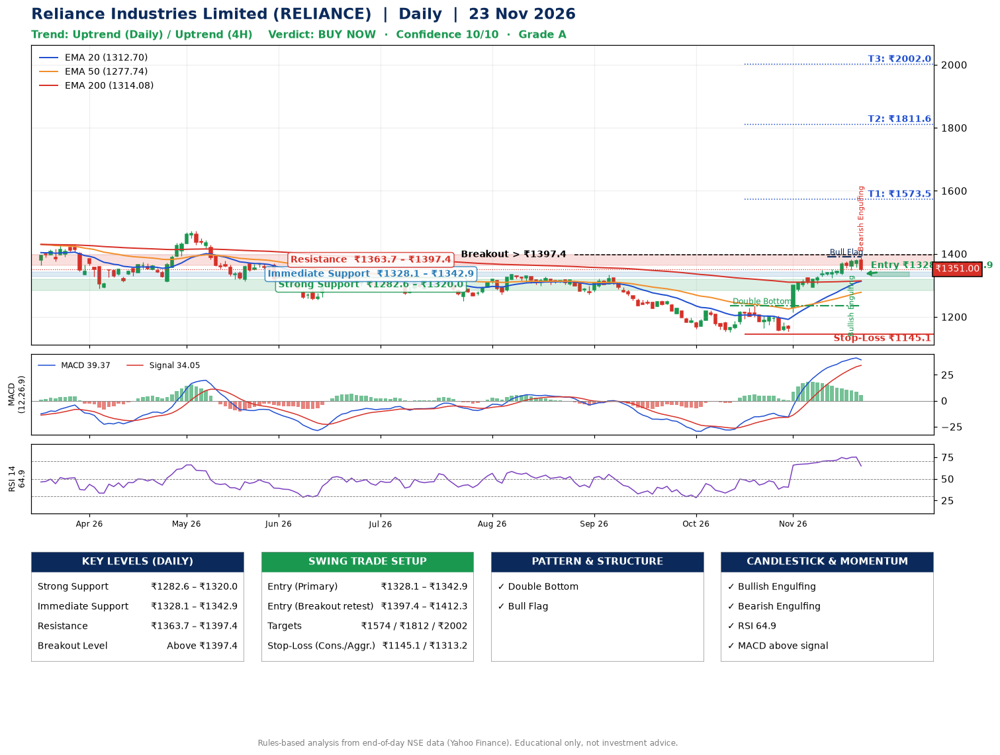

📌 **Reliance Industries Limited (RELIANCE) – Multi-Timeframe Technical Analysis (Daily + 4H Combined)**
_Data up to 23 Nov 2026 · Close ₹1351.00_

**📍 Daily Timeframe Trend**
- Trend: **Uptrend** (higher highs and higher lows)
- Recent swing highs: ₹1333.0, ₹1220.8, ₹1234.3 · swing lows: ₹1271.0, ₹1152.2, ₹1152.5
- EMAs: EMA20 ₹1312.7, EMA50 ₹1277.7, EMA200 ₹1314.1; mixed / crossing; price above EMA20, EMA50, EMA200
- MACD 39.37 above signal 34.05 (above zero); histogram falling
- RSI(14) 64.9; no divergence on the last two swings

**📍 4-Hour Timeframe Trend**
- Structure: **Uptrend** (higher highs and higher lows)
- Pullback/support area: recent 4H swing lows ₹1324.3, ₹1350.0; EMA20 ₹1342.8
- EMA20/50: bullish stack (EMA20 > EMA50); price above EMA20, EMA50
- MACD 23.85 below signal 28.34 (above zero); histogram falling
- RSI(14) 58.9; Regular bearish divergence

**📍 Pattern Detection (Both Timeframes)**
- Daily: **Double Bottom** – bottoms near ₹1152.2/₹1152.5, neckline ₹1234.3, confirmed (closed above neckline)
- Daily: **Bull Flag** – 15% pole then a tight 5% flag; trigger above ₹1390.0
- 4H: **Bull Flag** – 17% pole then a tight 3% flag; trigger above ₹1389.9

**📍 Candlestick Patterns (last 3 daily candles)**
- **Bullish Engulfing** – 19 Nov: buyers fully reversed the prior red candle
- **Bearish Engulfing** – 23 Nov: sellers fully reversed the prior green candle

**📍 Price Action Key Levels (Daily Structure)**

| Zone | Price Level (₹) | Context |
|------|-----------------|---------|
| Strong Support | ₹1282.6 – ₹1320.0 | Cluster of earlier swing lows (demand) |
| Immediate Support | ₹1328.1 – ₹1342.9 | Nearest swing-low / wick area |
| Resistance | ₹1363.7 – ₹1397.4 | Nearest swing-high supply |
| Breakout Level | Above ₹1397.4 | Swing continuation trigger (52-week high ₹1611.8) |

**📍 Swing Trade Setup**

🟢 **Entry Zone**
- Primary: ₹1328.1 – ₹1342.9 (daily support / EMA20 area; enter on a bullish 4H candle)
- Alternate: ₹1397.4 – ₹1412.3 (breakout retest)

🎯 **Profit Targets**
- T1: ₹1573.5
- T2: ₹1811.6
- T3: ₹2002.0

🛑 **Stop-Loss**
- Conservative: below daily swing low (₹1145.1)
- Aggressive: below 4H structure (₹1313.2)
- Risk per share ≈ ₹190.4; reward:risk to T1 ≈ 1.2
- Time to T1: about 48 trading days (it rose this much within 60 trading days 9% of the time in the last 2 years)
- Time to T2: it never rose this much within 60 trading days in the price history

**📌 Strategy Notes**
- Higher timeframe: daily trend is uptrend; only take longs while price holds above ₹1282.6.
- Entry timing: wait for a bullish 4H candle (engulfing/hammer) inside ₹1328.1 – ₹1342.9 rather than buying mid-range.
- EMA stacking: mixed / crossing; price above EMA20, EMA50, EMA200.
- Breakout rule: a daily close above ₹1397.4 with volume above its 20-day average (≈20,997,124) opens T2/T3.
- Momentum: RSI 65 – room to run; no divergence on the last two swings.
- Exit discipline: move the stop to entry once T1 is hit; book partial profits at each target.

**STEP 2 — Marked Up Chart**

**✅ Trade Validation Checklist**
- Trend + momentum aligned: Yes · Price at entry zone: No
- Stop defined (₹1145.1) · Reward:risk ≥ 1.5 to T1: No

## 📌 Final Verdict

Recommendation: **🟢 BUY NOW**

Confidence: **10/10**

Trade Quality: **A**

Reason:
• Daily uptrend (higher highs and higher lows)
• Double Bottom: bottoms near ₹1152.2/₹1152.5, neckline ₹1234.3, confirmed (closed above neckline)

Next Action:
• Buy now within the entry zone, with the stop-loss in place

_Rules-based analysis from end-of-day data. Educational only, not investment advice. Never place orders without your own confirmation._