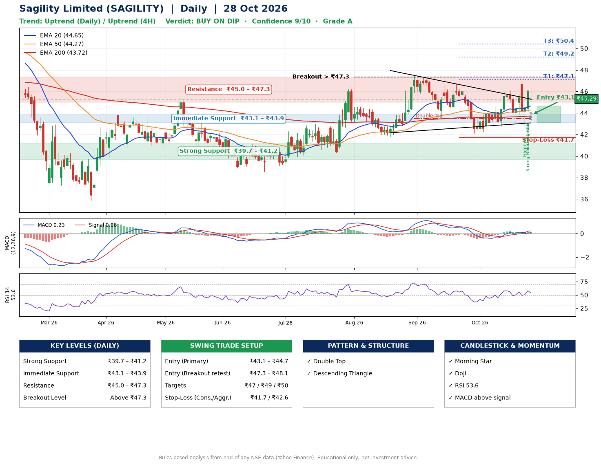

📌 **Sagility Limited (SAGILITY) – Multi-Timeframe Technical Analysis (Daily + 4H Combined)**
_Data up to 28 Oct 2026 · Close ₹45.29_

**📍 Daily Timeframe Trend**
- Trend: **Uptrend** (price above rising EMAs)
- Recent swing highs: ₹46.2, ₹47.5, ₹46.7 · swing lows: ₹41.8, ₹43.5, ₹42.1
- EMAs: EMA20 ₹44.7, EMA50 ₹44.3, EMA200 ₹43.7; bullish stack (EMA20 > EMA50 > EMA200); price above EMA20, EMA50, EMA200
- MACD 0.23 above signal 0.08 (above zero); histogram falling
- RSI(14) 53.6; no divergence on the last two swings

**📍 4-Hour Timeframe Trend**
- Structure: **Uptrend** (price above rising EMAs)
- Pullback/support area: recent 4H swing lows ₹42.9, ₹42.8; EMA20 ₹44.7
- EMA20/50: bullish stack (EMA20 > EMA50); price above EMA20, EMA50
- MACD 0.27 above signal 0.17 (above zero), fresh bullish crossover; histogram falling
- RSI(14) 54.7; Regular bullish divergence; Regular bearish divergence

**📍 Pattern Detection (Both Timeframes)**
- Daily: **Double Top** – tops near ₹47.5/₹46.7, neckline ₹43.5, forming
- Daily: **Descending Triangle** – converging swing highs and lows over the last ~60 sessions

**📍 Candlestick Patterns (last 3 daily candles)**
- **Hammer** – 26 Oct: long lower wick shows dip-buying near ₹42.7
- **Strong Bullish Candle** – 27 Oct: wide-range green candle, buyers in control
- **Morning Star** – 27 Oct: three-candle bullish reversal
- **Doji** – 28 Oct: indecision; wait for the next candle to confirm direction

**📍 Price Action Key Levels (Daily Structure)**

| Zone | Price Level (₹) | Context |
|------|-----------------|---------|
| Strong Support | ₹39.7 – ₹41.2 | Cluster of earlier swing lows (demand) |
| Immediate Support | ₹43.1 – ₹43.9 | Nearest swing-low / wick area |
| Resistance | ₹45.0 – ₹47.3 | Nearest swing-high supply |
| Breakout Level | Above ₹47.3 | Swing continuation trigger (52-week high ₹57.9) |

**📍 Swing Trade Setup**

🟢 **Entry Zone**
- Primary: ₹43.1 – ₹44.7 (daily support / EMA20 area; enter on a bullish 4H candle)
- Alternate: ₹47.3 – ₹48.1 (breakout retest)

🎯 **Profit Targets**
- T1: ₹47.1
- T2: ₹49.2
- T3: ₹50.4

🛑 **Stop-Loss**
- Conservative: below daily swing low (₹41.7)
- Aggressive: below 4H structure (₹42.6)
- Risk per share ≈ ₹2.1; reward:risk to T1 ≈ 1.5

**📌 Strategy Notes**
- Higher timeframe: daily trend is uptrend; only take longs while price holds above ₹39.7.
- Entry timing: wait for a bullish 4H candle (engulfing/hammer) inside ₹43.1 – ₹44.7 rather than buying mid-range.
- EMA stacking: bullish stack (EMA20 > EMA50 > EMA200); price above EMA20, EMA50, EMA200.
- Breakout rule: a daily close above ₹47.3 with volume above its 20-day average (≈20,993,770) opens T2/T3.
- Momentum: RSI 54 – room to run; no divergence on the last two swings.
- Exit discipline: move the stop to entry once T1 is hit; book partial profits at each target.

**STEP 2 — Marked Up Chart**

**✅ Trade Validation Checklist**
- Trend + momentum aligned: Yes · Price at entry zone: No
- Stop defined (₹41.7) · Reward:risk ≥ 1.5 to T1: Yes

## 📌 Final Verdict

Recommendation: **🟡 BUY ON DIP**

Confidence: **9/10**

Trade Quality: **A**

Reason:
• Daily uptrend (price above rising EMAs)
• EMAs stacked bullishly

Next Action:
• Wait for a pullback to ₹43.1–₹44.7, or a breakout above ₹47.3

_Rules-based analysis from end-of-day data. Educational only, not investment advice. Never place orders without your own confirmation._