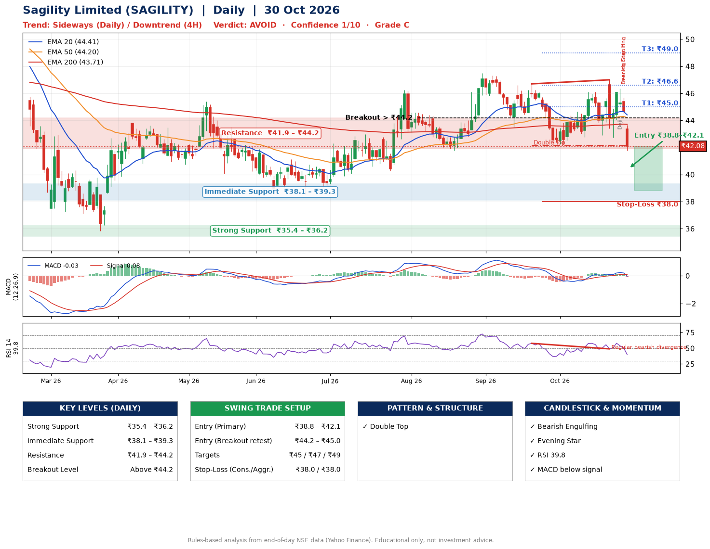

📌 **Sagility Limited (SAGILITY) – Multi-Timeframe Technical Analysis (Daily + 4H Combined)**
_Data up to 30 Oct 2026 · Close ₹42.08_

**📍 Daily Timeframe Trend**
- Trend: **Sideways** (mixed swing structure)
- Recent swing highs: ₹47.5, ₹46.7, ₹47.0 · swing lows: ₹41.8, ₹43.5, ₹42.1
- EMAs: EMA20 ₹44.4, EMA50 ₹44.2, EMA200 ₹43.7; bullish stack (EMA20 > EMA50 > EMA200); price below all EMAs
- MACD -0.03 below signal 0.08 (below zero), fresh bearish crossover; histogram falling
- RSI(14) 39.8; Regular bearish divergence

**📍 4-Hour Timeframe Trend**
- Structure: **Downtrend** (lower highs and lower lows)
- Pullback/support area: recent 4H swing lows ₹42.9, ₹42.8; EMA20 ₹44.3
- EMA20/50: bearish stack (EMA20 < EMA50); price below all EMAs
- MACD -0.21 below signal 0.08 (below zero), fresh bearish crossover; histogram falling
- RSI(14) 36.0; Regular bullish divergence; Hidden bearish divergence

**📍 Pattern Detection (Both Timeframes)**
- Daily: **Double Top** – tops near ₹46.7/₹47.0, neckline ₹42.1, confirmed (closed below neckline)

**📍 Candlestick Patterns (last 3 daily candles)**
- **Doji** – 28 Oct: indecision; wait for the next candle to confirm direction
- **Bearish Engulfing** – 29 Oct: sellers fully reversed the prior green candle
- **Evening Star** – 29 Oct: three-candle bearish reversal

**📍 Price Action Key Levels (Daily Structure)**

| Zone | Price Level (₹) | Context |
|------|-----------------|---------|
| Strong Support | ₹35.4 – ₹36.2 | Cluster of earlier swing lows (demand) |
| Immediate Support | ₹38.1 – ₹39.3 | Nearest swing-low / wick area |
| Resistance | ₹41.9 – ₹44.2 | Nearest swing-high supply |
| Breakout Level | Above ₹44.2 | Swing continuation trigger (52-week high ₹57.9) |

**📍 Swing Trade Setup**

🟢 **Entry Zone**
- Primary: ₹38.8 – ₹42.1 (daily support / EMA20 area; enter on a bullish 4H candle)
- Alternate: ₹44.2 – ₹45.0 (breakout retest)

🎯 **Profit Targets**
- T1: ₹45.0
- T2: ₹46.6
- T3: ₹49.0

🛑 **Stop-Loss**
- Conservative: below daily swing low (₹38.0)
- Aggressive: below 4H structure (₹38.0)
- Risk per share ≈ ₹2.4; reward:risk to T1 ≈ 1.9

**📌 Strategy Notes**
- Higher timeframe: daily trend is sideways; only take longs while price holds above ₹35.4.
- Entry timing: wait for a bullish 4H candle (engulfing/hammer) inside ₹38.8 – ₹42.1 rather than buying mid-range.
- EMA stacking: bullish stack (EMA20 > EMA50 > EMA200); price below all EMAs.
- Breakout rule: a daily close above ₹44.2 with volume above its 20-day average (≈59,146,153) opens T2/T3.
- Momentum: RSI 40 – room to run; Regular bearish divergence.
- Exit discipline: move the stop to entry once T1 is hit; book partial profits at each target.

**STEP 2 — Marked Up Chart**

**✅ Trade Validation Checklist**
- Trend + momentum aligned: No · Price at entry zone: Yes
- Stop defined (₹38.0) · Reward:risk ≥ 1.5 to T1: Yes

## 📌 Final Verdict

Recommendation: **🔴 AVOID**

Confidence: **1/10**

Trade Quality: **C**

Reason:
• Sharp pullback: 10% below the recent ₹47.0 high
• EMAs stacked bullishly

Next Action:
• Avoid until the trend changes (reclaim EMA50 and a higher low)

_Rules-based analysis from end-of-day data. Educational only, not investment advice. Never place orders without your own confirmation._