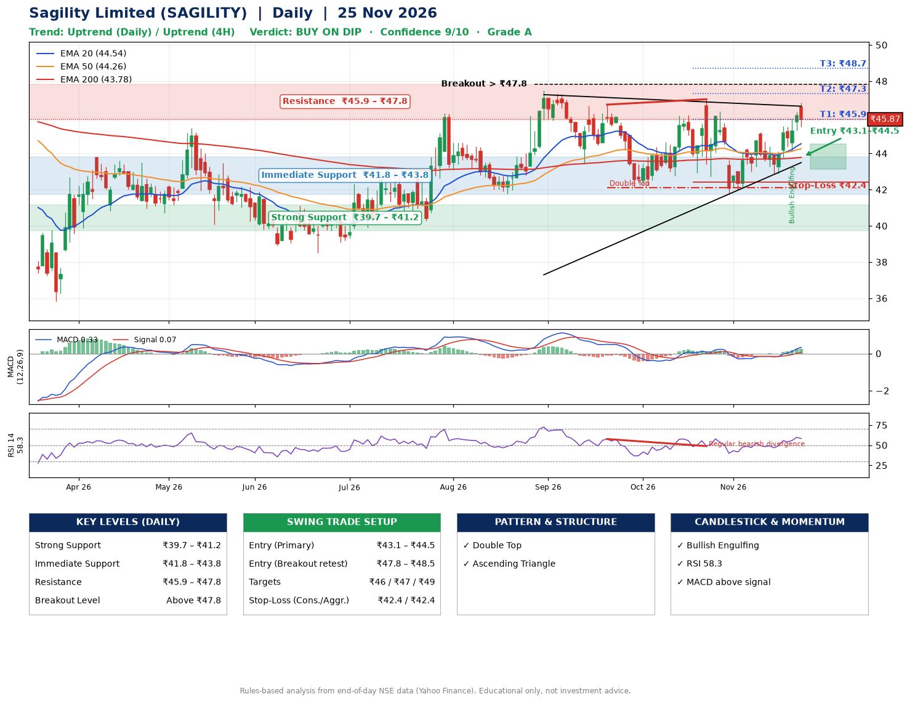

📌 **Sagility Limited (SAGILITY) – Multi-Timeframe Technical Analysis (Daily + 4H Combined)**
_Data up to 25 Nov 2026 · Close ₹45.87_

**📍 Daily Timeframe Trend**
- Trend: **Uptrend** (price above rising EMAs)
- Recent swing highs: ₹47.5, ₹46.7, ₹47.0 · swing lows: ₹41.8, ₹42.9, ₹42.9
- EMAs: EMA20 ₹44.5, EMA50 ₹44.3, EMA200 ₹43.8; bullish stack (EMA20 > EMA50 > EMA200); price above EMA20, EMA50, EMA200
- MACD 0.33 above signal 0.07 (above zero); histogram rising
- RSI(14) 58.3; Regular bearish divergence

**📍 4-Hour Timeframe Trend**
- Structure: **Uptrend** (higher highs and higher lows)
- Pullback/support area: recent 4H swing lows ₹42.9, ₹44.2; EMA20 ₹44.9
- EMA20/50: bullish stack (EMA20 > EMA50); price above EMA20, EMA50
- MACD 0.54 above signal 0.36 (above zero); histogram falling
- RSI(14) 62.2; no divergence

**📍 Pattern Detection (Both Timeframes)**
- Daily: **Double Top** – tops near ₹46.7/₹47.0, neckline ₹42.1, forming
- Daily: **Ascending Triangle** – converging swing highs and lows over the last ~60 sessions

**📍 Candlestick Patterns (last 3 daily candles)**
- **Bullish Engulfing** – 20 Nov: buyers fully reversed the prior red candle

**📍 Price Action Key Levels (Daily Structure)**

| Zone | Price Level (₹) | Context |
|------|-----------------|---------|
| Strong Support | ₹39.7 – ₹41.2 | Cluster of earlier swing lows (demand) |
| Immediate Support | ₹41.8 – ₹43.8 | Nearest swing-low / wick area |
| Resistance | ₹45.9 – ₹47.8 | Nearest swing-high supply |
| Breakout Level | Above ₹47.8 | Swing continuation trigger (52-week high ₹54.3) |

**📍 Swing Trade Setup**

🟢 **Entry Zone**
- Primary: ₹43.1 – ₹44.5 (daily support / EMA20 area; enter on a bullish 4H candle)
- Alternate: ₹47.8 – ₹48.5 (breakout retest)

🎯 **Profit Targets**
- T1: ₹45.9
- T2: ₹47.3
- T3: ₹48.7

🛑 **Stop-Loss**
- Conservative: below daily swing low (₹42.4)
- Aggressive: below 4H structure (₹42.4)
- Risk per share ≈ ₹1.4; reward:risk to T1 ≈ 1.5
- Time to T1: about 6 trading days (it rose this much within 60 trading days 87% of the time in the last 2 years)
- Time to T2: about 11 trading days (it rose this much within 60 trading days 74% of the time in the last 2 years)

**📌 Strategy Notes**
- Higher timeframe: daily trend is uptrend; only take longs while price holds above ₹39.7.
- Entry timing: wait for a bullish 4H candle (engulfing/hammer) inside ₹43.1 – ₹44.5 rather than buying mid-range.
- EMA stacking: bullish stack (EMA20 > EMA50 > EMA200); price above EMA20, EMA50, EMA200.
- Breakout rule: a daily close above ₹47.8 with volume above its 20-day average (≈66,211,213) opens T2/T3.
- Momentum: RSI 58 – room to run; Regular bearish divergence.
- Exit discipline: move the stop to entry once T1 is hit; book partial profits at each target.

**STEP 2 — Marked Up Chart**

**✅ Trade Validation Checklist**
- Trend + momentum aligned: Yes · Price at entry zone: No
- Stop defined (₹42.4) · Reward:risk ≥ 1.5 to T1: No

## 📌 Final Verdict

Recommendation: **🟡 BUY ON DIP**

Confidence: **9/10**

Trade Quality: **A**

Reason:
• Daily uptrend (price above rising EMAs)
• EMAs stacked bullishly

Next Action:
• Wait for a pullback to ₹43.1–₹44.5, or a breakout above ₹47.8

_Rules-based analysis from end-of-day data. Educational only, not investment advice. Never place orders without your own confirmation._