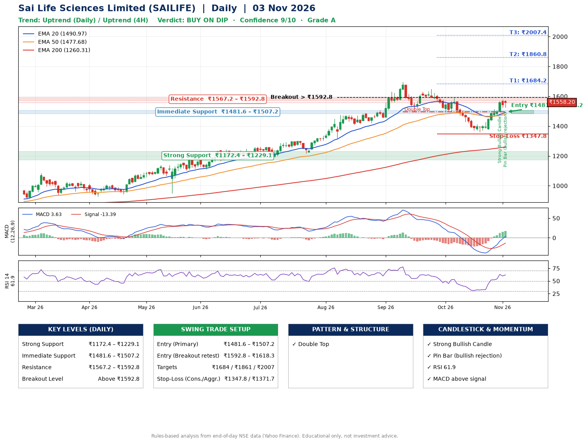

📌 **Sai Life Sciences Limited (SAILIFE) – Multi-Timeframe Technical Analysis (Daily + 4H Combined)**
_Data up to 03 Nov 2026 · Close ₹1558.20_

**📍 Daily Timeframe Trend**
- Trend: **Uptrend** (price above rising EMAs)
- Recent swing highs: ₹1300.0, ₹1697.0, ₹1649.8 · swing lows: ₹1216.3, ₹1494.4, ₹1360.6
- EMAs: EMA20 ₹1491.0, EMA50 ₹1477.7, EMA200 ₹1260.3; bullish stack (EMA20 > EMA50 > EMA200); price above EMA20, EMA50, EMA200
- MACD 3.63 above signal -13.39 (above zero), fresh bullish crossover; histogram rising
- RSI(14) 61.9; no divergence on the last two swings

**📍 4-Hour Timeframe Trend**
- Structure: **Uptrend** (higher highs and higher lows)
- Pullback/support area: recent 4H swing lows ₹1361.2, ₹1375.0; EMA20 ₹1498.4
- EMA20/50: bullish stack (EMA20 > EMA50); price above EMA20, EMA50
- MACD 26.69 above signal 13.07 (above zero); histogram falling
- RSI(14) 68.2; no divergence

**📍 Pattern Detection (Both Timeframes)**
- Daily: **Double Top** – tops near ₹1697.0/₹1649.8, neckline ₹1494.4, forming

**📍 Candlestick Patterns (last 3 daily candles)**
- **Strong Bullish Candle** – 30 Oct: wide-range green candle, buyers in control
- **Pin Bar (bullish rejection)** – 03 Nov: long lower wick shows dip-buying near ₹1522.9

**📍 Price Action Key Levels (Daily Structure)**

| Zone | Price Level (₹) | Context |
|------|-----------------|---------|
| Strong Support | ₹1172.4 – ₹1229.1 | Cluster of earlier swing lows (demand) |
| Immediate Support | ₹1481.6 – ₹1507.2 | Nearest swing-low / wick area |
| Resistance | ₹1567.2 – ₹1592.8 | Nearest swing-high supply |
| Breakout Level | Above ₹1592.8 | Swing continuation trigger (52-week high ₹1697.0) |

**📍 Swing Trade Setup**

🟢 **Entry Zone**
- Primary: ₹1481.6 – ₹1507.2 (daily support / EMA20 area; enter on a bullish 4H candle)
- Alternate: ₹1592.8 – ₹1618.3 (breakout retest)

🎯 **Profit Targets**
- T1: ₹1684.2
- T2: ₹1860.8
- T3: ₹2007.4

🛑 **Stop-Loss**
- Conservative: below daily swing low (₹1347.8)
- Aggressive: below 4H structure (₹1371.7)
- Risk per share ≈ ₹146.6; reward:risk to T1 ≈ 1.3

**📌 Strategy Notes**
- Higher timeframe: daily trend is uptrend; only take longs while price holds above ₹1172.4.
- Entry timing: wait for a bullish 4H candle (engulfing/hammer) inside ₹1481.6 – ₹1507.2 rather than buying mid-range.
- EMA stacking: bullish stack (EMA20 > EMA50 > EMA200); price above EMA20, EMA50, EMA200.
- Breakout rule: a daily close above ₹1592.8 with volume above its 20-day average (≈484,334) opens T2/T3.
- Momentum: RSI 62 – room to run; no divergence on the last two swings.
- Exit discipline: move the stop to entry once T1 is hit; book partial profits at each target.

**STEP 2 — Marked Up Chart**

**✅ Trade Validation Checklist**
- Trend + momentum aligned: Yes · Price at entry zone: No
- Stop defined (₹1347.8) · Reward:risk ≥ 1.5 to T1: No

## 📌 Final Verdict

Recommendation: **🟡 BUY ON DIP**

Confidence: **9/10**

Trade Quality: **A**

Reason:
• Daily uptrend (price above rising EMAs)
• EMAs stacked bullishly

Next Action:
• Wait for a pullback to ₹1481.6–₹1507.2

_Rules-based analysis from end-of-day data. Educational only, not investment advice. Never place orders without your own confirmation._