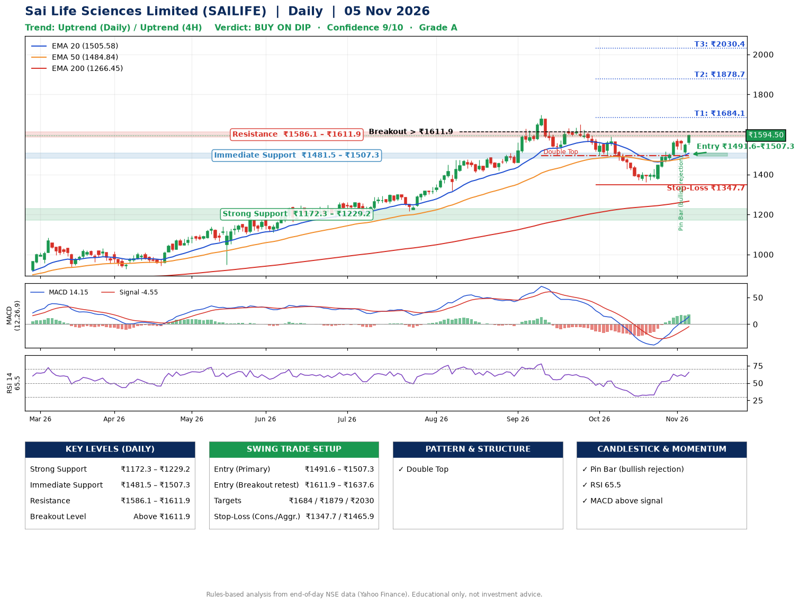

📌 **Sai Life Sciences Limited (SAILIFE) – Multi-Timeframe Technical Analysis (Daily + 4H Combined)**
_Data up to 05 Nov 2026 · Close ₹1594.50_

**📍 Daily Timeframe Trend**
- Trend: **Uptrend** (price above rising EMAs)
- Recent swing highs: ₹1300.0, ₹1697.0, ₹1649.8 · swing lows: ₹1216.3, ₹1494.4, ₹1360.6
- EMAs: EMA20 ₹1505.6, EMA50 ₹1484.8, EMA200 ₹1266.4; bullish stack (EMA20 > EMA50 > EMA200); price above EMA20, EMA50, EMA200
- MACD 14.15 above signal -4.55 (above zero); histogram rising
- RSI(14) 65.5; no divergence on the last two swings

**📍 4-Hour Timeframe Trend**
- Structure: **Uptrend** (higher highs and higher lows)
- Pullback/support area: recent 4H swing lows ₹1375.0, ₹1507.1; EMA20 ₹1522.1
- EMA20/50: bullish stack (EMA20 > EMA50); price above EMA20, EMA50
- MACD 31.90 above signal 22.65 (above zero); histogram rising
- RSI(14) 72.1; no divergence

**📍 Pattern Detection (Both Timeframes)**
- Daily: **Double Top** – tops near ₹1697.0/₹1649.8, neckline ₹1494.4, forming
- 4H: **Symmetrical Triangle** – converging swing highs and lows over the last ~60 sessions

**📍 Candlestick Patterns (last 3 daily candles)**
- **Pin Bar (bullish rejection)** – 03 Nov: long lower wick shows dip-buying near ₹1522.9

**📍 Price Action Key Levels (Daily Structure)**

| Zone | Price Level (₹) | Context |
|------|-----------------|---------|
| Strong Support | ₹1172.3 – ₹1229.2 | Cluster of earlier swing lows (demand) |
| Immediate Support | ₹1481.5 – ₹1507.3 | Nearest swing-low / wick area |
| Resistance | ₹1586.1 – ₹1611.9 | Nearest swing-high supply |
| Breakout Level | Above ₹1611.9 | Swing continuation trigger (52-week high ₹1697.0) |

**📍 Swing Trade Setup**

🟢 **Entry Zone**
- Primary: ₹1491.6 – ₹1507.3 (daily support / EMA20 area; enter on a bullish 4H candle)
- Alternate: ₹1611.9 – ₹1637.6 (breakout retest)

🎯 **Profit Targets**
- T1: ₹1684.1
- T2: ₹1878.7
- T3: ₹2030.4

🛑 **Stop-Loss**
- Conservative: below daily swing low (₹1347.7)
- Aggressive: below 4H structure (₹1465.9)
- Risk per share ≈ ₹151.7; reward:risk to T1 ≈ 1.2

**📌 Strategy Notes**
- Higher timeframe: daily trend is uptrend; only take longs while price holds above ₹1172.3.
- Entry timing: wait for a bullish 4H candle (engulfing/hammer) inside ₹1491.6 – ₹1507.3 rather than buying mid-range.
- EMA stacking: bullish stack (EMA20 > EMA50 > EMA200); price above EMA20, EMA50, EMA200.
- Breakout rule: a daily close above ₹1611.9 with volume above its 20-day average (≈481,206) opens T2/T3.
- Momentum: RSI 66 – elevated, prefer dips; no divergence on the last two swings.
- Exit discipline: move the stop to entry once T1 is hit; book partial profits at each target.

**STEP 2 — Marked Up Chart**

**✅ Trade Validation Checklist**
- Trend + momentum aligned: Yes · Price at entry zone: No
- Stop defined (₹1347.7) · Reward:risk ≥ 1.5 to T1: No

## 📌 Final Verdict

Recommendation: **🟡 BUY ON DIP**

Confidence: **9/10**

Trade Quality: **A**

Reason:
• Daily uptrend (price above rising EMAs)
• EMAs stacked bullishly

Next Action:
• Wait for a pullback to ₹1491.6–₹1507.3

_Rules-based analysis from end-of-day data. Educational only, not investment advice. Never place orders without your own confirmation._