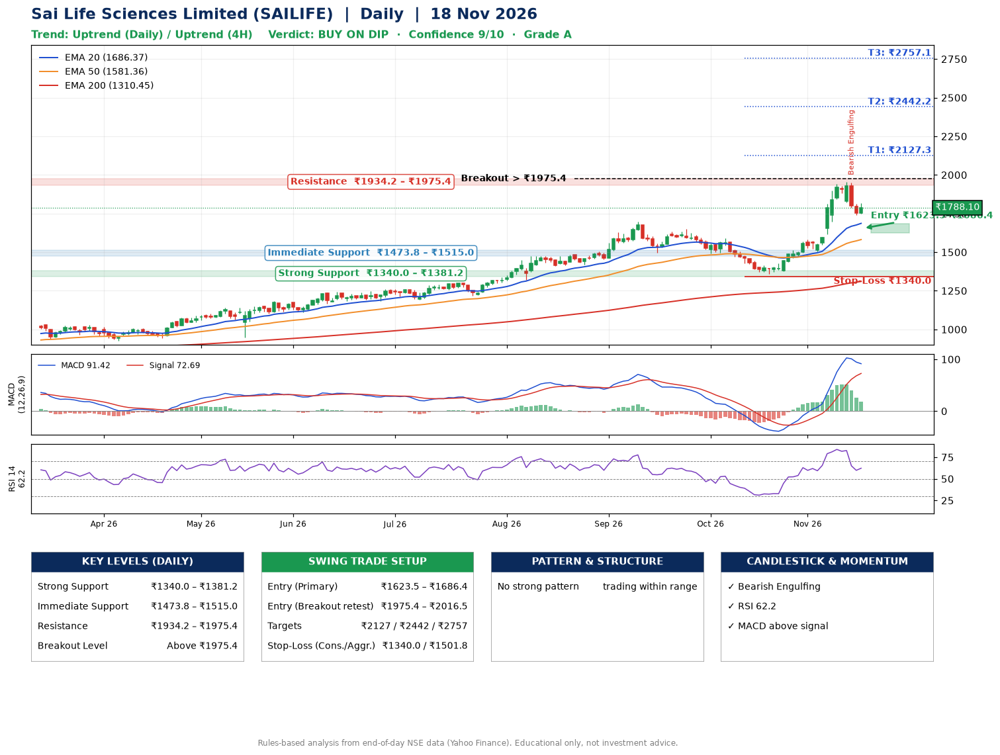

📌 **Sai Life Sciences Limited (SAILIFE) – Multi-Timeframe Technical Analysis (Daily + 4H Combined)**
_Data up to 18 Nov 2026 · Close ₹1788.10_

**📍 Daily Timeframe Trend**
- Trend: **Uptrend** (price above rising EMAs)
- Recent swing highs: ₹1300.0, ₹1697.0, ₹1649.8 · swing lows: ₹1216.3, ₹1494.4, ₹1360.6
- EMAs: EMA20 ₹1686.4, EMA50 ₹1581.4, EMA200 ₹1310.5; bullish stack (EMA20 > EMA50 > EMA200); price above EMA20, EMA50, EMA200
- MACD 91.42 above signal 72.69 (above zero); histogram falling
- RSI(14) 62.2; no divergence on the last two swings

**📍 4-Hour Timeframe Trend**
- Structure: **Uptrend** (higher highs and higher lows)
- Pullback/support area: recent 4H swing lows ₹1375.0, ₹1507.1; EMA20 ₹1769.6
- EMA20/50: bullish stack (EMA20 > EMA50); price above EMA20, EMA50
- MACD 61.55 below signal 82.24 (above zero), fresh bearish crossover; histogram falling
- RSI(14) 56.9; no divergence

**📍 Pattern Detection (Both Timeframes)**
- No strong pattern detected. Trading within range.

**📍 Candlestick Patterns (last 3 daily candles)**
- **Bearish Engulfing** – 16 Nov: sellers fully reversed the prior green candle

**📍 Price Action Key Levels (Daily Structure)**

| Zone | Price Level (₹) | Context |
|------|-----------------|---------|
| Strong Support | ₹1340.0 – ₹1381.2 | Cluster of earlier swing lows (demand) |
| Immediate Support | ₹1473.8 – ₹1515.0 | Nearest swing-low / wick area |
| Resistance | ₹1934.2 – ₹1975.4 | Nearest swing-high supply |
| Breakout Level | Above ₹1975.4 | Swing continuation trigger (52-week high ₹1954.8) |

**📍 Swing Trade Setup**

🟢 **Entry Zone**
- Primary: ₹1623.5 – ₹1686.4 (daily support / EMA20 area; enter on a bullish 4H candle)
- Alternate: ₹1975.4 – ₹2016.5 (breakout retest)

🎯 **Profit Targets**
- T1: ₹2127.3
- T2: ₹2442.2
- T3: ₹2757.1

🛑 **Stop-Loss**
- Conservative: below daily swing low (₹1340.0)
- Aggressive: below 4H structure (₹1501.8)
- Risk per share ≈ ₹314.9; reward:risk to T1 ≈ 1.5
- Time to T1: about 49 trading days (it rose this much within 60 trading days 23% of the time in the last 2 years)
- Time to T2: it never rose this much within 60 trading days in the price history

**📌 Strategy Notes**
- Higher timeframe: daily trend is uptrend; only take longs while price holds above ₹1340.0.
- Entry timing: wait for a bullish 4H candle (engulfing/hammer) inside ₹1623.5 – ₹1686.4 rather than buying mid-range.
- EMA stacking: bullish stack (EMA20 > EMA50 > EMA200); price above EMA20, EMA50, EMA200.
- Breakout rule: a daily close above ₹1975.4 with volume above its 20-day average (≈1,963,148) opens T2/T3.
- Momentum: RSI 62 – room to run; no divergence on the last two swings.
- Exit discipline: move the stop to entry once T1 is hit; book partial profits at each target.

**STEP 2 — Marked Up Chart**

**✅ Trade Validation Checklist**
- Trend + momentum aligned: Yes · Price at entry zone: No
- Stop defined (₹1340.0) · Reward:risk ≥ 1.5 to T1: No

## 📌 Final Verdict

Recommendation: **🟡 BUY ON DIP**

Confidence: **9/10**

Trade Quality: **A**

Reason:
• Daily uptrend (price above rising EMAs)
• EMAs stacked bullishly

Next Action:
• Wait for a pullback to ₹1623.5–₹1686.4

_Rules-based analysis from end-of-day data. Educational only, not investment advice. Never place orders without your own confirmation._