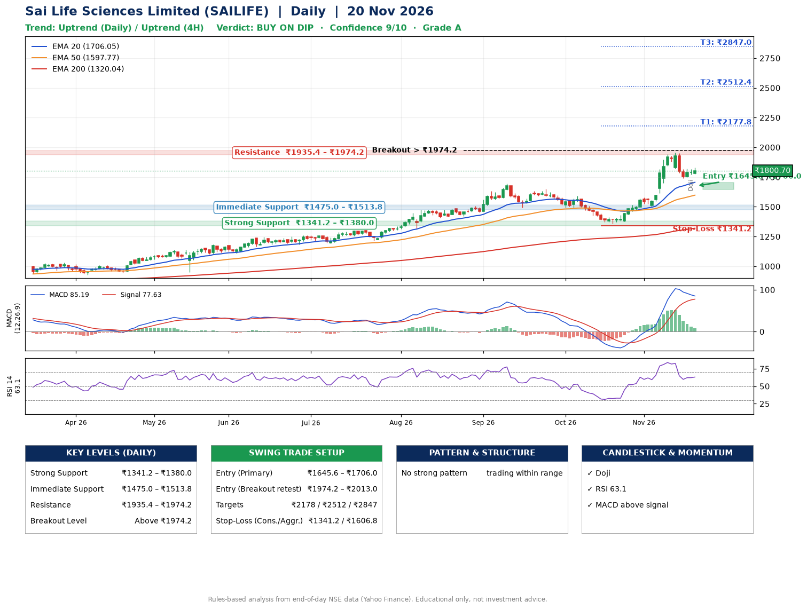

📌 **Sai Life Sciences Limited (SAILIFE) – Multi-Timeframe Technical Analysis (Daily + 4H Combined)**
_Data up to 20 Nov 2026 · Close ₹1800.70_

**📍 Daily Timeframe Trend**
- Trend: **Uptrend** (price above rising EMAs)
- Recent swing highs: ₹1697.0, ₹1649.8, ₹1954.8 · swing lows: ₹1216.3, ₹1494.4, ₹1360.6
- EMAs: EMA20 ₹1706.0, EMA50 ₹1597.8, EMA200 ₹1320.0; bullish stack (EMA20 > EMA50 > EMA200); price above EMA20, EMA50, EMA200
- MACD 85.19 above signal 77.63 (above zero); histogram falling
- RSI(14) 63.1; no divergence on the last two swings

**📍 4-Hour Timeframe Trend**
- Structure: **Uptrend** (higher highs and higher lows)
- Pullback/support area: recent 4H swing lows ₹1507.1, ₹1738.2; EMA20 ₹1777.5
- EMA20/50: bullish stack (EMA20 > EMA50); price above EMA20, EMA50
- MACD 43.55 below signal 61.98 (above zero); histogram rising
- RSI(14) 58.2; Hidden bullish divergence

**📍 Pattern Detection (Both Timeframes)**
- 4H: **Bull Flag** – 17% pole then a tight 5% flag; trigger above ₹1829.9

**📍 Candlestick Patterns (last 3 daily candles)**
- **Doji** – 19 Nov: indecision; wait for the next candle to confirm direction

**📍 Price Action Key Levels (Daily Structure)**

| Zone | Price Level (₹) | Context |
|------|-----------------|---------|
| Strong Support | ₹1341.2 – ₹1380.0 | Cluster of earlier swing lows (demand) |
| Immediate Support | ₹1475.0 – ₹1513.8 | Nearest swing-low / wick area |
| Resistance | ₹1935.4 – ₹1974.2 | Nearest swing-high supply |
| Breakout Level | Above ₹1974.2 | Swing continuation trigger (52-week high ₹1954.8) |

**📍 Swing Trade Setup**

🟢 **Entry Zone**
- Primary: ₹1645.6 – ₹1706.0 (daily support / EMA20 area; enter on a bullish 4H candle)
- Alternate: ₹1974.2 – ₹2013.0 (breakout retest)

🎯 **Profit Targets**
- T1: ₹2177.8
- T2: ₹2512.4
- T3: ₹2847.0

🛑 **Stop-Loss**
- Conservative: below daily swing low (₹1341.2)
- Aggressive: below 4H structure (₹1606.8)
- Risk per share ≈ ₹334.6; reward:risk to T1 ≈ 1.5
- Time to T1: about 51 trading days (it rose this much within 60 trading days 18% of the time in the last 2 years)
- Time to T2: it never rose this much within 60 trading days in the price history

**📌 Strategy Notes**
- Higher timeframe: daily trend is uptrend; only take longs while price holds above ₹1341.2.
- Entry timing: wait for a bullish 4H candle (engulfing/hammer) inside ₹1645.6 – ₹1706.0 rather than buying mid-range.
- EMA stacking: bullish stack (EMA20 > EMA50 > EMA200); price above EMA20, EMA50, EMA200.
- Breakout rule: a daily close above ₹1974.2 with volume above its 20-day average (≈1,986,810) opens T2/T3.
- Momentum: RSI 63 – room to run; no divergence on the last two swings.
- Exit discipline: move the stop to entry once T1 is hit; book partial profits at each target.

**STEP 2 — Marked Up Chart**

**✅ Trade Validation Checklist**
- Trend + momentum aligned: Yes · Price at entry zone: No
- Stop defined (₹1341.2) · Reward:risk ≥ 1.5 to T1: Yes

## 📌 Final Verdict

Recommendation: **🟡 BUY ON DIP**

Confidence: **9/10**

Trade Quality: **A**

Reason:
• Daily uptrend (price above rising EMAs)
• EMAs stacked bullishly

Next Action:
• Wait for a pullback to ₹1645.6–₹1706.0

_Rules-based analysis from end-of-day data. Educational only, not investment advice. Never place orders without your own confirmation._