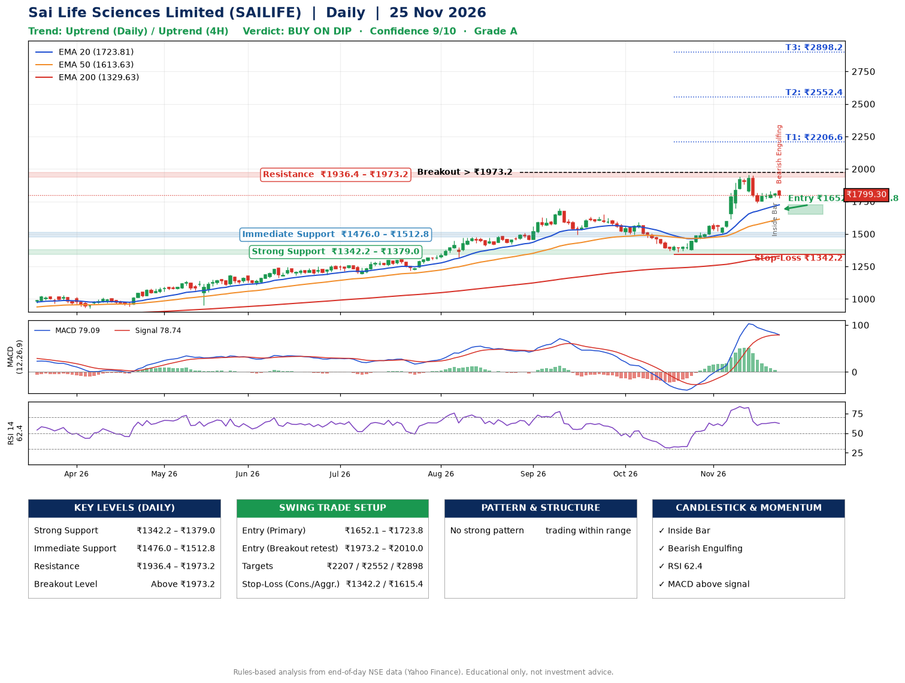

📌 **Sai Life Sciences Limited (SAILIFE) – Multi-Timeframe Technical Analysis (Daily + 4H Combined)**
_Data up to 25 Nov 2026 · Close ₹1799.30_

**📍 Daily Timeframe Trend**
- Trend: **Uptrend** (price above rising EMAs)
- Recent swing highs: ₹1697.0, ₹1649.8, ₹1954.8 · swing lows: ₹1216.3, ₹1494.4, ₹1360.6
- EMAs: EMA20 ₹1723.8, EMA50 ₹1613.6, EMA200 ₹1329.6; bullish stack (EMA20 > EMA50 > EMA200); price above EMA20, EMA50, EMA200
- MACD 79.09 above signal 78.74 (above zero); histogram falling
- RSI(14) 62.4; no divergence on the last two swings

**📍 4-Hour Timeframe Trend**
- Structure: **Uptrend** (price above rising EMAs)
- Pullback/support area: recent 4H swing lows ₹1507.1, ₹1738.2; EMA20 ₹1784.6
- EMA20/50: bullish stack (EMA20 > EMA50); price above EMA20, EMA50
- MACD 32.03 below signal 46.27 (above zero); histogram rising
- RSI(14) 57.9; Hidden bullish divergence

**📍 Pattern Detection (Both Timeframes)**
- 4H: **Bull Flag** – 16% pole then a tight 4% flag; trigger above ₹1838.2

**📍 Candlestick Patterns (last 3 daily candles)**
- **Inside Bar** – 23 Nov: compression inside the prior range ₹1776.9–₹1829.9
- **Bearish Engulfing** – 25 Nov: sellers fully reversed the prior green candle

**📍 Price Action Key Levels (Daily Structure)**

| Zone | Price Level (₹) | Context |
|------|-----------------|---------|
| Strong Support | ₹1342.2 – ₹1379.0 | Cluster of earlier swing lows (demand) |
| Immediate Support | ₹1476.0 – ₹1512.8 | Nearest swing-low / wick area |
| Resistance | ₹1936.4 – ₹1973.2 | Nearest swing-high supply |
| Breakout Level | Above ₹1973.2 | Swing continuation trigger (52-week high ₹1954.8) |

**📍 Swing Trade Setup**

🟢 **Entry Zone**
- Primary: ₹1652.1 – ₹1723.8 (daily support / EMA20 area; enter on a bullish 4H candle)
- Alternate: ₹1973.2 – ₹2010.0 (breakout retest)

🎯 **Profit Targets**
- T1: ₹2206.6
- T2: ₹2552.4
- T3: ₹2898.2

🛑 **Stop-Loss**
- Conservative: below daily swing low (₹1342.2)
- Aggressive: below 4H structure (₹1615.4)
- Risk per share ≈ ₹345.8; reward:risk to T1 ≈ 1.5
- Time to T1: about 51 trading days (it rose this much within 60 trading days 17% of the time in the last 2 years)
- Time to T2: it never rose this much within 60 trading days in the price history

**📌 Strategy Notes**
- Higher timeframe: daily trend is uptrend; only take longs while price holds above ₹1342.2.
- Entry timing: wait for a bullish 4H candle (engulfing/hammer) inside ₹1652.1 – ₹1723.8 rather than buying mid-range.
- EMA stacking: bullish stack (EMA20 > EMA50 > EMA200); price above EMA20, EMA50, EMA200.
- Breakout rule: a daily close above ₹1973.2 with volume above its 20-day average (≈1,977,711) opens T2/T3.
- Momentum: RSI 62 – room to run; no divergence on the last two swings.
- Exit discipline: move the stop to entry once T1 is hit; book partial profits at each target.

**STEP 2 — Marked Up Chart**

**✅ Trade Validation Checklist**
- Trend + momentum aligned: Yes · Price at entry zone: No
- Stop defined (₹1342.2) · Reward:risk ≥ 1.5 to T1: No

## 📌 Final Verdict

Recommendation: **🟡 BUY ON DIP**

Confidence: **9/10**

Trade Quality: **A**

Reason:
• Daily uptrend (price above rising EMAs)
• EMAs stacked bullishly

Next Action:
• Wait for a pullback to ₹1652.1–₹1723.8

_Rules-based analysis from end-of-day data. Educational only, not investment advice. Never place orders without your own confirmation._