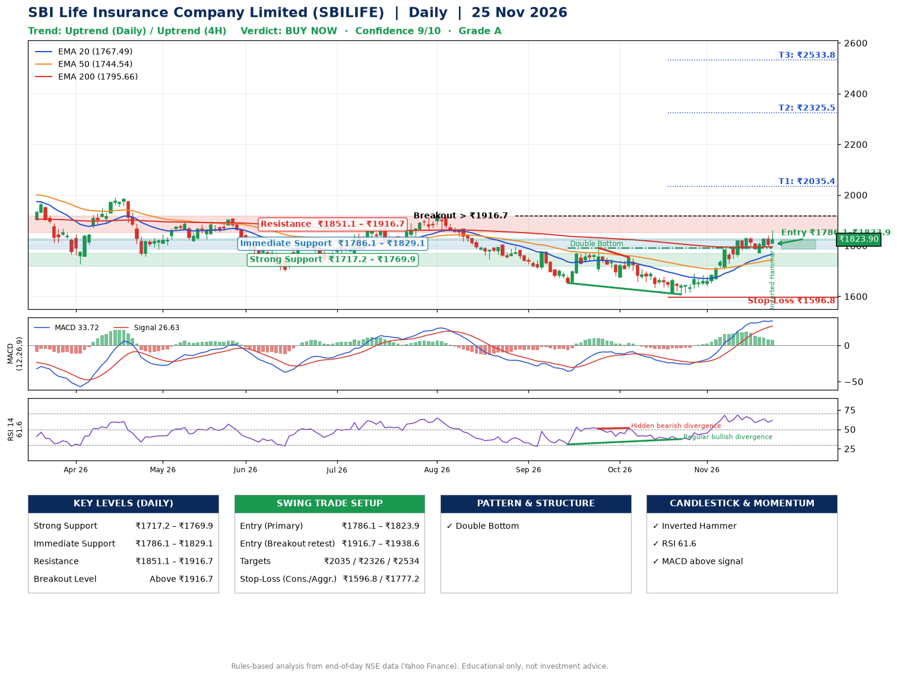

📌 **SBI Life Insurance Company Limited (SBILIFE) – Multi-Timeframe Technical Analysis (Daily + 4H Combined)**
_Data up to 25 Nov 2026 · Close ₹1823.90_

**📍 Daily Timeframe Trend**
- Trend: **Uptrend** (price above rising EMAs)
- Recent swing highs: ₹1775.0, ₹1791.4, ₹1754.3 · swing lows: ₹1746.4, ₹1652.9, ₹1607.7
- EMAs: EMA20 ₹1767.5, EMA50 ₹1744.5, EMA200 ₹1795.7; mixed / crossing; price above EMA20, EMA50, EMA200
- MACD 33.72 above signal 26.63 (above zero); histogram falling
- RSI(14) 61.6; Regular bullish divergence; Hidden bearish divergence

**📍 4-Hour Timeframe Trend**
- Structure: **Uptrend** (higher highs and higher lows)
- Pullback/support area: recent 4H swing lows ₹1609.0, ₹1779.8; EMA20 ₹1794.9
- EMA20/50: bullish stack (EMA20 > EMA50); price above EMA20, EMA50
- MACD 23.32 below signal 26.71 (above zero); histogram rising
- RSI(14) 61.3; Regular bearish divergence

**📍 Pattern Detection (Both Timeframes)**
- Daily: **Double Bottom** – bottoms near ₹1652.9/₹1607.7, neckline ₹1791.4, confirmed (closed above neckline)

**📍 Candlestick Patterns (last 3 daily candles)**
- **Inverted Hammer** – 25 Nov: long upper wick shows selling near ₹1862.0

**📍 Price Action Key Levels (Daily Structure)**

| Zone | Price Level (₹) | Context |
|------|-----------------|---------|
| Strong Support | ₹1717.2 – ₹1769.9 | Cluster of earlier swing lows (demand) |
| Immediate Support | ₹1786.1 – ₹1829.1 | Nearest swing-low / wick area |
| Resistance | ₹1851.1 – ₹1916.7 | Nearest swing-high supply |
| Breakout Level | Above ₹1916.7 | Swing continuation trigger (52-week high ₹2132.0) |

**📍 Swing Trade Setup**

🟢 **Entry Zone**
- Primary: ₹1786.1 – ₹1823.9 (daily support / EMA20 area; enter on a bullish 4H candle)
- Alternate: ₹1916.7 – ₹1938.6 (breakout retest)

🎯 **Profit Targets**
- T1: ₹2035.4
- T2: ₹2325.5
- T3: ₹2533.8

🛑 **Stop-Loss**
- Conservative: below daily swing low (₹1596.8)
- Aggressive: below 4H structure (₹1777.2)
- Risk per share ≈ ₹208.2; reward:risk to T1 ≈ 1.1
- Time to T1: about 36 trading days (it rose this much within 60 trading days 24% of the time in the last 2 years)
- Time to T2: about 52 trading days (it rose this much within 60 trading days 2% of the time in the last 2 years)

**📌 Strategy Notes**
- Higher timeframe: daily trend is uptrend; only take longs while price holds above ₹1717.2.
- Entry timing: wait for a bullish 4H candle (engulfing/hammer) inside ₹1786.1 – ₹1823.9 rather than buying mid-range.
- EMA stacking: mixed / crossing; price above EMA20, EMA50, EMA200.
- Breakout rule: a daily close above ₹1916.7 with volume above its 20-day average (≈1,168,692) opens T2/T3.
- Momentum: RSI 62 – room to run; Regular bullish divergence; Hidden bearish divergence.
- Exit discipline: move the stop to entry once T1 is hit; book partial profits at each target.

**STEP 2 — Marked Up Chart**

**✅ Trade Validation Checklist**
- Trend + momentum aligned: Yes · Price at entry zone: Yes
- Stop defined (₹1596.8) · Reward:risk ≥ 1.5 to T1: No

## 📌 Final Verdict

Recommendation: **🟢 BUY NOW**

Confidence: **9/10**

Trade Quality: **A**

Reason:
• Daily uptrend (price above rising EMAs)
• Double Bottom: bottoms near ₹1652.9/₹1607.7, neckline ₹1791.4, confirmed (closed above neckline)

Next Action:
• Buy now within the entry zone, with the stop-loss in place

_Rules-based analysis from end-of-day data. Educational only, not investment advice. Never place orders without your own confirmation._