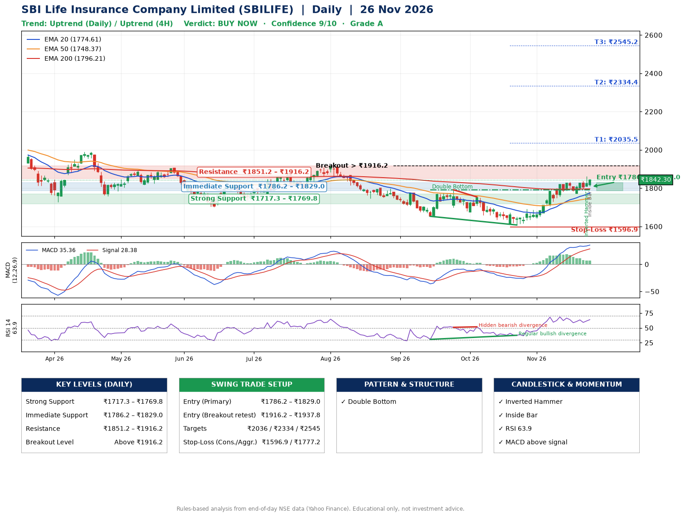

📌 **SBI Life Insurance Company Limited (SBILIFE) – Multi-Timeframe Technical Analysis (Daily + 4H Combined)**
_Data up to 26 Nov 2026 · Close ₹1842.30_

**📍 Daily Timeframe Trend**
- Trend: **Uptrend** (price above rising EMAs)
- Recent swing highs: ₹1775.0, ₹1791.4, ₹1754.3 · swing lows: ₹1746.4, ₹1652.9, ₹1607.7
- EMAs: EMA20 ₹1774.6, EMA50 ₹1748.4, EMA200 ₹1796.2; mixed / crossing; price above EMA20, EMA50, EMA200
- MACD 35.36 above signal 28.38 (above zero); histogram falling
- RSI(14) 63.9; Regular bullish divergence; Hidden bearish divergence

**📍 4-Hour Timeframe Trend**
- Structure: **Uptrend** (higher highs and higher lows)
- Pullback/support area: recent 4H swing lows ₹1609.0, ₹1779.8; EMA20 ₹1803.6
- EMA20/50: bullish stack (EMA20 > EMA50); price above EMA20, EMA50
- MACD 24.97 below signal 26.01 (above zero); histogram rising
- RSI(14) 64.7; Regular bearish divergence

**📍 Pattern Detection (Both Timeframes)**
- Daily: **Double Bottom** – bottoms near ₹1652.9/₹1607.7, neckline ₹1791.4, confirmed (closed above neckline)
- 4H: **Double Top** – tops near ₹1834.2/₹1861.9, neckline ₹1779.8, forming

**📍 Candlestick Patterns (last 3 daily candles)**
- **Inverted Hammer** – 25 Nov: long upper wick shows selling near ₹1862.0
- **Inside Bar** – 26 Nov: compression inside the prior range ₹1808.8–₹1862.0

**📍 Price Action Key Levels (Daily Structure)**

| Zone | Price Level (₹) | Context |
|------|-----------------|---------|
| Strong Support | ₹1717.3 – ₹1769.8 | Cluster of earlier swing lows (demand) |
| Immediate Support | ₹1786.2 – ₹1829.0 | Nearest swing-low / wick area |
| Resistance | ₹1851.2 – ₹1916.2 | Nearest swing-high supply |
| Breakout Level | Above ₹1916.2 | Swing continuation trigger (52-week high ₹2132.0) |

**📍 Swing Trade Setup**

🟢 **Entry Zone**
- Primary: ₹1786.2 – ₹1829.0 (daily support / EMA20 area; enter on a bullish 4H candle)
- Alternate: ₹1916.2 – ₹1937.8 (breakout retest)

🎯 **Profit Targets**
- T1: ₹2035.5
- T2: ₹2334.4
- T3: ₹2545.2

🛑 **Stop-Loss**
- Conservative: below daily swing low (₹1596.9)
- Aggressive: below 4H structure (₹1777.2)
- Risk per share ≈ ₹210.7; reward:risk to T1 ≈ 1.1
- Time to T1: about 33 trading days (it rose this much within 60 trading days 24% of the time in the last 2 years)
- Time to T2: about 52 trading days (it rose this much within 60 trading days 2% of the time in the last 2 years)

**📌 Strategy Notes**
- Higher timeframe: daily trend is uptrend; only take longs while price holds above ₹1717.3.
- Entry timing: wait for a bullish 4H candle (engulfing/hammer) inside ₹1786.2 – ₹1829.0 rather than buying mid-range.
- EMA stacking: mixed / crossing; price above EMA20, EMA50, EMA200.
- Breakout rule: a daily close above ₹1916.2 with volume above its 20-day average (≈1,114,127) opens T2/T3.
- Momentum: RSI 64 – room to run; Regular bullish divergence; Hidden bearish divergence.
- Exit discipline: move the stop to entry once T1 is hit; book partial profits at each target.

**STEP 2 — Marked Up Chart**

**✅ Trade Validation Checklist**
- Trend + momentum aligned: Yes · Price at entry zone: No
- Stop defined (₹1596.9) · Reward:risk ≥ 1.5 to T1: No

## 📌 Final Verdict

Recommendation: **🟢 BUY NOW**

Confidence: **9/10**

Trade Quality: **A**

Reason:
• Daily uptrend (price above rising EMAs)
• Double Bottom: bottoms near ₹1652.9/₹1607.7, neckline ₹1791.4, confirmed (closed above neckline)

Next Action:
• Buy now within the entry zone, with the stop-loss in place

_Rules-based analysis from end-of-day data. Educational only, not investment advice. Never place orders without your own confirmation._