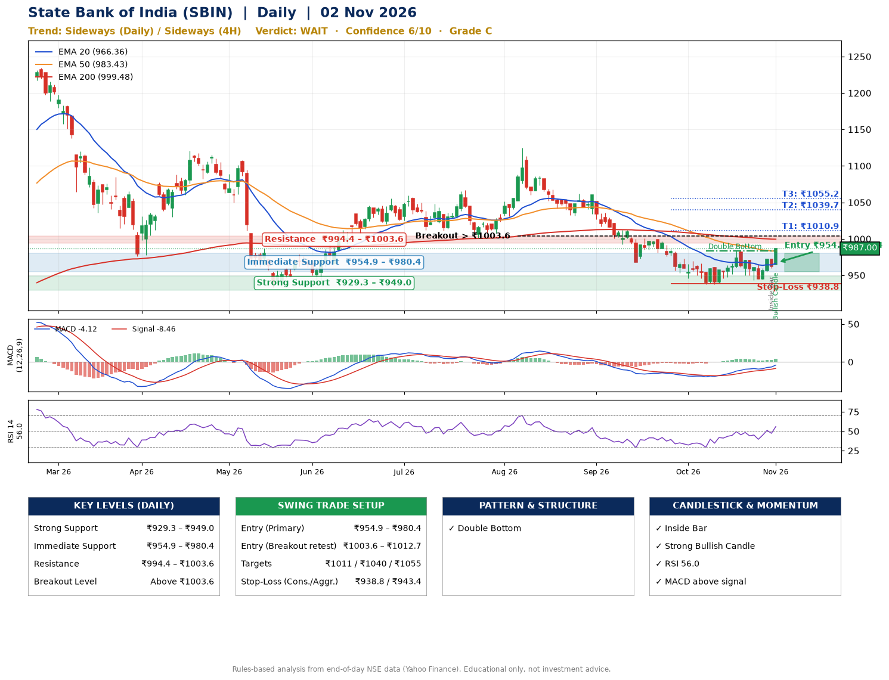

📌 **State Bank of India (SBIN) – Multi-Timeframe Technical Analysis (Daily + 4H Combined)**
_Data up to 02 Nov 2026 · Close ₹987.00_

**📍 Daily Timeframe Trend**
- Trend: **Sideways** (mixed swing structure)
- Recent swing highs: ₹1124.5, ₹1062.3, ₹983.8 · swing lows: ₹968.0, ₹937.5, ₹943.4
- EMAs: EMA20 ₹966.4, EMA50 ₹983.4, EMA200 ₹999.5; bearish stack (EMA20 < EMA50 < EMA200); price above EMA20, EMA50
- MACD -4.12 above signal -8.46 (below zero); histogram rising
- RSI(14) 56.0; no divergence on the last two swings

**📍 4-Hour Timeframe Trend**
- Structure: **Sideways** (mixed swing structure)
- Pullback/support area: recent 4H swing lows ₹943.5, ₹944.7; EMA20 ₹964.0
- EMA20/50: bearish stack (EMA20 < EMA50); price above EMA20, EMA50
- MACD 3.23 above signal 0.47 (above zero); histogram rising
- RSI(14) 62.6; Hidden bearish divergence

**📍 Pattern Detection (Both Timeframes)**
- Daily: **Double Bottom** – bottoms near ₹937.5/₹943.4, neckline ₹983.8, confirmed (closed above neckline)

**📍 Candlestick Patterns (last 3 daily candles)**
- **Inside Bar** – 30 Oct: compression inside the prior range ₹954.6–₹971.9
- **Strong Bullish Candle** – 02 Nov: wide-range green candle, buyers in control

**📍 Price Action Key Levels (Daily Structure)**

| Zone | Price Level (₹) | Context |
|------|-----------------|---------|
| Strong Support | ₹929.3 – ₹949.0 | Cluster of earlier swing lows (demand) |
| Immediate Support | ₹954.9 – ₹980.4 | Nearest swing-low / wick area |
| Resistance | ₹994.4 – ₹1003.6 | Nearest swing-high supply |
| Breakout Level | Above ₹1003.6 | Swing continuation trigger (52-week high ₹1234.7) |

**📍 Swing Trade Setup**

🟢 **Entry Zone**
- Primary: ₹954.9 – ₹980.4 (daily support / EMA20 area; enter on a bullish 4H candle)
- Alternate: ₹1003.6 – ₹1012.7 (breakout retest)

🎯 **Profit Targets**
- T1: ₹1010.9
- T2: ₹1039.7
- T3: ₹1055.2

🛑 **Stop-Loss**
- Conservative: below daily swing low (₹938.8)
- Aggressive: below 4H structure (₹943.4)
- Risk per share ≈ ₹28.8; reward:risk to T1 ≈ 1.5

**📌 Strategy Notes**
- Higher timeframe: daily trend is sideways; only take longs while price holds above ₹929.3.
- Entry timing: wait for a bullish 4H candle (engulfing/hammer) inside ₹954.9 – ₹980.4 rather than buying mid-range.
- EMA stacking: bearish stack (EMA20 < EMA50 < EMA200); price above EMA20, EMA50.
- Breakout rule: a daily close above ₹1003.6 with volume above its 20-day average (≈9,078,293) opens T2/T3.
- Momentum: RSI 56 – room to run; no divergence on the last two swings.
- Exit discipline: move the stop to entry once T1 is hit; book partial profits at each target.

**STEP 2 — Marked Up Chart**

**✅ Trade Validation Checklist**
- Trend + momentum aligned: No · Price at entry zone: No
- Stop defined (₹938.8) · Reward:risk ≥ 1.5 to T1: Yes

## 📌 Final Verdict

Recommendation: **🟠 WAIT**

Confidence: **6/10**

Trade Quality: **C**

Reason:
• Double Bottom: bottoms near ₹937.5/₹943.4, neckline ₹983.8, confirmed (closed above neckline)

Next Action:
• Wait for a breakout above ₹1003.6

_Rules-based analysis from end-of-day data. Educational only, not investment advice. Never place orders without your own confirmation._